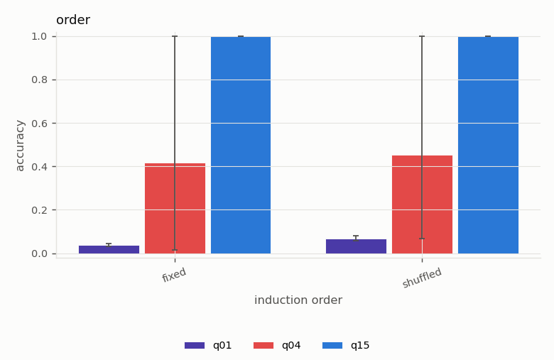
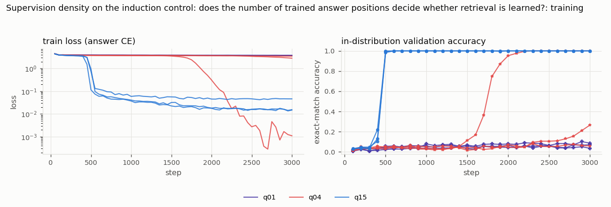

# Supervision density on the induction control: does the number of trained answer positions decide whether retrieval is learned?

*Study id:* `density`  
*Spec:* ``

## Design

**Research question.** Induction (content-based copying) is learned in ~500-900 steps when every second-half position is supervised (15 per sequence), while associative recall with 4 supervised queries per sequence is not learned in 3,000 steps even when the value-type shortcut is removed. Is supervision density the factor?

**Hypothesis.** If density is decisive, induction with 1 or 4 supervised positions per sequence (same task, same model, same evaluation) learns much later or not at all within 3,000 steps. If induction with 1-4 positions is still learned, density does not explain the recall/induction contrast.

**Independent variables:** supervised positions per sequence (1, 4, 15)  
**Controlled variables:** identical sequences (the input tokens do not depend on how many positions are supervised), shuffled induction, length 34; RoPE, 2 heads, d_model 64, 2 layers; lr 3e-3, batch 64, 3,000 steps, evaluation: the final position of identical example sets  
**Primary metric:** steps to 90% validation accuracy; final accuracy  
**Seeds:** [0, 1, 2]  
**Evaluation seed (shared by all runs):** 20261019

**Expected failure modes:** fewer supervised positions = fewer training targets per step; the comparison is per step, not per target

## Runs (measured)

| run_id | variant | seed | pos_method | status | elapsed_s | final_val_acc | final_train_loss | steps | n_params |
|---|---|---|---|---|---|---|---|---|---|
| q01_s0_0d61cfa0 | q01 | 0 | rope | completed | 351.990 | 0.086 | 3.764 | 3000 | 116736 |
| q01_s1_995ee30d | q01 | 1 | rope | completed | 351.917 | 0.035 | 3.738 | 3000 | 116736 |
| q01_s2_d18c3c11 | q01 | 2 | rope | completed | 591.794 | 0.070 | 3.768 | 3000 | 116736 |
| q04_s0_5777c1d0 | q04 | 0 | rope | completed | 615.790 | 0.266 | 2.827 | 3000 | 116736 |
| q04_s1_866b4fb8 | q04 | 1 | rope | completed | 581.287 | 1.000 | 0.001 | 3000 | 116736 |
| q04_s2_5f70bcf9 | q04 | 2 | rope | completed | 586.347 | 0.059 | 3.465 | 3000 | 116736 |
| q15_s0_57522b18 | q15 | 0 | rope | completed | 517.633 | 1.000 | 0.046 | 3000 | 116736 |
| q15_s1_0ea58256 | q15 | 1 | rope | completed | 538.872 | 1.000 | 0.015 | 3000 | 116736 |
| q15_s2_80bf9735 | q15 | 2 | rope | completed | 221.315 | 1.000 | 0.015 | 3000 | 116736 |

## Validity flags

* `q01_s0_0d61cfa0`: in-distribution val acc 0.086 < 0.90 -> undertrained or unable to learn the task; out-of-distribution failures of this run are NOT evidence about extrapolation.
* `q01_s1_995ee30d`: in-distribution val acc 0.035 < 0.90 -> undertrained or unable to learn the task; out-of-distribution failures of this run are NOT evidence about extrapolation.
* `q01_s2_d18c3c11`: in-distribution val acc 0.070 < 0.90 -> undertrained or unable to learn the task; out-of-distribution failures of this run are NOT evidence about extrapolation.
* `q04_s0_5777c1d0`: in-distribution val acc 0.266 < 0.90 -> undertrained or unable to learn the task; out-of-distribution failures of this run are NOT evidence about extrapolation.
* `q04_s2_5f70bcf9`: in-distribution val acc 0.059 < 0.90 -> undertrained or unable to learn the task; out-of-distribution failures of this run are NOT evidence about extrapolation.

## Controls (mean, min and max over seeds)

| grid | cell | variant | n_seeds | mean | min | max |
|---|---|---|---|---|---|---|
| control_in_distribution | default | q01 | 3 | 0.044 | 0.040 | 0.053 |
| control_in_distribution | default | q04 | 3 | 0.464 | 0.120 | 1.000 |
| control_in_distribution | default | q15 | 3 | 1.000 | 1.000 | 1.000 |
| control_position_offset | pos_offset=0 | q01 | 3 | 0.044 | 0.040 | 0.053 |
| control_position_offset | pos_offset=0 | q04 | 3 | 0.464 | 0.120 | 1.000 |
| control_position_offset | pos_offset=0 | q15 | 3 | 1.000 | 1.000 | 1.000 |

## Control metrics per run (measured)

`composition_end_given_both_hops` = accuracy on the chain end among contexts where both single hops were answered correctly (multi-hop only).

| run_id | variant | seed | in_distribution_acc | pos_offset_0_acc |
|---|---|---|---|---|
| q01_s0_0d61cfa0 | q01 | 0 | 0.040 | 0.040 |
| q01_s1_995ee30d | q01 | 1 | 0.053 | 0.053 |
| q01_s2_d18c3c11 | q01 | 2 | 0.040 | 0.040 |
| q04_s0_5777c1d0 | q04 | 0 | 0.273 | 0.273 |
| q04_s1_866b4fb8 | q04 | 1 | 1.000 | 1.000 |
| q04_s2_5f70bcf9 | q04 | 2 | 0.120 | 0.120 |
| q15_s0_57522b18 | q15 | 0 | 1.000 | 1.000 |
| q15_s1_0ea58256 | q15 | 1 | 1.000 | 1.000 |
| q15_s2_80bf9735 | q15 | 2 | 1.000 | 1.000 |

## Grid `order` (derived: mean across seeds; t-interval over seeds)

| grid | variant | cell_induction_order | n_seeds | n_per_seed | mean | std | min | max | t_lo | t_hi |
|---|---|---|---|---|---|---|---|---|---|---|
| order | q01 | fixed | 3 | 300 | 0.038 | 0.007 | 0.030 | 0.043 | 0.021 | 0.055 |
| order | q01 | shuffled | 3 | 300 | 0.067 | 0.012 | 0.057 | 0.080 | 0.037 | 0.097 |
| order | q04 | fixed | 3 | 300 | 0.418 | 0.517 | 0.013 | 1.000 | -0.866 | 1.702 |
| order | q04 | shuffled | 3 | 300 | 0.452 | 0.487 | 0.067 | 1.000 | -0.758 | 1.663 |
| order | q15 | fixed | 3 | 300 | 1.000 | 0.000 | 1.000 | 1.000 | 1.000 | 1.000 |
| order | q15 | shuffled | 3 | 300 | 1.000 | 0.000 | 1.000 | 1.000 | 1.000 | 1.000 |

Baselines on the identical examples (reference):

| cell_induction_order | oracle | random_context | chance | best_fixed_offset | best_fixed_offset_d |
|---|---|---|---|---|---|
| shuffled | 1.000 | 0.062 | 0.021 | 0.100 | 17 |
| fixed | 1.000 | 0.062 | 0.021 | 1.000 | 16 |

## Paired differences vs `q15` (per-seed differences on identical examples)

| grid | cell_induction_order | a | b | mean_diff | t_lo | t_hi | n_seeds | seeds_a_better | seeds_b_better |
|---|---|---|---|---|---|---|---|---|---|
| order | fixed | q01 | q15 | -0.962 | -0.979 | -0.945 | 3 | 0 | 3 |
| order | shuffled | q01 | q15 | -0.933 | -0.963 | -0.903 | 3 | 0 | 3 |
| order | fixed | q04 | q15 | -0.582 | -1.866 | 0.702 | 3 | 0 | 2 |
| order | shuffled | q04 | q15 | -0.548 | -1.758 | 0.663 | 3 | 0 | 2 |

## Figures

## Reading guide

* Per-seed Wilson intervals (in `per_seed_cells.csv`) capture example sampling only; the across-seed t-interval captures training variability but is very wide with 3 seeds.
* Interpretation and conclusions are written separately in `docs/results.md`; this report is generated mechanically from the measured tables above.
