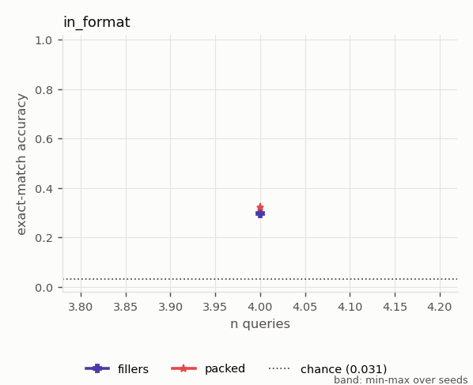
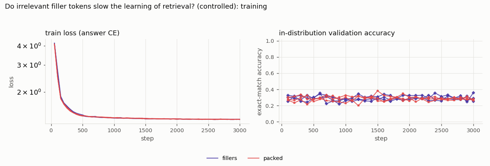

# Do irrelevant filler tokens slow the learning of retrieval? (controlled)

*Study id:* `fillers`  
*Spec:* ``

## Design

**Research question.** Holding the number of associations (4), the number of supervised queries (4, one per association) and the query format fixed, does adding irrelevant filler tokens to the context change how quickly and how well the model learns retrieval?

**Hypothesis.** If fillers are an obstacle, the filler condition reaches 90% later (or not at all) and ends lower than the packed condition. The earlier Q1/Q2 pilot could not test this because it changed the number of pairs (and hence chance level) together with the fillers.

**Independent variables:** filler count (0 vs 24)  
**Controlled variables:** 4 associations per sequence, all 4 queried (3 auxiliary + 1 scored), <ans> query format, auxiliary answers hidden (v2). v1 displayed them, which let the scored answer be found by elimination; v1 results are kept in experiments/results/fillers_v1_elimination_confounded, model (RoPE, 2 heads, d_model 64, 2 layers), optimiser, steps, batch size, seeds, evaluation format identical to the training format; chance = 1/32, random-in-context = 1/4, UNAVOIDABLE CONFOUND: fillers add length (24 vs 48 tokens) and spread the pairs apart  
**Primary metric:** steps to 90% validation accuracy and final validation accuracy  
**Seeds:** [0, 1, 2]  
**Evaluation seed (shared by all runs):** 20261016

**Expected failure modes:** neither condition learns within budget (then the comparison is inconclusive); length and distance effects are confounded with filler count

## Runs (measured)

| run_id | variant | seed | pos_method | status | elapsed_s | final_val_acc | final_train_loss | steps | n_params |
|---|---|---|---|---|---|---|---|---|---|
| fillers_s0_c8eeb996 | fillers | 0 | rope | completed | 599.188 | 0.359 | 1.328 | 3000 | 116736 |
| fillers_s1_6be48cf3 | fillers | 1 | rope | completed | 641.384 | 0.254 | 1.323 | 3000 | 116736 |
| fillers_s2_2fe1d2c2 | fillers | 2 | rope | completed | 516.333 | 0.289 | 1.325 | 3000 | 116736 |
| packed_s0_8cd0ca90 | packed | 0 | rope | completed | 596.478 | 0.281 | 1.328 | 3000 | 116736 |
| packed_s1_b84c142e | packed | 1 | rope | completed | 583.654 | 0.262 | 1.323 | 3000 | 116736 |
| packed_s2_4d9a3fa4 | packed | 2 | rope | completed | 337.708 | 0.273 | 1.325 | 3000 | 116736 |

## Validity flags

* `fillers_s0_c8eeb996`: in-distribution val acc 0.359 < 0.90 -> undertrained or unable to learn the task; out-of-distribution failures of this run are NOT evidence about extrapolation.
* `fillers_s1_6be48cf3`: in-distribution val acc 0.254 < 0.90 -> undertrained or unable to learn the task; out-of-distribution failures of this run are NOT evidence about extrapolation.
* `fillers_s2_2fe1d2c2`: in-distribution val acc 0.289 < 0.90 -> undertrained or unable to learn the task; out-of-distribution failures of this run are NOT evidence about extrapolation.
* `packed_s0_8cd0ca90`: in-distribution val acc 0.281 < 0.90 -> undertrained or unable to learn the task; out-of-distribution failures of this run are NOT evidence about extrapolation.
* `packed_s1_b84c142e`: in-distribution val acc 0.262 < 0.90 -> undertrained or unable to learn the task; out-of-distribution failures of this run are NOT evidence about extrapolation.
* `packed_s2_4d9a3fa4`: in-distribution val acc 0.273 < 0.90 -> undertrained or unable to learn the task; out-of-distribution failures of this run are NOT evidence about extrapolation.

## Controls (mean, min and max over seeds)

| grid | cell | variant | n_seeds | mean | min | max |
|---|---|---|---|---|---|---|
| control_counterfactual | distractor_edit | fillers | 3 | 0.390 | 0.370 | 0.403 |
| control_counterfactual | distractor_edit | packed | 3 | 0.430 | 0.410 | 0.450 |
| control_counterfactual | evidence_move | fillers | 3 | 0.941 | 0.920 | 0.953 |
| control_counterfactual | evidence_move | packed | 3 | 0.892 | 0.877 | 0.907 |
| control_counterfactual | filler_resample | fillers | 3 | 0.977 | 0.973 | 0.980 |
| control_counterfactual | filler_resample | packed | 3 | 0.969 | 0.967 | 0.970 |
| control_counterfactual | key_swap | fillers | 3 | 0.267 | 0.240 | 0.297 |
| control_counterfactual | key_swap | packed | 3 | 0.277 | 0.253 | 0.293 |
| control_counterfactual | value_edit | fillers | 3 | 0.203 | 0.193 | 0.217 |
| control_counterfactual | value_edit | packed | 3 | 0.221 | 0.190 | 0.240 |
| control_evidence_removed | default | fillers | 3 | 0.031 | 0.023 | 0.043 |
| control_evidence_removed | default | packed | 3 | 0.031 | 0.027 | 0.037 |
| control_in_distribution | default | fillers | 3 | 0.263 | 0.247 | 0.280 |
| control_in_distribution | default | packed | 3 | 0.291 | 0.273 | 0.307 |
| control_position_offset | pos_offset=0 | fillers | 3 | 0.263 | 0.247 | 0.280 |
| control_position_offset | pos_offset=0 | packed | 3 | 0.291 | 0.273 | 0.307 |

## Control metrics per run (measured)

`composition_end_given_both_hops` = accuracy on the chain end among contexts where both single hops were answered correctly (multi-hop only).

| run_id | variant | seed | in_distribution_acc | evidence_removed_acc | chance_acc | cf_distractor_edit_rate | cf_distractor_edit_rate_given_orig_correct | cf_distractor_edit_n | cf_evidence_move_rate | cf_evidence_move_rate_given_orig_correct | cf_evidence_move_n | cf_filler_resample_rate | cf_filler_resample_rate_given_orig_correct | cf_filler_resample_n | cf_key_swap_rate | cf_key_swap_rate_given_orig_correct | cf_key_swap_n | cf_key_swap_shortcut_reference | cf_value_edit_rate | cf_value_edit_rate_given_orig_correct | cf_value_edit_n | cf_value_edit_shortcut_reference | pos_offset_0_acc |
|---|---|---|---|---|---|---|---|---|---|---|---|---|---|---|---|---|---|---|---|---|---|---|---|
| fillers_s0_c8eeb996 | fillers | 0 | 0.280 | 0.043 | 0.031 | 0.397 | 0.524 | 300 | 0.920 | 0.917 | 300 | 0.973 | 0.976 | 300 | 0.240 | 0.012 | 300 | 0.250 | 0.193 | 0.298 | 300 | 0.250 | 0.280 |
| fillers_s1_6be48cf3 | fillers | 1 | 0.247 | 0.027 | 0.031 | 0.403 | 0.541 | 300 | 0.950 | 0.959 | 300 | 0.977 | 0.973 | 300 | 0.297 | 0.000 | 300 | 0.250 | 0.217 | 0.365 | 300 | 0.250 | 0.247 |
| fillers_s2_2fe1d2c2 | fillers | 2 | 0.263 | 0.023 | 0.031 | 0.370 | 0.557 | 300 | 0.953 | 0.962 | 300 | 0.980 | 0.987 | 300 | 0.263 | 0.000 | 300 | 0.250 | 0.200 | 0.266 | 300 | 0.250 | 0.263 |
| packed_s0_8cd0ca90 | packed | 0 | 0.273 | 0.030 | 0.031 | 0.430 | 0.671 | 300 | 0.893 | 0.854 | 300 | 0.967 | 0.976 | 300 | 0.293 | 0.012 | 300 | 0.250 | 0.190 | 0.329 | 300 | 0.250 | 0.273 |
| packed_s1_b84c142e | packed | 1 | 0.293 | 0.027 | 0.031 | 0.450 | 0.670 | 300 | 0.877 | 0.830 | 300 | 0.970 | 1.000 | 300 | 0.283 | 0.000 | 300 | 0.250 | 0.233 | 0.364 | 300 | 0.250 | 0.293 |
| packed_s2_4d9a3fa4 | packed | 2 | 0.307 | 0.037 | 0.031 | 0.410 | 0.576 | 300 | 0.907 | 0.870 | 300 | 0.970 | 0.946 | 300 | 0.253 | 0.000 | 300 | 0.250 | 0.240 | 0.359 | 300 | 0.250 | 0.307 |

## Grid `in_format` (derived: mean across seeds; t-interval over seeds)

| grid | variant | cell_n_queries | n_seeds | n_per_seed | mean | std | min | max | t_lo | t_hi |
|---|---|---|---|---|---|---|---|---|---|---|
| in_format | fillers | 4 | 3 | 400 | 0.298 | 0.024 | 0.275 | 0.323 | 0.238 | 0.357 |
| in_format | packed | 4 | 3 | 400 | 0.323 | 0.011 | 0.312 | 0.335 | 0.294 | 0.351 |

Baselines on the identical examples (reference):

| cell_n_queries | oracle | naive_induction | last_value | random_context | elimination | chance | best_fixed_offset | best_fixed_offset_d |
|---|---|---|---|---|---|---|---|---|
| 4 | 1.000 | 1.000 | 0.292 | 0.275 | 0.275 | 0.031 | 0.128 | 20 |

## Paired differences vs `packed` (per-seed differences on identical examples)

| grid | cell_n_queries | a | b | mean_diff | t_lo | t_hi | n_seeds | seeds_a_better | seeds_b_better |
|---|---|---|---|---|---|---|---|---|---|
| in_format | 4 | fillers | packed | -0.025 | -0.104 | 0.054 | 3 | 1 | 2 |

## Figures

## Reading guide

* Per-seed Wilson intervals (in `per_seed_cells.csv`) capture example sampling only; the across-seed t-interval captures training variability but is very wide with 3 seeds.
* Interpretation and conclusions are written separately in `docs/results.md`; this report is generated mechanically from the measured tables above.
