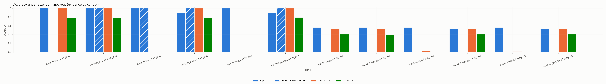

# Mechanistic analysis: Content-based induction control: does retrieval emerge, and when?

Observational measures (attention, logit lens) describe internal quantities; only knockout, patching and ablation are interventions. Knockout measures only the *direct* <ans>-to-evidence read in a layer; patching restoration is reported per position role.

## `learned_h4_s0_9ddefc3d` (learned)

* training lengths [34, 34], long set length 68 
* retrieval head (max attention to evidence value, last layer, in-distribution): {'layer': 1, 'head': 2}

Retrieval-head attention to evidence value and score gap, by correctness:

| set | correct | attn_evidence_value | score_gap | attn_entropy |
|---|---|---|---|---|
| in_distribution | 1.000 | 1.000 | nan | 0.000 |
| long_68 | 0.000 | 0.021 | nan | 0.904 |
| long_68 | 1.000 | 0.926 | nan | 0.225 |

Long set, retrieval head by evidence distance:

| distance_bin | attn_evidence_value | score_gap | correct |
|---|---|---|---|
| (32, 64] | 0.474 | nan | 0.503 |
| (64, 128] | 0.971 | nan | 1.000 |

## `none_h2_s0_6a0e459a` (none)

* training lengths [34, 34], long set length 68 
* retrieval head (max attention to evidence value, last layer, in-distribution): {'layer': 1, 'head': 1}

Retrieval-head attention to evidence value and score gap, by correctness:

| set | correct | attn_evidence_value | score_gap | attn_entropy |
|---|---|---|---|---|
| in_distribution | 0.000 | 0.136 | nan | 1.638 |
| in_distribution | 1.000 | 0.604 | nan | 1.057 |
| long_68 | 0.000 | 0.041 | nan | 2.163 |
| long_68 | 1.000 | 0.549 | nan | 1.293 |

Long set, retrieval head by evidence distance:

| distance_bin | attn_evidence_value | score_gap | correct |
|---|---|---|---|
| (32, 64] | 0.209 | nan | 0.372 |
| (64, 128] | 0.985 | nan | 1.000 |

## `rope_h2_s0_92b653be` (rope)

* training lengths [34, 34], long set length 68 
* retrieval head (max attention to evidence value, last layer, in-distribution): {'layer': 1, 'head': 0}

Retrieval-head attention to evidence value and score gap, by correctness:

| set | correct | attn_evidence_value | score_gap | attn_entropy |
|---|---|---|---|---|
| in_distribution | 1.000 | 0.000 | nan | 0.051 |
| long_68 | 0.000 | 0.003 | nan | 2.385 |
| long_68 | 1.000 | 0.005 | nan | 0.819 |

Long set, retrieval head by evidence distance:

| distance_bin | attn_evidence_value | score_gap | correct |
|---|---|---|---|
| (32, 64] | 0.004 | nan | 0.545 |
| (64, 128] | 0.000 | nan | 0.889 |

## `rope_h4_fixed_order_s0_b5ba919e` (rope)

* training lengths [34, 34], long set length 68 
* retrieval head (max attention to evidence value, last layer, in-distribution): {'layer': 1, 'head': 3}

Retrieval-head attention to evidence value and score gap, by correctness:

| set | correct | attn_evidence_value | score_gap | attn_entropy |
|---|---|---|---|---|
| in_distribution | 1.000 | 0.034 | nan | 3.512 |
| long_68 | 0.000 | 0.015 | nan | 4.209 |

Long set, retrieval head by evidence distance:

| distance_bin | attn_evidence_value | score_gap | correct |
|---|---|---|---|
| (32, 64] | 0.015 | nan | 0.000 |

## Attention knockout (accuracy)

| variant | condition | layer | acc | p_answer | n | set |
|---|---|---|---|---|---|---|
| learned_h4 | none | - | 1.000 | 1.000 | 200 | in_distribution |
| learned_h4 | evidence | 0 | 1.000 | 1.000 | 200 | in_distribution |
| learned_h4 | control_pair | 0 | 1.000 | 1.000 | 200 | in_distribution |
| learned_h4 | evidence | 1 | 0.000 | 0.000 | 200 | in_distribution |
| learned_h4 | control_pair | 1 | 1.000 | 1.000 | 200 | in_distribution |
| learned_h4 | evidence | all | 0.000 | 0.000 | 200 | in_distribution |
| learned_h4 | control_pair | all | 1.000 | 1.000 | 200 | in_distribution |
| learned_h4 | none | - | 0.525 | 0.524 | 200 | long_68 |
| learned_h4 | evidence | 0 | 0.515 | 0.510 | 200 | long_68 |
| learned_h4 | control_pair | 0 | 0.520 | 0.520 | 200 | long_68 |
| learned_h4 | evidence | 1 | 0.020 | 0.023 | 200 | long_68 |
| learned_h4 | control_pair | 1 | 0.525 | 0.525 | 200 | long_68 |
| learned_h4 | evidence | all | 0.010 | 0.014 | 200 | long_68 |
| learned_h4 | control_pair | all | 0.520 | 0.521 | 200 | long_68 |
| none_h2 | none | - | 0.770 | 0.682 | 200 | in_distribution |
| none_h2 | evidence | 0 | 0.780 | 0.689 | 200 | in_distribution |
| none_h2 | control_pair | 0 | 0.775 | 0.687 | 200 | in_distribution |
| none_h2 | evidence | 1 | 0.000 | 0.004 | 200 | in_distribution |
| none_h2 | control_pair | 1 | 0.785 | 0.708 | 200 | in_distribution |
| none_h2 | evidence | all | 0.000 | 0.003 | 200 | in_distribution |
| none_h2 | control_pair | all | 0.790 | 0.712 | 200 | in_distribution |
| none_h2 | none | - | 0.400 | 0.322 | 200 | long_68 |
| none_h2 | evidence | 0 | 0.400 | 0.325 | 200 | long_68 |
| none_h2 | control_pair | 0 | 0.390 | 0.323 | 200 | long_68 |
| none_h2 | evidence | 1 | 0.000 | 0.007 | 200 | long_68 |
| none_h2 | control_pair | 1 | 0.400 | 0.331 | 200 | long_68 |
| none_h2 | evidence | all | 0.000 | 0.007 | 200 | long_68 |
| none_h2 | control_pair | all | 0.400 | 0.333 | 200 | long_68 |
| rope_h2 | none | - | 1.000 | 1.000 | 200 | in_distribution |
| rope_h2 | evidence | 0 | 1.000 | 1.000 | 200 | in_distribution |
| rope_h2 | control_pair | 0 | 1.000 | 1.000 | 200 | in_distribution |
| rope_h2 | evidence | 1 | 1.000 | 1.000 | 200 | in_distribution |
| rope_h2 | control_pair | 1 | 0.890 | 0.890 | 200 | in_distribution |
| rope_h2 | evidence | all | 1.000 | 1.000 | 200 | in_distribution |
| rope_h2 | control_pair | all | 0.890 | 0.890 | 200 | in_distribution |
| rope_h2 | none | - | 0.560 | 0.561 | 200 | long_68 |
| rope_h2 | evidence | 0 | 0.560 | 0.561 | 200 | long_68 |
| rope_h2 | control_pair | 0 | 0.560 | 0.561 | 200 | long_68 |
| rope_h2 | evidence | 1 | 0.560 | 0.561 | 200 | long_68 |
| rope_h2 | control_pair | 1 | 0.530 | 0.534 | 200 | long_68 |
| rope_h2 | evidence | all | 0.560 | 0.561 | 200 | long_68 |
| rope_h2 | control_pair | all | 0.530 | 0.534 | 200 | long_68 |
| rope_h4_fixed_order | none | - | 1.000 | 1.000 | 200 | in_distribution |
| rope_h4_fixed_order | evidence | 0 | 0.000 | 0.001 | 200 | in_distribution |
| rope_h4_fixed_order | control_pair | 0 | 1.000 | 1.000 | 200 | in_distribution |
| rope_h4_fixed_order | evidence | 1 | 1.000 | 1.000 | 200 | in_distribution |
| rope_h4_fixed_order | control_pair | 1 | 1.000 | 1.000 | 200 | in_distribution |
| rope_h4_fixed_order | evidence | all | 0.000 | 0.001 | 200 | in_distribution |
| rope_h4_fixed_order | control_pair | all | 1.000 | 1.000 | 200 | in_distribution |
| rope_h4_fixed_order | none | - | 0.000 | 0.000 | 200 | long_68 |
| rope_h4_fixed_order | evidence | 0 | 0.000 | 0.000 | 200 | long_68 |
| rope_h4_fixed_order | control_pair | 0 | 0.000 | 0.000 | 200 | long_68 |
| rope_h4_fixed_order | evidence | 1 | 0.000 | 0.000 | 200 | long_68 |
| rope_h4_fixed_order | control_pair | 1 | 0.000 | 0.000 | 200 | long_68 |
| rope_h4_fixed_order | evidence | all | 0.000 | 0.000 | 200 | long_68 |
| rope_h4_fixed_order | control_pair | all | 0.000 | 0.000 | 200 | long_68 |

## Logit lens: P(answer) after each layer

| variant | set | layer | p_answer | correct_at_layer |
|---|---|---|---|---|
| learned_h4 | in_distribution | 0 | 0.027 | 0.025 |
| learned_h4 | in_distribution | 1 | 1.000 | 1.000 |
| learned_h4 | long_68 | 0 | 0.037 | 0.040 |
| learned_h4 | long_68 | 1 | 0.524 | 0.525 |
| none_h2 | in_distribution | 0 | 0.023 | 0.010 |
| none_h2 | in_distribution | 1 | 0.682 | 0.770 |
| none_h2 | long_68 | 0 | 0.001 | 0.005 |
| none_h2 | long_68 | 1 | 0.322 | 0.400 |
| rope_h2 | in_distribution | 0 | 0.024 | 0.035 |
| rope_h2 | in_distribution | 1 | 1.000 | 1.000 |
| rope_h2 | long_68 | 0 | 0.025 | 0.035 |
| rope_h2 | long_68 | 1 | 0.561 | 0.560 |
| rope_h4_fixed_order | in_distribution | 0 | 1.000 | 1.000 |
| rope_h4_fixed_order | in_distribution | 1 | 1.000 | 1.000 |
| rope_h4_fixed_order | long_68 | 0 | 0.000 | 0.000 |
| rope_h4_fixed_order | long_68 | 1 | 0.000 | 0.000 |

## Head ablation (zeroed head output; in-distribution)

| variant | layer | head | acc | p_answer | acc_drop |
|---|---|---|---|---|---|
| learned_h4 | - | - | 1.000 | 1.000 | 0.000 |
| learned_h4 | 0 | 0 | 0.310 | 0.300 | 0.690 |
| learned_h4 | 0 | 1 | 1.000 | 1.000 | 0.000 |
| learned_h4 | 0 | 2 | 1.000 | 1.000 | 0.000 |
| learned_h4 | 0 | 3 | 1.000 | 1.000 | 0.000 |
| learned_h4 | 1 | 0 | 1.000 | 1.000 | 0.000 |
| learned_h4 | 1 | 1 | 1.000 | 1.000 | 0.000 |
| learned_h4 | 1 | 2 | 0.880 | 0.834 | 0.120 |
| learned_h4 | 1 | 3 | 1.000 | 1.000 | 0.000 |
| none_h2 | - | - | 0.770 | 0.682 | 0.000 |
| none_h2 | 0 | 0 | 0.460 | 0.418 | 0.310 |
| none_h2 | 0 | 1 | 0.290 | 0.264 | 0.480 |
| none_h2 | 1 | 0 | 0.435 | 0.333 | 0.335 |
| none_h2 | 1 | 1 | 0.445 | 0.341 | 0.325 |
| rope_h2 | - | - | 1.000 | 1.000 | 0.000 |
| rope_h2 | 0 | 0 | 0.015 | 0.017 | 0.985 |
| rope_h2 | 0 | 1 | 0.030 | 0.025 | 0.970 |
| rope_h2 | 1 | 0 | 0.985 | 0.912 | 0.015 |
| rope_h2 | 1 | 1 | 0.990 | 0.926 | 0.010 |
| rope_h4_fixed_order | - | - | 1.000 | 1.000 | 0.000 |
| rope_h4_fixed_order | 0 | 0 | 1.000 | 1.000 | 0.000 |
| rope_h4_fixed_order | 0 | 1 | 0.975 | 0.969 | 0.025 |
| rope_h4_fixed_order | 0 | 2 | 1.000 | 1.000 | 0.000 |
| rope_h4_fixed_order | 0 | 3 | 1.000 | 1.000 | 0.000 |
| rope_h4_fixed_order | 1 | 0 | 1.000 | 1.000 | 0.000 |
| rope_h4_fixed_order | 1 | 1 | 1.000 | 1.000 | 0.000 |
| rope_h4_fixed_order | 1 | 2 | 1.000 | 1.000 | 0.000 |
| rope_h4_fixed_order | 1 | 3 | 1.000 | 1.000 | 0.000 |
