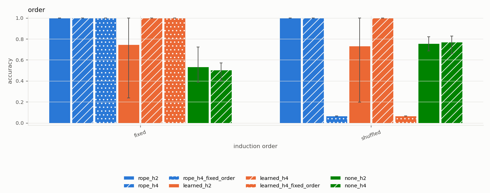
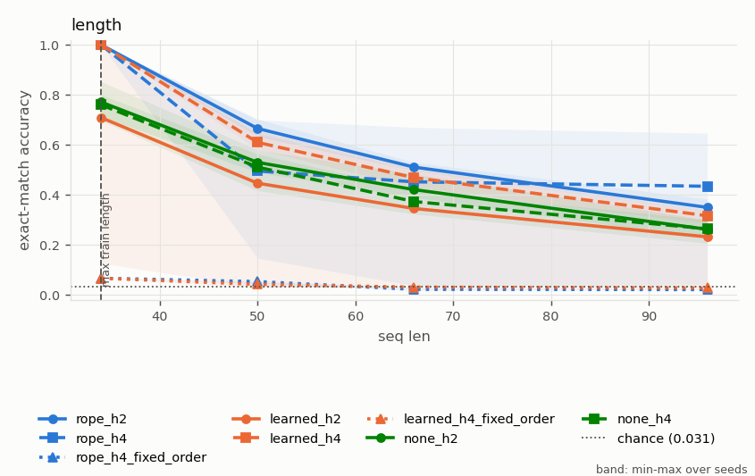
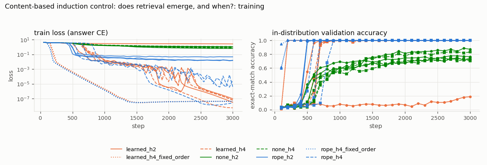

# Content-based induction control: does retrieval emerge, and when?

*Study id:* `induction`  
*Spec:* ``

## Design

**Research question.** On a task that can ONLY be solved by matching content (a shuffled repeat, verified to have no fixed-offset solution), does each positional method learn content-based retrieval within a fixed budget, and does the onset depend on the positional method and on the head width?

**Hypothesis.** Calibration (single seeds) suggested: RoPE with 2 heads (d_h 32) learns abruptly around step 1200; NoPE with 4 heads learns around step 1600; learned absolute (2 or 4 heads) and RoPE with 4 heads (d_h 16) do not learn within 2000 steps. If real, onset differences should replicate across seeds; if they are seed noise, onsets will overlap across methods.

**Independent variables:** pos_method, n_heads  
**Controlled variables:** task: shuffled induction, length 34 (16 distinct entities + 16-entity shuffled repeat), d_model 64, 2 layers, d_mlp 256; optimiser, lr 3e-3, batch 64, 3000 steps, every second-half position supervised (n_queries: all) in training; evaluation scores the final position  
**Primary metric:** steps to 90% validation accuracy (onset of content-based retrieval); final accuracy; for fixed-order models, accuracy on the shuffled order (does a perfect training score imply content retrieval?)
  
**Seeds:** [0, 1, 2]  
**Evaluation seed (shared by all runs):** 20261015

**Expected failure modes:** no onset within budget (reported as not reached, not as inability); onset timing is stochastic; three seeds can only detect large differences; head-width variants also change per-head capacity, not only RoPE frequency coverage

**Scope note (transparent reductions):** Fixed-order variants (positional shortcut available) are the shortcut condition: they are trained on the fixed order and evaluated on both orders (grid `order`). Originally one seed; extended to three seeds and a second positional method after the first result, because it is the most direct test of the central question.

## Runs (measured)

| run_id | variant | seed | pos_method | status | elapsed_s | final_val_acc | final_train_loss | steps | n_params |
|---|---|---|---|---|---|---|---|---|---|
| learned_h2_s0_5c85c4aa | learned_h2 | 0 | learned | completed | 261.003 | 1.000 | 0.000 | 3000 | 149504 |
| learned_h2_s1_4b7d6ea6 | learned_h2 | 1 | learned | completed | 259.305 | 1.000 | 0.000 | 3000 | 149504 |
| learned_h2_s2_e3f2095b | learned_h2 | 2 | learned | completed | 259.272 | 0.188 | 2.614 | 3000 | 149504 |
| learned_h4_fixed_order_s0_1bf697c1 | learned_h4_fixed_order | 0 | learned | completed | 561.120 | 1.000 | 0.000 | 3000 | 149504 |
| learned_h4_fixed_order_s1_79789755 | learned_h4_fixed_order | 1 | learned | completed | 555.906 | 1.000 | 0.000 | 3000 | 149504 |
| learned_h4_fixed_order_s2_fac8c2c4 | learned_h4_fixed_order | 2 | learned | completed | 471.018 | 1.000 | 0.000 | 3000 | 149504 |
| learned_h4_s0_9ddefc3d | learned_h4 | 0 | learned | completed | 294.073 | 1.000 | 0.000 | 3000 | 149504 |
| learned_h4_s1_36d15c20 | learned_h4 | 1 | learned | completed | 293.871 | 1.000 | 0.000 | 3000 | 149504 |
| learned_h4_s2_b0adc569 | learned_h4 | 2 | learned | completed | 291.495 | 1.000 | 0.000 | 3000 | 149504 |
| none_h2_s0_6a0e459a | none_h2 | 0 | none | completed | 235.141 | 0.766 | 0.980 | 3000 | 116736 |
| none_h2_s1_85e1e9eb | none_h2 | 1 | none | completed | 235.553 | 0.871 | 0.628 | 3000 | 116736 |
| none_h2_s2_58066cb5 | none_h2 | 2 | none | completed | 235.591 | 0.727 | 1.066 | 3000 | 116736 |
| none_h4_s0_5ca12584 | none_h4 | 0 | none | completed | 260.778 | 0.707 | 1.166 | 3000 | 116736 |
| none_h4_s1_f63939d1 | none_h4 | 1 | none | completed | 261.656 | 0.832 | 0.688 | 3000 | 116736 |
| none_h4_s2_14335b66 | none_h4 | 2 | none | completed | 261.087 | 0.734 | 0.816 | 3000 | 116736 |
| rope_h2_s0_92b653be | rope_h2 | 0 | rope | completed | 268.965 | 1.000 | 0.046 | 3000 | 116736 |
| rope_h2_s1_4220baf1 | rope_h2 | 1 | rope | completed | 268.553 | 1.000 | 0.015 | 3000 | 116736 |
| rope_h2_s2_5241b678 | rope_h2 | 2 | rope | completed | 268.977 | 1.000 | 0.015 | 3000 | 116736 |
| rope_h4_fixed_order_s0_b5ba919e | rope_h4_fixed_order | 0 | rope | completed | 165.663 | 1.000 | 0.000 | 3000 | 116736 |
| rope_h4_fixed_order_s1_f0187e82 | rope_h4_fixed_order | 1 | rope | completed | 673.692 | 1.000 | 0.000 | 3000 | 116736 |
| rope_h4_fixed_order_s2_4a4b15dd | rope_h4_fixed_order | 2 | rope | completed | 662.129 | 1.000 | 0.000 | 3000 | 116736 |
| rope_h4_s0_b8076af6 | rope_h4 | 0 | rope | completed | 336.431 | 1.000 | 0.000 | 3000 | 116736 |
| rope_h4_s1_e1b545a6 | rope_h4 | 1 | rope | completed | 338.654 | 1.000 | 0.000 | 3000 | 116736 |
| rope_h4_s2_b1cb5e7c | rope_h4 | 2 | rope | completed | 337.983 | 1.000 | 0.000 | 3000 | 116736 |

## Validity flags

* `learned_h2_s2_e3f2095b`: in-distribution val acc 0.188 < 0.90 -> undertrained or unable to learn the task; out-of-distribution failures of this run are NOT evidence about extrapolation.
* `none_h2_s0_6a0e459a`: in-distribution val acc 0.766 < 0.90 -> undertrained or unable to learn the task; out-of-distribution failures of this run are NOT evidence about extrapolation.
* `none_h2_s1_85e1e9eb`: in-distribution val acc 0.871 < 0.90 -> undertrained or unable to learn the task; out-of-distribution failures of this run are NOT evidence about extrapolation.
* `none_h2_s2_58066cb5`: in-distribution val acc 0.727 < 0.90 -> undertrained or unable to learn the task; out-of-distribution failures of this run are NOT evidence about extrapolation.
* `none_h4_s0_5ca12584`: in-distribution val acc 0.707 < 0.90 -> undertrained or unable to learn the task; out-of-distribution failures of this run are NOT evidence about extrapolation.
* `none_h4_s1_f63939d1`: in-distribution val acc 0.832 < 0.90 -> undertrained or unable to learn the task; out-of-distribution failures of this run are NOT evidence about extrapolation.
* `none_h4_s2_14335b66`: in-distribution val acc 0.734 < 0.90 -> undertrained or unable to learn the task; out-of-distribution failures of this run are NOT evidence about extrapolation.

## Controls (mean, min and max over seeds)

| grid | cell | variant | n_seeds | mean | min | max |
|---|---|---|---|---|---|---|
| control_in_distribution | default | learned_h2 | 3 | 0.730 | 0.190 | 1.000 |
| control_in_distribution | default | learned_h4 | 3 | 1.000 | 1.000 | 1.000 |
| control_in_distribution | default | learned_h4_fixed_order | 3 | 1.000 | 1.000 | 1.000 |
| control_in_distribution | default | none_h2 | 3 | 0.764 | 0.713 | 0.857 |
| control_in_distribution | default | none_h4 | 3 | 0.766 | 0.683 | 0.850 |
| control_in_distribution | default | rope_h2 | 3 | 1.000 | 1.000 | 1.000 |
| control_in_distribution | default | rope_h4 | 3 | 1.000 | 1.000 | 1.000 |
| control_in_distribution | default | rope_h4_fixed_order | 3 | 1.000 | 1.000 | 1.000 |
| control_position_offset | pos_offset=0 | learned_h2 | 3 | 0.730 | 0.190 | 1.000 |
| control_position_offset | pos_offset=0 | learned_h4 | 3 | 1.000 | 1.000 | 1.000 |
| control_position_offset | pos_offset=0 | learned_h4_fixed_order | 3 | 1.000 | 1.000 | 1.000 |
| control_position_offset | pos_offset=0 | none_h2 | 3 | 0.764 | 0.713 | 0.857 |
| control_position_offset | pos_offset=0 | none_h4 | 3 | 0.766 | 0.683 | 0.850 |
| control_position_offset | pos_offset=0 | rope_h2 | 3 | 1.000 | 1.000 | 1.000 |
| control_position_offset | pos_offset=0 | rope_h4 | 3 | 1.000 | 1.000 | 1.000 |
| control_position_offset | pos_offset=0 | rope_h4_fixed_order | 3 | 1.000 | 1.000 | 1.000 |
| control_position_offset | pos_offset=64 | learned_h2 | 3 | 0.131 | 0.050 | 0.197 |
| control_position_offset | pos_offset=64 | learned_h4 | 3 | 0.154 | 0.147 | 0.163 |
| control_position_offset | pos_offset=64 | learned_h4_fixed_order | 3 | 0.012 | 0.007 | 0.017 |
| control_position_offset | pos_offset=64 | none_h2 | 3 | 0.764 | 0.713 | 0.857 |
| control_position_offset | pos_offset=64 | none_h4 | 3 | 0.766 | 0.683 | 0.850 |
| control_position_offset | pos_offset=64 | rope_h2 | 3 | 1.000 | 1.000 | 1.000 |
| control_position_offset | pos_offset=64 | rope_h4 | 3 | 1.000 | 1.000 | 1.000 |
| control_position_offset | pos_offset=64 | rope_h4_fixed_order | 3 | 1.000 | 1.000 | 1.000 |

## Control metrics per run (measured)

`composition_end_given_both_hops` = accuracy on the chain end among contexts where both single hops were answered correctly (multi-hop only).

| run_id | variant | seed | in_distribution_acc | pos_offset_0_acc | pos_offset_64_acc |
|---|---|---|---|---|---|
| learned_h2_s0_5c85c4aa | learned_h2 | 0 | 1.000 | 1.000 | 0.197 |
| learned_h2_s1_4b7d6ea6 | learned_h2 | 1 | 1.000 | 1.000 | 0.147 |
| learned_h2_s2_e3f2095b | learned_h2 | 2 | 0.190 | 0.190 | 0.050 |
| learned_h4_s0_9ddefc3d | learned_h4 | 0 | 1.000 | 1.000 | 0.153 |
| learned_h4_s1_36d15c20 | learned_h4 | 1 | 1.000 | 1.000 | 0.147 |
| learned_h4_s2_b0adc569 | learned_h4 | 2 | 1.000 | 1.000 | 0.163 |
| learned_h4_fixed_order_s0_1bf697c1 | learned_h4_fixed_order | 0 | 1.000 | 1.000 | 0.017 |
| learned_h4_fixed_order_s1_79789755 | learned_h4_fixed_order | 1 | 1.000 | 1.000 | 0.013 |
| learned_h4_fixed_order_s2_fac8c2c4 | learned_h4_fixed_order | 2 | 1.000 | 1.000 | 0.007 |
| none_h2_s0_6a0e459a | none_h2 | 0 | 0.713 | 0.713 | 0.713 |
| none_h2_s1_85e1e9eb | none_h2 | 1 | 0.857 | 0.857 | 0.857 |
| none_h2_s2_58066cb5 | none_h2 | 2 | 0.723 | 0.723 | 0.723 |
| none_h4_s0_5ca12584 | none_h4 | 0 | 0.683 | 0.683 | 0.683 |
| none_h4_s1_f63939d1 | none_h4 | 1 | 0.850 | 0.850 | 0.850 |
| none_h4_s2_14335b66 | none_h4 | 2 | 0.763 | 0.763 | 0.763 |
| rope_h2_s0_92b653be | rope_h2 | 0 | 1.000 | 1.000 | 1.000 |
| rope_h2_s1_4220baf1 | rope_h2 | 1 | 1.000 | 1.000 | 1.000 |
| rope_h2_s2_5241b678 | rope_h2 | 2 | 1.000 | 1.000 | 1.000 |
| rope_h4_s0_b8076af6 | rope_h4 | 0 | 1.000 | 1.000 | 1.000 |
| rope_h4_s1_e1b545a6 | rope_h4 | 1 | 1.000 | 1.000 | 1.000 |
| rope_h4_s2_b1cb5e7c | rope_h4 | 2 | 1.000 | 1.000 | 1.000 |
| rope_h4_fixed_order_s0_b5ba919e | rope_h4_fixed_order | 0 | 1.000 | 1.000 | 1.000 |
| rope_h4_fixed_order_s1_f0187e82 | rope_h4_fixed_order | 1 | 1.000 | 1.000 | 1.000 |
| rope_h4_fixed_order_s2_4a4b15dd | rope_h4_fixed_order | 2 | 1.000 | 1.000 | 1.000 |

## Grid `order` (derived: mean across seeds; t-interval over seeds)

| grid | variant | cell_induction_order | n_seeds | n_per_seed | mean | std | min | max | t_lo | t_hi |
|---|---|---|---|---|---|---|---|---|---|---|
| order | learned_h2 | fixed | 3 | 300 | 0.746 | 0.441 | 0.237 | 1.000 | -0.349 | 1.840 |
| order | learned_h2 | shuffled | 3 | 300 | 0.732 | 0.464 | 0.197 | 1.000 | -0.420 | 1.884 |
| order | learned_h4 | fixed | 3 | 300 | 1.000 | 0.000 | 1.000 | 1.000 | 1.000 | 1.000 |
| order | learned_h4 | shuffled | 3 | 300 | 1.000 | 0.000 | 1.000 | 1.000 | 1.000 | 1.000 |
| order | learned_h4_fixed_order | fixed | 3 | 300 | 1.000 | 0.000 | 1.000 | 1.000 | 1.000 | 1.000 |
| order | learned_h4_fixed_order | shuffled | 3 | 300 | 0.067 | 0.000 | 0.067 | 0.067 | 0.067 | 0.067 |
| order | none_h2 | fixed | 3 | 300 | 0.533 | 0.172 | 0.387 | 0.723 | 0.105 | 0.962 |
| order | none_h2 | shuffled | 3 | 300 | 0.757 | 0.067 | 0.687 | 0.820 | 0.590 | 0.923 |
| order | none_h4 | fixed | 3 | 300 | 0.504 | 0.089 | 0.403 | 0.570 | 0.284 | 0.725 |
| order | none_h4 | shuffled | 3 | 300 | 0.769 | 0.092 | 0.663 | 0.827 | 0.541 | 0.996 |
| order | rope_h2 | fixed | 3 | 300 | 1.000 | 0.000 | 1.000 | 1.000 | 1.000 | 1.000 |
| order | rope_h2 | shuffled | 3 | 300 | 1.000 | 0.000 | 1.000 | 1.000 | 1.000 | 1.000 |
| order | rope_h4 | fixed | 3 | 300 | 1.000 | 0.000 | 1.000 | 1.000 | 1.000 | 1.000 |
| order | rope_h4 | shuffled | 3 | 300 | 1.000 | 0.000 | 1.000 | 1.000 | 1.000 | 1.000 |
| order | rope_h4_fixed_order | fixed | 3 | 300 | 1.000 | 0.000 | 1.000 | 1.000 | 1.000 | 1.000 |
| order | rope_h4_fixed_order | shuffled | 3 | 300 | 0.067 | 0.000 | 0.067 | 0.067 | 0.067 | 0.067 |

Baselines on the identical examples (reference):

| cell_induction_order | oracle | random_context | chance | best_fixed_offset | best_fixed_offset_d | cell_seq_len |
|---|---|---|---|---|---|---|
| shuffled | 1.000 | 0.062 | 0.021 | 0.080 | 1 | nan |
| fixed | 1.000 | 0.062 | 0.021 | 1.000 | 16 | nan |

## Grid `length` (derived: mean across seeds; t-interval over seeds)

| grid | variant | cell_seq_len | n_seeds | n_per_seed | mean | std | min | max | t_lo | t_hi |
|---|---|---|---|---|---|---|---|---|---|---|
| length | learned_h2 | 34 | 3 | 300 | 0.709 | 0.504 | 0.127 | 1.000 | -0.544 | 1.961 |
| length | learned_h2 | 50 | 3 | 300 | 0.447 | 0.361 | 0.030 | 0.657 | -0.450 | 1.343 |
| length | learned_h2 | 66 | 3 | 300 | 0.346 | 0.268 | 0.037 | 0.510 | -0.319 | 1.011 |
| length | learned_h2 | 96 | 3 | 300 | 0.232 | 0.172 | 0.033 | 0.340 | -0.196 | 0.661 |
| length | learned_h4 | 34 | 3 | 300 | 1.000 | 0.000 | 1.000 | 1.000 | 1.000 | 1.000 |
| length | learned_h4 | 50 | 3 | 300 | 0.610 | 0.033 | 0.583 | 0.647 | 0.528 | 0.692 |
| length | learned_h4 | 66 | 3 | 300 | 0.469 | 0.036 | 0.430 | 0.500 | 0.380 | 0.557 |
| length | learned_h4 | 96 | 3 | 300 | 0.317 | 0.026 | 0.287 | 0.333 | 0.252 | 0.381 |
| length | learned_h4_fixed_order | 34 | 3 | 300 | 0.067 | 0.000 | 0.067 | 0.067 | 0.067 | 0.067 |
| length | learned_h4_fixed_order | 50 | 3 | 300 | 0.042 | 0.011 | 0.030 | 0.050 | 0.016 | 0.069 |
| length | learned_h4_fixed_order | 66 | 3 | 300 | 0.031 | 0.004 | 0.027 | 0.033 | 0.022 | 0.041 |
| length | learned_h4_fixed_order | 96 | 3 | 300 | 0.028 | 0.005 | 0.023 | 0.033 | 0.015 | 0.040 |
| length | none_h2 | 34 | 3 | 300 | 0.771 | 0.073 | 0.713 | 0.853 | 0.589 | 0.953 |
| length | none_h2 | 50 | 3 | 300 | 0.530 | 0.046 | 0.490 | 0.580 | 0.416 | 0.644 |
| length | none_h2 | 66 | 3 | 300 | 0.421 | 0.054 | 0.390 | 0.483 | 0.287 | 0.555 |
| length | none_h2 | 96 | 3 | 300 | 0.262 | 0.037 | 0.227 | 0.300 | 0.171 | 0.353 |
| length | none_h4 | 34 | 3 | 300 | 0.760 | 0.055 | 0.697 | 0.800 | 0.622 | 0.898 |
| length | none_h4 | 50 | 3 | 300 | 0.511 | 0.082 | 0.417 | 0.563 | 0.308 | 0.715 |
| length | none_h4 | 66 | 3 | 300 | 0.373 | 0.048 | 0.323 | 0.420 | 0.253 | 0.494 |
| length | none_h4 | 96 | 3 | 300 | 0.264 | 0.050 | 0.207 | 0.300 | 0.139 | 0.390 |
| length | rope_h2 | 34 | 3 | 300 | 1.000 | 0.000 | 1.000 | 1.000 | 1.000 | 1.000 |
| length | rope_h2 | 50 | 3 | 300 | 0.666 | 0.035 | 0.633 | 0.703 | 0.578 | 0.753 |
| length | rope_h2 | 66 | 3 | 300 | 0.511 | 0.017 | 0.497 | 0.530 | 0.469 | 0.554 |
| length | rope_h2 | 96 | 3 | 300 | 0.350 | 0.029 | 0.333 | 0.383 | 0.278 | 0.422 |
| length | rope_h4 | 34 | 3 | 300 | 1.000 | 0.000 | 1.000 | 1.000 | 1.000 | 1.000 |
| length | rope_h4 | 50 | 3 | 300 | 0.496 | 0.304 | 0.147 | 0.700 | -0.259 | 1.250 |
| length | rope_h4 | 66 | 3 | 300 | 0.452 | 0.360 | 0.037 | 0.670 | -0.442 | 1.347 |
| length | rope_h4 | 96 | 3 | 300 | 0.434 | 0.342 | 0.040 | 0.647 | -0.415 | 1.284 |
| length | rope_h4_fixed_order | 34 | 3 | 300 | 0.067 | 0.000 | 0.067 | 0.067 | 0.067 | 0.067 |
| length | rope_h4_fixed_order | 50 | 3 | 300 | 0.053 | 0.006 | 0.047 | 0.057 | 0.039 | 0.068 |
| length | rope_h4_fixed_order | 66 | 3 | 300 | 0.022 | 0.007 | 0.017 | 0.030 | 0.005 | 0.039 |
| length | rope_h4_fixed_order | 96 | 3 | 300 | 0.021 | 0.002 | 0.020 | 0.023 | 0.016 | 0.026 |

Baselines on the identical examples (reference):

| cell_induction_order | oracle | random_context | chance | best_fixed_offset | best_fixed_offset_d | cell_seq_len |
|---|---|---|---|---|---|---|
| nan | 1.000 | 0.062 | 0.021 | 0.103 | 11 | 34 |
| nan | 1.000 | 0.042 | 0.021 | 0.070 | 31 | 50 |
| nan | 1.000 | 0.031 | 0.021 | 0.067 | 51 | 66 |
| nan | 1.000 | 0.021 | 0.021 | 0.043 | 46 | 96 |

## Paired differences vs `rope_h2` (per-seed differences on identical examples)

| grid | cell_induction_order | a | b | mean_diff | t_lo | t_hi | n_seeds | seeds_a_better | seeds_b_better | cell_seq_len |
|---|---|---|---|---|---|---|---|---|---|---|
| order | fixed | learned_h2 | rope_h2 | -0.254 | -1.349 | 0.840 | 3 | 0 | 1 | nan |
| order | shuffled | learned_h2 | rope_h2 | -0.268 | -1.420 | 0.884 | 3 | 0 | 1 | nan |
| order | fixed | learned_h4 | rope_h2 | 0.000 | 0.000 | 0.000 | 3 | 0 | 0 | nan |
| order | shuffled | learned_h4 | rope_h2 | 0.000 | 0.000 | 0.000 | 3 | 0 | 0 | nan |
| order | fixed | learned_h4_fixed_order | rope_h2 | 0.000 | 0.000 | 0.000 | 3 | 0 | 0 | nan |
| order | shuffled | learned_h4_fixed_order | rope_h2 | -0.933 | -0.933 | -0.933 | 3 | 0 | 3 | nan |
| order | fixed | none_h2 | rope_h2 | -0.467 | -0.895 | -0.038 | 3 | 0 | 3 | nan |
| order | shuffled | none_h2 | rope_h2 | -0.243 | -0.410 | -0.077 | 3 | 0 | 3 | nan |
| order | fixed | none_h4 | rope_h2 | -0.496 | -0.716 | -0.275 | 3 | 0 | 3 | nan |
| order | shuffled | none_h4 | rope_h2 | -0.231 | -0.459 | -0.004 | 3 | 0 | 3 | nan |
| order | fixed | rope_h4 | rope_h2 | 0.000 | 0.000 | 0.000 | 3 | 0 | 0 | nan |
| order | shuffled | rope_h4 | rope_h2 | 0.000 | 0.000 | 0.000 | 3 | 0 | 0 | nan |
| order | fixed | rope_h4_fixed_order | rope_h2 | 0.000 | 0.000 | 0.000 | 3 | 0 | 0 | nan |
| order | shuffled | rope_h4_fixed_order | rope_h2 | -0.933 | -0.933 | -0.933 | 3 | 0 | 3 | nan |
| length | nan | learned_h2 | rope_h2 | -0.291 | -1.544 | 0.961 | 3 | 0 | 1 | 34 |
| length | nan | learned_h2 | rope_h2 | -0.219 | -1.047 | 0.610 | 3 | 0 | 3 | 50 |
| length | nan | learned_h2 | rope_h2 | -0.166 | -0.801 | 0.470 | 3 | 1 | 2 | 66 |
| length | nan | learned_h2 | rope_h2 | -0.118 | -0.518 | 0.283 | 3 | 1 | 2 | 96 |
| length | nan | learned_h4 | rope_h2 | 0.000 | 0.000 | 0.000 | 3 | 0 | 0 | 34 |
| length | nan | learned_h4 | rope_h2 | -0.056 | -0.207 | 0.096 | 3 | 1 | 2 | 50 |
| length | nan | learned_h4 | rope_h2 | -0.042 | -0.144 | 0.060 | 3 | 1 | 2 | 66 |
| length | nan | learned_h4 | rope_h2 | -0.033 | -0.170 | 0.103 | 3 | 0 | 2 | 96 |
| length | nan | learned_h4_fixed_order | rope_h2 | -0.933 | -0.933 | -0.933 | 3 | 0 | 3 | 34 |
| length | nan | learned_h4_fixed_order | rope_h2 | -0.623 | -0.689 | -0.558 | 3 | 0 | 3 | 50 |
| length | nan | learned_h4_fixed_order | rope_h2 | -0.480 | -0.532 | -0.428 | 3 | 0 | 3 | 66 |
| length | nan | learned_h4_fixed_order | rope_h2 | -0.322 | -0.404 | -0.241 | 3 | 0 | 3 | 96 |
| length | nan | none_h2 | rope_h2 | -0.229 | -0.411 | -0.047 | 3 | 0 | 3 | 34 |
| length | nan | none_h2 | rope_h2 | -0.136 | -0.265 | -0.006 | 3 | 0 | 3 | 50 |
| length | nan | none_h2 | rope_h2 | -0.090 | -0.239 | 0.059 | 3 | 0 | 3 | 66 |
| length | nan | none_h2 | rope_h2 | -0.088 | -0.130 | -0.045 | 3 | 0 | 3 | 96 |
| length | nan | none_h4 | rope_h2 | -0.240 | -0.378 | -0.102 | 3 | 0 | 3 | 34 |
| length | nan | none_h4 | rope_h2 | -0.154 | -0.440 | 0.131 | 3 | 0 | 3 | 50 |
| length | nan | none_h4 | rope_h2 | -0.138 | -0.292 | 0.016 | 3 | 0 | 3 | 66 |
| length | nan | none_h4 | rope_h2 | -0.086 | -0.204 | 0.033 | 3 | 0 | 3 | 96 |
| length | nan | rope_h4 | rope_h2 | 0.000 | 0.000 | 0.000 | 3 | 0 | 0 | 34 |
| length | nan | rope_h4 | rope_h2 | -0.170 | -1.003 | 0.663 | 3 | 2 | 1 | 50 |
| length | nan | rope_h4 | rope_h2 | -0.059 | -0.994 | 0.876 | 3 | 2 | 1 | 66 |
| length | nan | rope_h4 | rope_h2 | 0.084 | -0.729 | 0.898 | 3 | 2 | 1 | 96 |
| length | nan | rope_h4_fixed_order | rope_h2 | -0.933 | -0.933 | -0.933 | 3 | 0 | 3 | 34 |
| length | nan | rope_h4_fixed_order | rope_h2 | -0.612 | -0.699 | -0.525 | 3 | 0 | 3 | 50 |
| length | nan | rope_h4_fixed_order | rope_h2 | -0.489 | -0.534 | -0.443 | 3 | 0 | 3 | 66 |
| length | nan | rope_h4_fixed_order | rope_h2 | -0.329 | -0.403 | -0.255 | 3 | 0 | 3 | 96 |

## Figures

## Reading guide

* Per-seed Wilson intervals (in `per_seed_cells.csv`) capture example sampling only; the across-seed t-interval captures training variability but is very wide with 3 seeds.
* Interpretation and conclusions are written separately in `docs/results.md`; this report is generated mechanically from the measured tables above.
