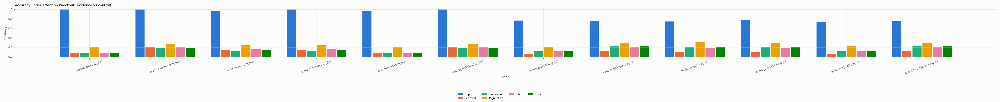
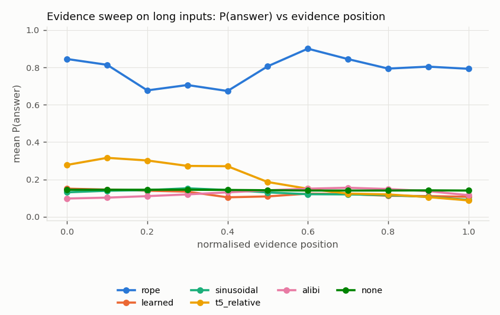

# Mechanistic analysis: Positional encodings under length, position, distance and distractors (Studies 1, 2, 3, 5) — v2

Observational measures (attention, logit lens) describe internal quantities; only knockout, patching and ablation are interventions. Knockout measures only the *direct* <ans>-to-evidence read in a layer; patching restoration is reported per position role.

## `alibi_s0_14edea8d` (alibi)

* training lengths [24, 64], long set length 128 
* retrieval head (max attention to evidence value, last layer, in-distribution): {'layer': 1, 'head': 0}

Retrieval-head attention to evidence value and score gap, by correctness:

| set | correct | attn_evidence_value | score_gap | attn_entropy |
|---|---|---|---|---|
| in_distribution | 0.000 | 0.000 | -4.232 | 1.958 |
| in_distribution | 1.000 | 0.000 | -3.522 | 2.128 |
| long_128 | 0.000 | 0.000 | -3.936 | 2.976 |
| long_128 | 1.000 | 0.000 | -4.102 | 3.197 |

Long set, retrieval head by evidence distance:

| distance_bin | attn_evidence_value | score_gap | correct |
|---|---|---|---|
| (0, 16] | 0.000 | -4.489 | 0.320 |
| (16, 32] | 0.000 | -3.124 | 0.158 |
| (32, 64] | 0.000 | -3.347 | 0.208 |
| (64, 128] | 0.000 | -4.317 | 0.165 |

## `learned_s0_b216759c` (learned)

* training lengths [24, 64], long set length 128 
* retrieval head (max attention to evidence value, last layer, in-distribution): {'layer': 1, 'head': 1}

Retrieval-head attention to evidence value and score gap, by correctness:

| set | correct | attn_evidence_value | score_gap | attn_entropy |
|---|---|---|---|---|
| in_distribution | 0.000 | 0.000 | -2.746 | 1.791 |
| in_distribution | 1.000 | 0.006 | -3.384 | 1.968 |
| long_128 | 0.000 | 0.000 | -3.008 | 2.608 |
| long_128 | 1.000 | 0.000 | -3.056 | 2.745 |

Long set, retrieval head by evidence distance:

| distance_bin | attn_evidence_value | score_gap | correct |
|---|---|---|---|
| (0, 16] | 0.000 | -3.999 | 0.000 |
| (16, 32] | 0.000 | -5.339 | 0.158 |
| (32, 64] | 0.000 | -2.762 | 0.094 |
| (64, 128] | 0.000 | -2.473 | 0.136 |

## `none_s0_3b095ef5` (none)

* training lengths [24, 64], long set length 128 
* retrieval head (max attention to evidence value, last layer, in-distribution): {'layer': 1, 'head': 0}

Retrieval-head attention to evidence value and score gap, by correctness:

| set | correct | attn_evidence_value | score_gap | attn_entropy |
|---|---|---|---|---|
| in_distribution | 0.000 | 0.000 | -5.282 | 1.878 |
| in_distribution | 1.000 | 0.000 | -5.768 | 1.697 |
| long_128 | 0.000 | 0.000 | -4.421 | 3.027 |
| long_128 | 1.000 | 0.000 | -5.334 | 2.870 |

Long set, retrieval head by evidence distance:

| distance_bin | attn_evidence_value | score_gap | correct |
|---|---|---|---|
| (0, 16] | 0.000 | -8.612 | 0.240 |
| (16, 32] | 0.000 | -3.474 | 0.053 |
| (32, 64] | 0.000 | -5.251 | 0.245 |
| (64, 128] | 0.000 | -3.514 | 0.204 |

## `rope_s0_8f19ac01` (rope)

* training lengths [24, 64], long set length 128 
* retrieval head (max attention to evidence value, last layer, in-distribution): {'layer': 1, 'head': 0}

Retrieval-head attention to evidence value and score gap, by correctness:

| set | correct | attn_evidence_value | score_gap | attn_entropy |
|---|---|---|---|---|
| in_distribution | 1.000 | 0.418 | 10.658 | 0.690 |
| long_128 | 0.000 | 0.051 | 7.263 | 1.116 |
| long_128 | 1.000 | 0.111 | 9.728 | 0.839 |

Long set, retrieval head by evidence distance:

| distance_bin | attn_evidence_value | score_gap | correct |
|---|---|---|---|
| (0, 16] | 0.077 | 6.841 | 0.800 |
| (16, 32] | 0.134 | 10.633 | 0.842 |
| (32, 64] | 0.180 | 8.526 | 0.811 |
| (64, 128] | 0.053 | 9.803 | 0.738 |

## `sinusoidal_s0_7022156b` (sinusoidal)

* training lengths [24, 64], long set length 128 
* retrieval head (max attention to evidence value, last layer, in-distribution): {'layer': 1, 'head': 1}

Retrieval-head attention to evidence value and score gap, by correctness:

| set | correct | attn_evidence_value | score_gap | attn_entropy |
|---|---|---|---|---|
| in_distribution | 0.000 | 0.000 | -6.495 | 1.696 |
| in_distribution | 1.000 | 0.000 | -7.491 | 1.898 |
| long_128 | 0.000 | 0.000 | -6.532 | 2.941 |
| long_128 | 1.000 | 0.000 | -3.539 | 2.820 |

Long set, retrieval head by evidence distance:

| distance_bin | attn_evidence_value | score_gap | correct |
|---|---|---|---|
| (0, 16] | 0.000 | -12.449 | 0.160 |
| (16, 32] | 0.000 | -13.467 | 0.158 |
| (32, 64] | 0.000 | -6.243 | 0.151 |
| (64, 128] | 0.000 | -2.774 | 0.252 |

## `t5_relative_s0_fd015ce8` (t5_relative)

* training lengths [24, 64], long set length 128 
* retrieval head (max attention to evidence value, last layer, in-distribution): {'layer': 1, 'head': 1}

Retrieval-head attention to evidence value and score gap, by correctness:

| set | correct | attn_evidence_value | score_gap | attn_entropy |
|---|---|---|---|---|
| in_distribution | 0.000 | 0.003 | -1.493 | 1.380 |
| in_distribution | 1.000 | 0.003 | -1.253 | 1.354 |
| long_128 | 0.000 | 0.004 | -1.535 | 1.276 |
| long_128 | 1.000 | 0.005 | -1.455 | 1.284 |

Long set, retrieval head by evidence distance:

| distance_bin | attn_evidence_value | score_gap | correct |
|---|---|---|---|
| (0, 16] | 0.003 | -1.875 | 0.000 |
| (16, 32] | 0.002 | -1.462 | 0.053 |
| (32, 64] | 0.005 | -1.763 | 0.208 |
| (64, 128] | 0.004 | -1.303 | 0.447 |

## Attention knockout (accuracy)

| variant | condition | layer | acc | p_answer | n | set |
|---|---|---|---|---|---|---|
| alibi | none | - | 0.165 | 0.124 | 200 | in_distribution |
| alibi | evidence | 0 | 0.090 | 0.082 | 200 | in_distribution |
| alibi | control_pair | 0 | 0.210 | 0.139 | 200 | in_distribution |
| alibi | evidence | 1 | 0.165 | 0.124 | 200 | in_distribution |
| alibi | control_pair | 1 | 0.165 | 0.124 | 200 | in_distribution |
| alibi | evidence | all | 0.090 | 0.082 | 200 | in_distribution |
| alibi | control_pair | all | 0.210 | 0.139 | 200 | in_distribution |
| alibi | none | - | 0.195 | 0.128 | 200 | long_128 |
| alibi | evidence | 0 | 0.115 | 0.085 | 200 | long_128 |
| alibi | control_pair | 0 | 0.200 | 0.141 | 200 | long_128 |
| alibi | evidence | 1 | 0.195 | 0.128 | 200 | long_128 |
| alibi | control_pair | 1 | 0.195 | 0.128 | 200 | long_128 |
| alibi | evidence | all | 0.115 | 0.085 | 200 | long_128 |
| alibi | control_pair | all | 0.200 | 0.141 | 200 | long_128 |
| learned | none | - | 0.150 | 0.118 | 200 | in_distribution |
| learned | evidence | 0 | 0.075 | 0.075 | 200 | in_distribution |
| learned | control_pair | 0 | 0.205 | 0.136 | 200 | in_distribution |
| learned | evidence | 1 | 0.150 | 0.118 | 200 | in_distribution |
| learned | control_pair | 1 | 0.150 | 0.118 | 200 | in_distribution |
| learned | evidence | all | 0.075 | 0.075 | 200 | in_distribution |
| learned | control_pair | all | 0.205 | 0.136 | 200 | in_distribution |
| learned | none | - | 0.110 | 0.107 | 200 | long_128 |
| learned | evidence | 0 | 0.065 | 0.067 | 200 | long_128 |
| learned | control_pair | 0 | 0.130 | 0.117 | 200 | long_128 |
| learned | evidence | 1 | 0.110 | 0.107 | 200 | long_128 |
| learned | control_pair | 1 | 0.110 | 0.107 | 200 | long_128 |
| learned | evidence | all | 0.065 | 0.067 | 200 | long_128 |
| learned | control_pair | all | 0.130 | 0.117 | 200 | long_128 |
| none | none | - | 0.140 | 0.132 | 200 | in_distribution |
| none | evidence | 0 | 0.090 | 0.091 | 200 | in_distribution |
| none | control_pair | 0 | 0.190 | 0.149 | 200 | in_distribution |
| none | evidence | 1 | 0.140 | 0.132 | 200 | in_distribution |
| none | control_pair | 1 | 0.140 | 0.132 | 200 | in_distribution |
| none | evidence | all | 0.090 | 0.091 | 200 | in_distribution |
| none | control_pair | all | 0.190 | 0.149 | 200 | in_distribution |
| none | none | - | 0.205 | 0.150 | 200 | long_128 |
| none | evidence | 0 | 0.120 | 0.095 | 200 | long_128 |
| none | control_pair | 0 | 0.230 | 0.170 | 200 | long_128 |
| none | evidence | 1 | 0.205 | 0.150 | 200 | long_128 |
| none | control_pair | 1 | 0.205 | 0.150 | 200 | long_128 |
| none | evidence | all | 0.120 | 0.095 | 200 | long_128 |
| none | control_pair | all | 0.230 | 0.170 | 200 | long_128 |
| rope | none | - | 1.000 | 0.998 | 200 | in_distribution |
| rope | evidence | 0 | 1.000 | 0.998 | 200 | in_distribution |
| rope | control_pair | 0 | 1.000 | 0.998 | 200 | in_distribution |
| rope | evidence | 1 | 0.960 | 0.959 | 200 | in_distribution |
| rope | control_pair | 1 | 1.000 | 0.998 | 200 | in_distribution |
| rope | evidence | all | 0.960 | 0.958 | 200 | in_distribution |
| rope | control_pair | all | 1.000 | 0.998 | 200 | in_distribution |
| rope | none | - | 0.775 | 0.752 | 200 | long_128 |
| rope | evidence | 0 | 0.765 | 0.750 | 200 | long_128 |
| rope | control_pair | 0 | 0.760 | 0.745 | 200 | long_128 |
| rope | evidence | 1 | 0.745 | 0.741 | 200 | long_128 |
| rope | control_pair | 1 | 0.775 | 0.753 | 200 | long_128 |
| rope | evidence | all | 0.740 | 0.737 | 200 | long_128 |
| rope | control_pair | all | 0.760 | 0.745 | 200 | long_128 |
| sinusoidal | none | - | 0.125 | 0.122 | 200 | in_distribution |
| sinusoidal | evidence | 0 | 0.085 | 0.080 | 200 | in_distribution |
| sinusoidal | control_pair | 0 | 0.185 | 0.146 | 200 | in_distribution |
| sinusoidal | evidence | 1 | 0.125 | 0.122 | 200 | in_distribution |
| sinusoidal | control_pair | 1 | 0.125 | 0.122 | 200 | in_distribution |
| sinusoidal | evidence | all | 0.085 | 0.080 | 200 | in_distribution |
| sinusoidal | control_pair | all | 0.185 | 0.146 | 200 | in_distribution |
| sinusoidal | none | - | 0.205 | 0.129 | 200 | long_128 |
| sinusoidal | evidence | 0 | 0.115 | 0.083 | 200 | long_128 |
| sinusoidal | control_pair | 0 | 0.240 | 0.150 | 200 | long_128 |
| sinusoidal | evidence | 1 | 0.205 | 0.129 | 200 | long_128 |
| sinusoidal | control_pair | 1 | 0.210 | 0.129 | 200 | long_128 |
| sinusoidal | evidence | all | 0.115 | 0.083 | 200 | long_128 |
| sinusoidal | control_pair | all | 0.240 | 0.150 | 200 | long_128 |
| t5_relative | none | - | 0.250 | 0.189 | 200 | in_distribution |
| t5_relative | evidence | 0 | 0.210 | 0.145 | 200 | in_distribution |
| t5_relative | control_pair | 0 | 0.275 | 0.209 | 200 | in_distribution |
| t5_relative | evidence | 1 | 0.250 | 0.189 | 200 | in_distribution |
| t5_relative | control_pair | 1 | 0.250 | 0.189 | 200 | in_distribution |
| t5_relative | evidence | all | 0.210 | 0.144 | 200 | in_distribution |
| t5_relative | control_pair | all | 0.275 | 0.209 | 200 | in_distribution |
| t5_relative | none | - | 0.290 | 0.206 | 200 | long_128 |
| t5_relative | evidence | 0 | 0.215 | 0.150 | 200 | long_128 |
| t5_relative | control_pair | 0 | 0.300 | 0.223 | 200 | long_128 |
| t5_relative | evidence | 1 | 0.305 | 0.207 | 200 | long_128 |
| t5_relative | control_pair | 1 | 0.285 | 0.207 | 200 | long_128 |
| t5_relative | evidence | all | 0.225 | 0.150 | 200 | long_128 |
| t5_relative | control_pair | all | 0.300 | 0.223 | 200 | long_128 |

## Logit lens: P(answer) after each layer

| variant | set | layer | p_answer | correct_at_layer |
|---|---|---|---|---|
| alibi | in_distribution | 0 | 0.134 | 0.140 |
| alibi | in_distribution | 1 | 0.124 | 0.165 |
| alibi | long_128 | 0 | 0.144 | 0.165 |
| alibi | long_128 | 1 | 0.128 | 0.195 |
| learned | in_distribution | 0 | 0.136 | 0.170 |
| learned | in_distribution | 1 | 0.118 | 0.150 |
| learned | long_128 | 0 | 0.144 | 0.155 |
| learned | long_128 | 1 | 0.107 | 0.110 |
| none | in_distribution | 0 | 0.166 | 0.185 |
| none | in_distribution | 1 | 0.132 | 0.140 |
| none | long_128 | 0 | 0.163 | 0.185 |
| none | long_128 | 1 | 0.150 | 0.205 |
| rope | in_distribution | 0 | 0.043 | 0.060 |
| rope | in_distribution | 1 | 0.998 | 1.000 |
| rope | long_128 | 0 | 0.027 | 0.025 |
| rope | long_128 | 1 | 0.752 | 0.775 |
| sinusoidal | in_distribution | 0 | 0.128 | 0.160 |
| sinusoidal | in_distribution | 1 | 0.122 | 0.125 |
| sinusoidal | long_128 | 0 | 0.113 | 0.135 |
| sinusoidal | long_128 | 1 | 0.129 | 0.205 |
| t5_relative | in_distribution | 0 | 0.141 | 0.155 |
| t5_relative | in_distribution | 1 | 0.189 | 0.250 |
| t5_relative | long_128 | 0 | 0.151 | 0.165 |
| t5_relative | long_128 | 1 | 0.206 | 0.290 |

## Evidence sweep (same context, only the evidence moves; long set)

| variant | norm_bin | p_answer | correct | resid_cos_to_original |
|---|---|---|---|---|
| alibi | 0.000 | 0.098 | 0.125 | 0.994 |
| alibi | 0.100 | 0.103 | 0.167 | 0.995 |
| alibi | 0.200 | 0.111 | 0.153 | 0.995 |
| alibi | 0.300 | 0.120 | 0.208 | 0.993 |
| alibi | 0.400 | 0.131 | 0.194 | 0.989 |
| alibi | 0.500 | 0.142 | 0.167 | 0.986 |
| alibi | 0.600 | 0.151 | 0.188 | 0.983 |
| alibi | 0.700 | 0.156 | 0.194 | 0.980 |
| alibi | 0.800 | 0.149 | 0.167 | 0.979 |
| alibi | 0.900 | 0.137 | 0.153 | 0.979 |
| alibi | 1.000 | 0.116 | 0.083 | 0.980 |
| learned | 0.000 | 0.151 | 0.250 | 0.939 |
| learned | 0.100 | 0.146 | 0.271 | 0.961 |
| learned | 0.200 | 0.140 | 0.250 | 0.961 |
| learned | 0.300 | 0.135 | 0.250 | 0.954 |
| learned | 0.400 | 0.104 | 0.181 | 0.926 |
| learned | 0.500 | 0.109 | 0.188 | 0.948 |
| learned | 0.600 | 0.124 | 0.208 | 0.967 |
| learned | 0.700 | 0.122 | 0.167 | 0.965 |
| learned | 0.800 | 0.113 | 0.167 | 0.965 |
| learned | 0.900 | 0.111 | 0.181 | 0.964 |
| learned | 1.000 | 0.107 | 0.208 | 0.955 |
| none | 0.000 | 0.145 | 0.125 | 1.000 |
| none | 0.100 | 0.145 | 0.125 | 1.000 |
| none | 0.200 | 0.145 | 0.125 | 1.000 |
| none | 0.300 | 0.145 | 0.125 | 1.000 |
| none | 0.400 | 0.144 | 0.125 | 1.000 |
| none | 0.500 | 0.142 | 0.125 | 1.000 |
| none | 0.600 | 0.141 | 0.125 | 0.999 |
| none | 0.700 | 0.141 | 0.125 | 0.999 |
| none | 0.800 | 0.141 | 0.125 | 0.999 |
| none | 0.900 | 0.142 | 0.125 | 0.998 |
| none | 1.000 | 0.141 | 0.125 | 0.996 |
| rope | 0.000 | 0.845 | 0.875 | 0.847 |
| rope | 0.100 | 0.814 | 0.875 | 0.824 |
| rope | 0.200 | 0.677 | 0.694 | 0.795 |
| rope | 0.300 | 0.706 | 0.708 | 0.806 |
| rope | 0.400 | 0.674 | 0.681 | 0.810 |
| rope | 0.500 | 0.806 | 0.833 | 0.834 |
| rope | 0.600 | 0.901 | 0.917 | 0.852 |
| rope | 0.700 | 0.845 | 0.875 | 0.842 |
| rope | 0.800 | 0.794 | 0.833 | 0.803 |
| rope | 0.900 | 0.804 | 0.833 | 0.812 |
| rope | 1.000 | 0.793 | 0.792 | 0.782 |
| sinusoidal | 0.000 | 0.131 | 0.208 | 0.995 |
| sinusoidal | 0.100 | 0.139 | 0.250 | 0.995 |
| sinusoidal | 0.200 | 0.143 | 0.250 | 0.996 |
| sinusoidal | 0.300 | 0.153 | 0.312 | 0.995 |
| sinusoidal | 0.400 | 0.143 | 0.222 | 0.994 |
| sinusoidal | 0.500 | 0.131 | 0.125 | 0.995 |
| sinusoidal | 0.600 | 0.121 | 0.125 | 0.995 |
| sinusoidal | 0.700 | 0.120 | 0.139 | 0.994 |
| sinusoidal | 0.800 | 0.116 | 0.083 | 0.991 |
| sinusoidal | 0.900 | 0.107 | 0.083 | 0.988 |
| sinusoidal | 1.000 | 0.091 | 0.042 | 0.976 |
| t5_relative | 0.000 | 0.278 | 0.417 | 0.969 |
| t5_relative | 0.100 | 0.316 | 0.562 | 0.969 |
| t5_relative | 0.200 | 0.302 | 0.458 | 0.976 |
| t5_relative | 0.300 | 0.273 | 0.396 | 0.974 |
| t5_relative | 0.400 | 0.271 | 0.389 | 0.981 |
| t5_relative | 0.500 | 0.186 | 0.271 | 0.979 |
| t5_relative | 0.600 | 0.150 | 0.167 | 0.968 |
| t5_relative | 0.700 | 0.124 | 0.097 | 0.957 |
| t5_relative | 0.800 | 0.120 | 0.104 | 0.954 |
| t5_relative | 0.900 | 0.105 | 0.083 | 0.946 |
| t5_relative | 1.000 | 0.088 | 0.083 | 0.925 |

## Activation patching (value corruption): mean restoration by layer and role

| variant | layer | role | mean | std | count |
|---|---|---|---|---|---|
| alibi | 0 | evidence_value | 1.000 | 0.000 | 24 |
| alibi | 0 | ans | 0.000 | 0.000 | 24 |
| alibi | 0 | bos | 0.000 | 0.000 | 24 |
| alibi | 0 | distractor_key | 0.000 | 0.000 | 72 |
| alibi | 0 | distractor_value | 0.000 | 0.000 | 72 |
| alibi | 0 | evidence_key | 0.000 | 0.000 | 24 |
| alibi | 0 | filler | 0.000 | 0.000 | 696 |
| alibi | 0 | query_marker | 0.000 | 0.000 | 24 |
| alibi | 1 | ans | 0.449 | 0.516 | 24 |
| alibi | 1 | query_marker | 0.264 | 0.446 | 24 |
| alibi | 1 | filler | 0.072 | 0.218 | 696 |
| alibi | 1 | evidence_value | 0.028 | 0.136 | 24 |
| alibi | 1 | distractor_value | 0.000 | 0.000 | 72 |
| alibi | 1 | distractor_key | 0.000 | 0.000 | 72 |
| alibi | 1 | bos | 0.000 | 0.000 | 24 |
| alibi | 1 | evidence_key | 0.000 | 0.000 | 24 |
| alibi | 2 | ans | 1.000 | 0.000 | 24 |
| alibi | 2 | bos | 0.000 | 0.000 | 24 |
| alibi | 2 | distractor_key | 0.000 | 0.000 | 72 |
| alibi | 2 | distractor_value | 0.000 | 0.000 | 72 |
| alibi | 2 | evidence_key | 0.000 | 0.000 | 24 |
| alibi | 2 | evidence_value | 0.000 | 0.000 | 24 |
| alibi | 2 | filler | 0.000 | 0.000 | 696 |
| alibi | 2 | query_marker | 0.000 | 0.000 | 24 |
| learned | 0 | evidence_value | 1.000 | 0.000 | 24 |
| learned | 0 | ans | 0.000 | 0.000 | 24 |
| learned | 0 | bos | 0.000 | 0.000 | 24 |
| learned | 0 | distractor_key | 0.000 | 0.000 | 72 |
| learned | 0 | distractor_value | 0.000 | 0.000 | 72 |
| learned | 0 | evidence_key | 0.000 | 0.000 | 24 |
| learned | 0 | filler | 0.000 | 0.000 | 696 |
| learned | 0 | query_marker | 0.000 | 0.000 | 24 |
| learned | 1 | ans | 0.406 | 0.403 | 24 |
| learned | 1 | query_marker | 0.211 | 0.336 | 24 |
| learned | 1 | filler | 0.096 | 0.227 | 696 |
| learned | 1 | bos | 0.000 | 0.000 | 24 |
| learned | 1 | evidence_key | 0.000 | 0.000 | 24 |
| learned | 1 | distractor_value | -0.000 | 0.000 | 72 |
| learned | 1 | distractor_key | -0.000 | 0.000 | 72 |
| learned | 1 | evidence_value | -0.000 | 0.000 | 24 |
| learned | 2 | ans | 1.000 | 0.000 | 24 |
| learned | 2 | bos | 0.000 | 0.000 | 24 |
| learned | 2 | distractor_key | 0.000 | 0.000 | 72 |
| learned | 2 | distractor_value | 0.000 | 0.000 | 72 |
| learned | 2 | evidence_key | 0.000 | 0.000 | 24 |
| learned | 2 | evidence_value | 0.000 | 0.000 | 24 |
| learned | 2 | filler | 0.000 | 0.000 | 696 |
| learned | 2 | query_marker | 0.000 | 0.000 | 24 |
| none | 0 | evidence_value | 1.000 | 0.000 | 24 |
| none | 0 | ans | 0.000 | 0.000 | 24 |
| none | 0 | bos | 0.000 | 0.000 | 24 |
| none | 0 | distractor_key | 0.000 | 0.000 | 72 |
| none | 0 | distractor_value | 0.000 | 0.000 | 72 |
| none | 0 | evidence_key | 0.000 | 0.000 | 24 |
| none | 0 | filler | 0.000 | 0.000 | 696 |
| none | 0 | query_marker | 0.000 | 0.000 | 24 |
| none | 1 | query_marker | 1.214 | 4.404 | 24 |
| none | 1 | ans | 0.529 | 0.446 | 24 |
| none | 1 | evidence_value | 0.009 | 0.046 | 24 |
| none | 1 | bos | 0.000 | 0.000 | 24 |
| none | 1 | evidence_key | 0.000 | 0.000 | 24 |
| none | 1 | distractor_value | -0.000 | 0.000 | 72 |
| none | 1 | distractor_key | -0.000 | 0.000 | 72 |
| none | 1 | filler | -0.060 | 0.720 | 696 |
| none | 2 | ans | 1.000 | 0.000 | 24 |
| none | 2 | bos | 0.000 | 0.000 | 24 |
| none | 2 | distractor_key | 0.000 | 0.000 | 72 |
| none | 2 | distractor_value | 0.000 | 0.000 | 72 |
| none | 2 | evidence_key | 0.000 | 0.000 | 24 |
| none | 2 | evidence_value | 0.000 | 0.000 | 24 |
| none | 2 | filler | 0.000 | 0.000 | 696 |
| none | 2 | query_marker | 0.000 | 0.000 | 24 |
| rope | 0 | evidence_value | 1.000 | 0.000 | 24 |
| rope | 0 | ans | 0.000 | 0.000 | 24 |
| rope | 0 | bos | 0.000 | 0.000 | 24 |
| rope | 0 | distractor_key | 0.000 | 0.000 | 72 |
| rope | 0 | distractor_value | 0.000 | 0.000 | 72 |
| rope | 0 | evidence_key | 0.000 | 0.000 | 24 |
| rope | 0 | filler | 0.000 | 0.000 | 696 |
| rope | 0 | query_marker | 0.000 | 0.000 | 24 |
| rope | 1 | evidence_value | 0.906 | 0.896 | 24 |
| rope | 1 | distractor_key | 0.029 | 0.239 | 72 |
| rope | 1 | query_marker | 0.025 | 0.120 | 24 |
| rope | 1 | filler | 0.024 | 0.181 | 696 |
| rope | 1 | ans | 0.010 | 0.092 | 24 |
| rope | 1 | distractor_value | 0.000 | 0.000 | 72 |
| rope | 1 | bos | 0.000 | 0.000 | 24 |
| rope | 1 | evidence_key | 0.000 | 0.000 | 24 |
| rope | 2 | ans | 1.000 | 0.000 | 24 |
| rope | 2 | bos | 0.000 | 0.000 | 24 |
| rope | 2 | distractor_key | 0.000 | 0.000 | 72 |
| rope | 2 | distractor_value | 0.000 | 0.000 | 72 |
| rope | 2 | evidence_key | 0.000 | 0.000 | 24 |
| rope | 2 | evidence_value | 0.000 | 0.000 | 24 |
| rope | 2 | filler | 0.000 | 0.000 | 696 |
| rope | 2 | query_marker | 0.000 | 0.000 | 24 |
| sinusoidal | 0 | evidence_value | 1.000 | 0.000 | 24 |
| sinusoidal | 0 | ans | 0.000 | 0.000 | 24 |
| sinusoidal | 0 | bos | 0.000 | 0.000 | 24 |
| sinusoidal | 0 | distractor_key | 0.000 | 0.000 | 72 |
| sinusoidal | 0 | distractor_value | 0.000 | 0.000 | 72 |
| sinusoidal | 0 | evidence_key | 0.000 | 0.000 | 24 |
| sinusoidal | 0 | filler | 0.000 | 0.000 | 696 |
| sinusoidal | 0 | query_marker | 0.000 | 0.000 | 24 |
| sinusoidal | 1 | filler | 0.086 | 0.597 | 696 |
| sinusoidal | 1 | ans | 0.015 | 1.431 | 24 |
| sinusoidal | 1 | distractor_value | 0.000 | 0.000 | 72 |
| sinusoidal | 1 | distractor_key | 0.000 | 0.000 | 72 |
| sinusoidal | 1 | bos | 0.000 | 0.000 | 24 |
| sinusoidal | 1 | evidence_key | 0.000 | 0.000 | 24 |
| sinusoidal | 1 | evidence_value | -0.000 | 0.000 | 24 |
| sinusoidal | 1 | query_marker | -0.070 | 1.855 | 24 |
| sinusoidal | 2 | ans | 1.000 | 0.000 | 24 |
| sinusoidal | 2 | bos | 0.000 | 0.000 | 24 |
| sinusoidal | 2 | distractor_key | 0.000 | 0.000 | 72 |
| sinusoidal | 2 | distractor_value | 0.000 | 0.000 | 72 |
| sinusoidal | 2 | evidence_key | 0.000 | 0.000 | 24 |
| sinusoidal | 2 | evidence_value | 0.000 | 0.000 | 24 |
| sinusoidal | 2 | filler | 0.000 | 0.000 | 696 |
| sinusoidal | 2 | query_marker | 0.000 | 0.000 | 24 |
| t5_relative | 0 | evidence_value | 1.000 | 0.000 | 24 |
| t5_relative | 0 | ans | 0.000 | 0.000 | 24 |
| t5_relative | 0 | bos | 0.000 | 0.000 | 24 |
| t5_relative | 0 | distractor_key | 0.000 | 0.000 | 72 |
| t5_relative | 0 | distractor_value | 0.000 | 0.000 | 72 |
| t5_relative | 0 | evidence_key | 0.000 | 0.000 | 24 |
| t5_relative | 0 | filler | 0.000 | 0.000 | 696 |
| t5_relative | 0 | query_marker | 0.000 | 0.000 | 24 |
| t5_relative | 1 | ans | 0.430 | 0.489 | 24 |
| t5_relative | 1 | query_marker | 0.249 | 0.464 | 24 |
| t5_relative | 1 | evidence_value | 0.008 | 0.100 | 24 |
| t5_relative | 1 | distractor_key | 0.003 | 0.025 | 72 |
| t5_relative | 1 | filler | 0.001 | 0.333 | 696 |
| t5_relative | 1 | bos | 0.000 | 0.000 | 24 |
| t5_relative | 1 | evidence_key | 0.000 | 0.000 | 24 |
| t5_relative | 1 | distractor_value | -0.000 | 0.003 | 72 |
| t5_relative | 2 | ans | 1.000 | 0.000 | 24 |
| t5_relative | 2 | bos | 0.000 | 0.000 | 24 |
| t5_relative | 2 | distractor_key | 0.000 | 0.000 | 72 |
| t5_relative | 2 | distractor_value | 0.000 | 0.000 | 72 |
| t5_relative | 2 | evidence_key | 0.000 | 0.000 | 24 |
| t5_relative | 2 | evidence_value | 0.000 | 0.000 | 24 |
| t5_relative | 2 | filler | 0.000 | 0.000 | 696 |
| t5_relative | 2 | query_marker | 0.000 | 0.000 | 24 |

## Head ablation (zeroed head output; in-distribution)

| variant | layer | head | acc | p_answer | acc_drop |
|---|---|---|---|---|---|
| alibi | - | - | 0.165 | 0.124 | 0.000 |
| alibi | 0 | 0 | 0.145 | 0.095 | 0.020 |
| alibi | 0 | 1 | 0.145 | 0.076 | 0.020 |
| alibi | 1 | 0 | 0.180 | 0.127 | -0.015 |
| alibi | 1 | 1 | 0.145 | 0.121 | 0.020 |
| learned | - | - | 0.150 | 0.118 | 0.000 |
| learned | 0 | 0 | 0.135 | 0.087 | 0.015 |
| learned | 0 | 1 | 0.120 | 0.084 | 0.030 |
| learned | 1 | 0 | 0.195 | 0.126 | -0.045 |
| learned | 1 | 1 | 0.130 | 0.112 | 0.020 |
| none | - | - | 0.140 | 0.132 | 0.000 |
| none | 0 | 0 | 0.105 | 0.090 | 0.035 |
| none | 0 | 1 | 0.175 | 0.098 | -0.035 |
| none | 1 | 0 | 0.155 | 0.133 | -0.015 |
| none | 1 | 1 | 0.120 | 0.124 | 0.020 |
| rope | - | - | 1.000 | 0.998 | 0.000 |
| rope | 0 | 0 | 0.020 | 0.030 | 0.980 |
| rope | 0 | 1 | 0.080 | 0.089 | 0.920 |
| rope | 1 | 0 | 0.910 | 0.801 | 0.090 |
| rope | 1 | 1 | 0.770 | 0.670 | 0.230 |
| sinusoidal | - | - | 0.125 | 0.122 | 0.000 |
| sinusoidal | 0 | 0 | 0.060 | 0.052 | 0.065 |
| sinusoidal | 0 | 1 | 0.180 | 0.116 | -0.055 |
| sinusoidal | 1 | 0 | 0.125 | 0.106 | 0.000 |
| sinusoidal | 1 | 1 | 0.080 | 0.099 | 0.045 |
| t5_relative | - | - | 0.250 | 0.189 | 0.000 |
| t5_relative | 0 | 0 | 0.155 | 0.106 | 0.095 |
| t5_relative | 0 | 1 | 0.085 | 0.065 | 0.165 |
| t5_relative | 1 | 0 | 0.230 | 0.173 | 0.020 |
| t5_relative | 1 | 1 | 0.185 | 0.124 | 0.065 |
