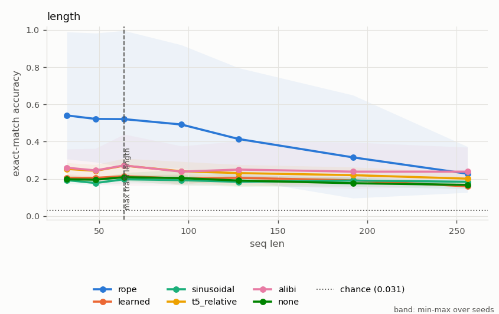
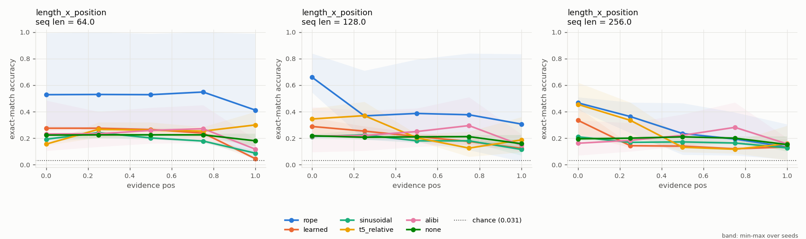
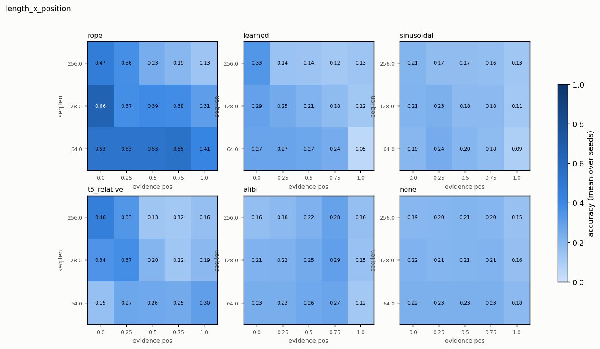
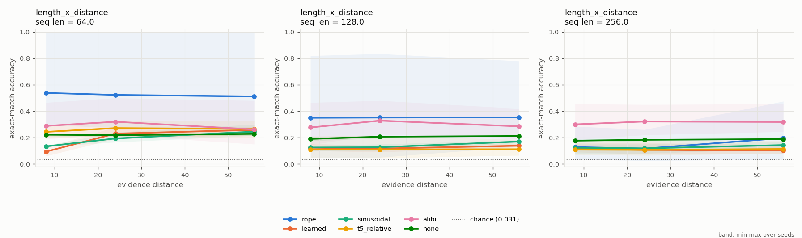
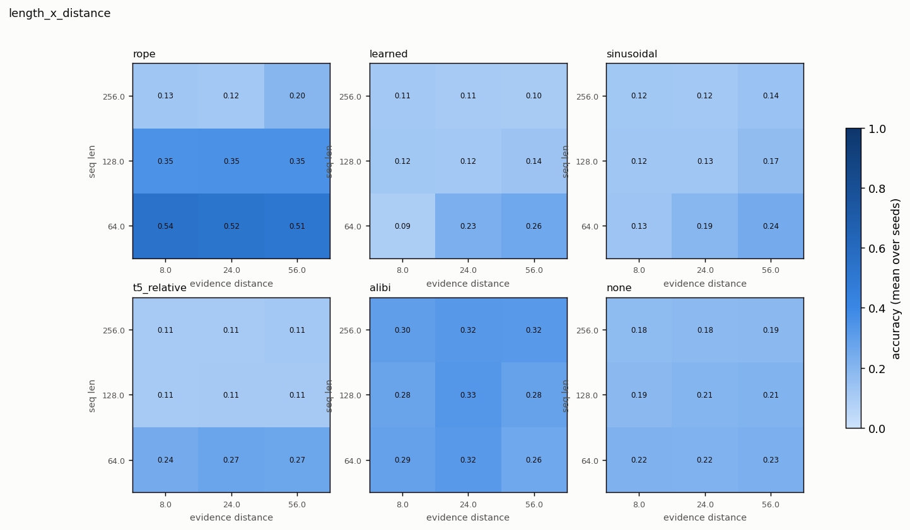
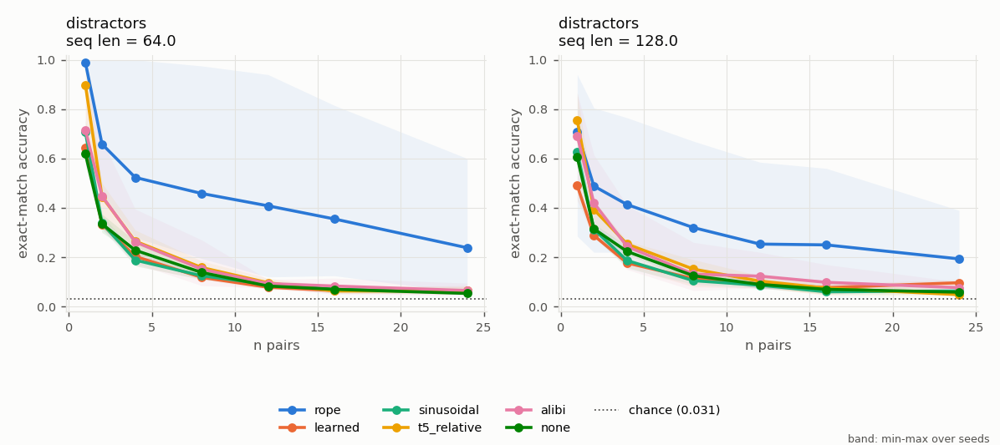
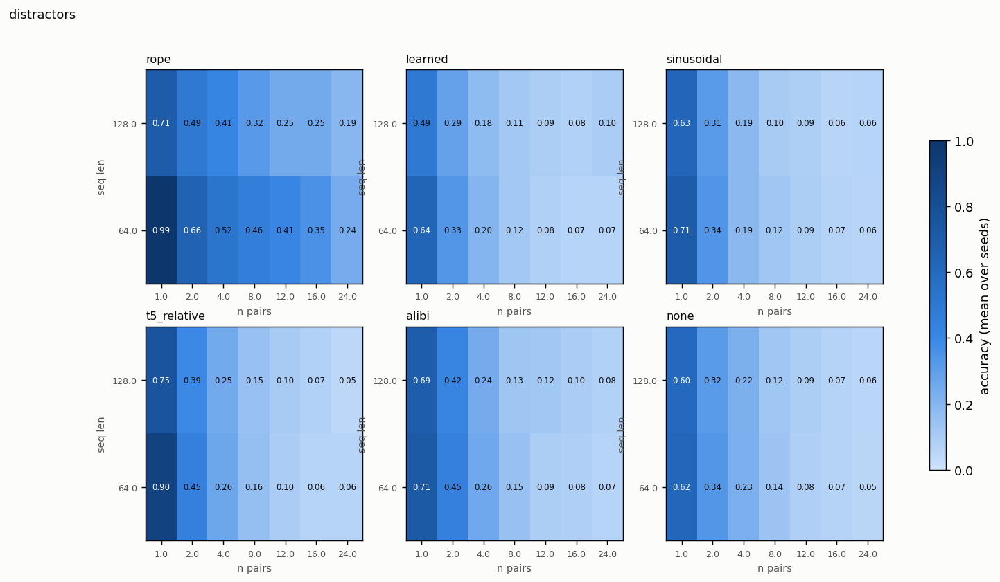
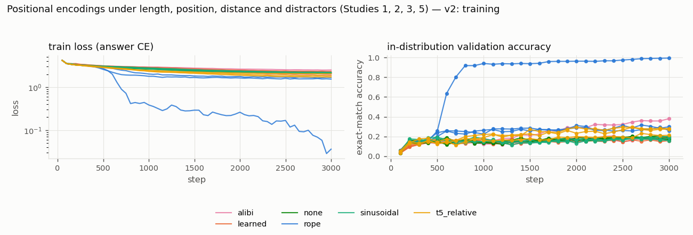

# Positional encodings under length, position, distance and distractors (Studies 1, 2, 3, 5) — v2

*Study id:* `main_pe`  
*Spec:* ``

## Design

**Research question.** With a training recipe under which a 2-layer model learns GENUINE key-value retrieval (verified by counterfactual edits), how does retrieval accuracy depend on sequence length, evidence position, evidence-to-query distance and the number of distractor pairs, and how do six positional representations compare under identical model, data, budget and evaluation examples?

**Hypothesis.** (H1) Models that learn the task retain high accuracy for in-range lengths at every evidence position. (H2) Beyond the training length (64), methods whose attention depends on absolute position (learned, sinusoidal) degrade more than translation-invariant ones (RoPE, T5 bias, ALiBi, NoPE); the learned table degrades most (untrained rows). (H3) More distractor pairs than trained (4) reduce accuracy. Each hypothesis can be falsified by the grids below.

**Independent variables:** pos_method, seq_len, evidence_pos, evidence_distance, n_pairs  
**Controlled variables:** architecture: 2 layers, d_model 64, 2 heads (d_h 32), d_mlp 256, pre-LN (identical attention code), training data: 4 key-value pairs, keys and values from ONE shared vocabulary (no value-type shortcut), key-last queries, every pair queried with HIDDEN answers in 75% of sequences (no elimination shortcut), lengths 24-64, steps (3000), batch size, optimiser, learning-rate schedule, evaluation examples (shared eval_seed; cells paired within each grid)  
**Primary metric:** exact-match accuracy of the answer token (single-query format)  
**Seeds:** [0, 1, 2]  
**Evaluation seed (shared by all runs):** 20261011

**Expected failure modes:** a method fails to learn in distribution (optimisation, not extrapolation) -> flagged by val acc < 0.9; learned absolute table: untrained rows beyond the training length; sinusoidal: unseen absolute phase combinations at long lengths; T5 bias: all distances >= 128 share one bucket; ALiBi: fixed distance penalty limits long-range reads; NoPE: weak positional information; may not form the previous-token step; softmax dilution over more tokens at longer lengths; more candidates with more pairs

**Scope note (transparent reductions):** v2 of this study. v1 (results kept in experiments/results/main_pe_v1_elimination_confounded) was stopped after its training design was found to contain an elimination shortcut. v2 uses the only recipe found to produce genuine retrieval under variable length (calibration probe S3 and study value_type): a fixed number of training pairs (4); variable pair counts (2-8) were not learned within budget (probes S1/S2). Lures are omitted (undefined with a shared vocabulary). Mechanistic analysis on seed 0 only.

## Runs (measured)

| run_id | variant | seed | pos_method | status | elapsed_s | final_val_acc | final_train_loss | steps | n_params |
|---|---|---|---|---|---|---|---|---|---|
| alibi_s0_14edea8d | alibi | 0 | alibi | completed | 426.728 | 0.186 | 2.282 | 3000 | 116736 |
| alibi_s1_48cfd5ce | alibi | 1 | alibi | completed | 424.848 | 0.381 | 1.904 | 3000 | 116736 |
| alibi_s2_58a1d391 | alibi | 2 | alibi | completed | 434.859 | 0.174 | 2.506 | 3000 | 116736 |
| learned_s0_b216759c | learned | 0 | learned | completed | 416.133 | 0.158 | 2.314 | 3000 | 149504 |
| learned_s1_6ad3a80b | learned | 1 | learned | completed | 418.099 | 0.197 | 2.142 | 3000 | 149504 |
| learned_s2_448772ac | learned | 2 | learned | completed | 420.894 | 0.178 | 2.076 | 3000 | 149504 |
| none_s0_3b095ef5 | none | 0 | none | completed | 647.728 | 0.191 | 2.101 | 3000 | 116736 |
| none_s1_e4cb344a | none | 1 | none | completed | 646.892 | 0.184 | 2.143 | 3000 | 116736 |
| none_s2_38e4d4af | none | 2 | none | completed | 655.852 | 0.170 | 2.169 | 3000 | 116736 |
| rope_s0_8f19ac01 | rope | 0 | rope | completed | 528.723 | 0.994 | 0.036 | 3000 | 116736 |
| rope_s1_5e00cee4 | rope | 1 | rope | completed | 531.414 | 0.299 | 1.677 | 3000 | 116736 |
| rope_s2_7938b6b2 | rope | 2 | rope | completed | 535.572 | 0.260 | 1.537 | 3000 | 116736 |
| sinusoidal_s0_7022156b | sinusoidal | 0 | sinusoidal | completed | 439.295 | 0.203 | 2.210 | 3000 | 116736 |
| sinusoidal_s1_98fe67d9 | sinusoidal | 1 | sinusoidal | completed | 437.523 | 0.189 | 2.161 | 3000 | 116736 |
| sinusoidal_s2_a808ee47 | sinusoidal | 2 | sinusoidal | completed | 442.154 | 0.158 | 2.082 | 3000 | 116736 |
| t5_relative_s0_fd015ce8 | t5_relative | 0 | t5_relative | completed | 417.963 | 0.275 | 1.845 | 3000 | 116800 |
| t5_relative_s1_ddadde76 | t5_relative | 1 | t5_relative | completed | 419.664 | 0.213 | 2.046 | 3000 | 116800 |
| t5_relative_s2_6b7d8280 | t5_relative | 2 | t5_relative | completed | 423.949 | 0.279 | 1.721 | 3000 | 116800 |

## Validity flags

* `alibi_s0_14edea8d`: in-distribution val acc 0.186 < 0.90 -> undertrained or unable to learn the task; out-of-distribution failures of this run are NOT evidence about extrapolation.
* `alibi_s1_48cfd5ce`: in-distribution val acc 0.381 < 0.90 -> undertrained or unable to learn the task; out-of-distribution failures of this run are NOT evidence about extrapolation.
* `alibi_s2_58a1d391`: in-distribution val acc 0.174 < 0.90 -> undertrained or unable to learn the task; out-of-distribution failures of this run are NOT evidence about extrapolation.
* `learned_s0_b216759c`: in-distribution val acc 0.158 < 0.90 -> undertrained or unable to learn the task; out-of-distribution failures of this run are NOT evidence about extrapolation.
* `learned_s1_6ad3a80b`: in-distribution val acc 0.197 < 0.90 -> undertrained or unable to learn the task; out-of-distribution failures of this run are NOT evidence about extrapolation.
* `learned_s2_448772ac`: in-distribution val acc 0.178 < 0.90 -> undertrained or unable to learn the task; out-of-distribution failures of this run are NOT evidence about extrapolation.
* `none_s0_3b095ef5`: in-distribution val acc 0.191 < 0.90 -> undertrained or unable to learn the task; out-of-distribution failures of this run are NOT evidence about extrapolation.
* `none_s1_e4cb344a`: in-distribution val acc 0.184 < 0.90 -> undertrained or unable to learn the task; out-of-distribution failures of this run are NOT evidence about extrapolation.
* `none_s2_38e4d4af`: in-distribution val acc 0.170 < 0.90 -> undertrained or unable to learn the task; out-of-distribution failures of this run are NOT evidence about extrapolation.
* `rope_s1_5e00cee4`: in-distribution val acc 0.299 < 0.90 -> undertrained or unable to learn the task; out-of-distribution failures of this run are NOT evidence about extrapolation.
* `rope_s2_7938b6b2`: in-distribution val acc 0.260 < 0.90 -> undertrained or unable to learn the task; out-of-distribution failures of this run are NOT evidence about extrapolation.
* `sinusoidal_s0_7022156b`: in-distribution val acc 0.203 < 0.90 -> undertrained or unable to learn the task; out-of-distribution failures of this run are NOT evidence about extrapolation.
* `sinusoidal_s1_98fe67d9`: in-distribution val acc 0.189 < 0.90 -> undertrained or unable to learn the task; out-of-distribution failures of this run are NOT evidence about extrapolation.
* `sinusoidal_s2_a808ee47`: in-distribution val acc 0.158 < 0.90 -> undertrained or unable to learn the task; out-of-distribution failures of this run are NOT evidence about extrapolation.
* `t5_relative_s0_fd015ce8`: in-distribution val acc 0.275 < 0.90 -> undertrained or unable to learn the task; out-of-distribution failures of this run are NOT evidence about extrapolation.
* `t5_relative_s1_ddadde76`: in-distribution val acc 0.213 < 0.90 -> undertrained or unable to learn the task; out-of-distribution failures of this run are NOT evidence about extrapolation.
* `t5_relative_s2_6b7d8280`: in-distribution val acc 0.279 < 0.90 -> undertrained or unable to learn the task; out-of-distribution failures of this run are NOT evidence about extrapolation.

## Controls (mean, min and max over seeds)

| grid | cell | variant | n_seeds | mean | min | max |
|---|---|---|---|---|---|---|
| control_counterfactual | distractor_edit | alibi | 3 | 0.502 | 0.410 | 0.613 |
| control_counterfactual | distractor_edit | learned | 3 | 0.505 | 0.497 | 0.510 |
| control_counterfactual | distractor_edit | none | 3 | 0.485 | 0.477 | 0.490 |
| control_counterfactual | distractor_edit | rope | 3 | 0.574 | 0.333 | 1.000 |
| control_counterfactual | distractor_edit | sinusoidal | 3 | 0.505 | 0.487 | 0.527 |
| control_counterfactual | distractor_edit | t5_relative | 3 | 0.481 | 0.468 | 0.500 |
| control_counterfactual | evidence_move | alibi | 3 | 0.739 | 0.603 | 0.828 |
| control_counterfactual | evidence_move | learned | 3 | 0.829 | 0.810 | 0.853 |
| control_counterfactual | evidence_move | none | 3 | 0.969 | 0.953 | 1.000 |
| control_counterfactual | evidence_move | rope | 3 | 0.881 | 0.812 | 1.000 |
| control_counterfactual | evidence_move | sinusoidal | 3 | 0.852 | 0.802 | 0.895 |
| control_counterfactual | evidence_move | t5_relative | 3 | 0.800 | 0.728 | 0.940 |
| control_counterfactual | filler_resample | alibi | 3 | 0.845 | 0.830 | 0.858 |
| control_counterfactual | filler_resample | learned | 3 | 0.871 | 0.853 | 0.900 |
| control_counterfactual | filler_resample | none | 3 | 0.930 | 0.905 | 0.975 |
| control_counterfactual | filler_resample | rope | 3 | 0.973 | 0.960 | 0.998 |
| control_counterfactual | filler_resample | sinusoidal | 3 | 0.888 | 0.868 | 0.900 |
| control_counterfactual | filler_resample | t5_relative | 3 | 0.938 | 0.915 | 0.983 |
| control_counterfactual | key_swap | alibi | 3 | 0.251 | 0.147 | 0.427 |
| control_counterfactual | key_swap | learned | 3 | 0.170 | 0.145 | 0.195 |
| control_counterfactual | key_swap | none | 3 | 0.173 | 0.168 | 0.182 |
| control_counterfactual | key_swap | rope | 3 | 0.510 | 0.263 | 1.000 |
| control_counterfactual | key_swap | sinusoidal | 3 | 0.177 | 0.158 | 0.190 |
| control_counterfactual | key_swap | t5_relative | 3 | 0.213 | 0.185 | 0.228 |
| control_counterfactual | value_edit | alibi | 3 | 0.203 | 0.115 | 0.375 |
| control_counterfactual | value_edit | learned | 3 | 0.125 | 0.107 | 0.140 |
| control_counterfactual | value_edit | none | 3 | 0.085 | 0.070 | 0.113 |
| control_counterfactual | value_edit | rope | 3 | 0.498 | 0.225 | 1.000 |
| control_counterfactual | value_edit | sinusoidal | 3 | 0.114 | 0.107 | 0.128 |
| control_counterfactual | value_edit | t5_relative | 3 | 0.198 | 0.113 | 0.258 |
| control_evidence_removed | default | alibi | 3 | 0.027 | 0.015 | 0.035 |
| control_evidence_removed | default | learned | 3 | 0.028 | 0.028 | 0.030 |
| control_evidence_removed | default | none | 3 | 0.028 | 0.022 | 0.035 |
| control_evidence_removed | default | rope | 3 | 0.026 | 0.022 | 0.030 |
| control_evidence_removed | default | sinusoidal | 3 | 0.032 | 0.028 | 0.035 |
| control_evidence_removed | default | t5_relative | 3 | 0.028 | 0.025 | 0.030 |
| control_in_distribution | default | alibi | 3 | 0.260 | 0.142 | 0.458 |
| control_in_distribution | default | learned | 3 | 0.190 | 0.175 | 0.210 |
| control_in_distribution | default | none | 3 | 0.228 | 0.220 | 0.233 |
| control_in_distribution | default | rope | 3 | 0.520 | 0.270 | 1.000 |
| control_in_distribution | default | sinusoidal | 3 | 0.212 | 0.200 | 0.220 |
| control_in_distribution | default | t5_relative | 3 | 0.277 | 0.233 | 0.312 |
| control_position_offset | pos_offset=0 | alibi | 3 | 0.260 | 0.142 | 0.458 |
| control_position_offset | pos_offset=0 | learned | 3 | 0.190 | 0.175 | 0.210 |
| control_position_offset | pos_offset=0 | none | 3 | 0.228 | 0.220 | 0.233 |
| control_position_offset | pos_offset=0 | rope | 3 | 0.520 | 0.270 | 1.000 |
| control_position_offset | pos_offset=0 | sinusoidal | 3 | 0.212 | 0.200 | 0.220 |
| control_position_offset | pos_offset=0 | t5_relative | 3 | 0.277 | 0.233 | 0.312 |
| control_position_offset | pos_offset=192 | alibi | 3 | 0.260 | 0.142 | 0.458 |
| control_position_offset | pos_offset=192 | learned | 3 | 0.188 | 0.170 | 0.207 |
| control_position_offset | pos_offset=192 | none | 3 | 0.228 | 0.220 | 0.233 |
| control_position_offset | pos_offset=192 | rope | 3 | 0.520 | 0.270 | 1.000 |
| control_position_offset | pos_offset=192 | sinusoidal | 3 | 0.205 | 0.200 | 0.212 |
| control_position_offset | pos_offset=192 | t5_relative | 3 | 0.277 | 0.233 | 0.312 |
| control_position_offset | pos_offset=64 | alibi | 3 | 0.260 | 0.142 | 0.458 |
| control_position_offset | pos_offset=64 | learned | 3 | 0.192 | 0.188 | 0.195 |
| control_position_offset | pos_offset=64 | none | 3 | 0.228 | 0.220 | 0.233 |
| control_position_offset | pos_offset=64 | rope | 3 | 0.520 | 0.270 | 1.000 |
| control_position_offset | pos_offset=64 | sinusoidal | 3 | 0.194 | 0.185 | 0.203 |
| control_position_offset | pos_offset=64 | t5_relative | 3 | 0.277 | 0.233 | 0.312 |

## Control metrics per run (measured)

`composition_end_given_both_hops` = accuracy on the chain end among contexts where both single hops were answered correctly (multi-hop only).

| run_id | variant | seed | in_distribution_acc | evidence_removed_acc | chance_acc | cf_distractor_edit_rate | cf_distractor_edit_rate_given_orig_correct | cf_distractor_edit_n | cf_evidence_move_rate | cf_evidence_move_rate_given_orig_correct | cf_evidence_move_n | cf_filler_resample_rate | cf_filler_resample_rate_given_orig_correct | cf_filler_resample_n | cf_key_swap_rate | cf_key_swap_rate_given_orig_correct | cf_key_swap_n | cf_key_swap_shortcut_reference | cf_value_edit_rate | cf_value_edit_rate_given_orig_correct | cf_value_edit_n | cf_value_edit_shortcut_reference | pos_offset_0_acc | pos_offset_64_acc | pos_offset_192_acc |
|---|---|---|---|---|---|---|---|---|---|---|---|---|---|---|---|---|---|---|---|---|---|---|---|---|---|
| alibi_s0_14edea8d | alibi | 0 | 0.142 | 0.015 | 0.031 | 0.410 | 0.614 | 400 | 0.787 | 0.737 | 400 | 0.830 | 0.912 | 400 | 0.177 | 0.000 | 400 | 0.250 | 0.117 | 0.123 | 400 | 0.250 | 0.142 | 0.142 | 0.142 |
| alibi_s1_48cfd5ce | alibi | 1 | 0.458 | 0.035 | 0.031 | 0.613 | 0.787 | 400 | 0.603 | 0.650 | 400 | 0.858 | 0.902 | 400 | 0.427 | 0.475 | 400 | 0.250 | 0.375 | 0.568 | 400 | 0.250 | 0.458 | 0.458 | 0.458 |
| alibi_s2_58a1d391 | alibi | 2 | 0.180 | 0.030 | 0.031 | 0.485 | 0.556 | 400 | 0.828 | 0.861 | 400 | 0.848 | 0.917 | 400 | 0.147 | 0.042 | 400 | 0.250 | 0.115 | 0.153 | 400 | 0.250 | 0.180 | 0.180 | 0.180 |
| learned_s0_b216759c | learned | 0 | 0.175 | 0.030 | 0.031 | 0.507 | 0.629 | 400 | 0.810 | 0.843 | 400 | 0.860 | 0.886 | 400 | 0.145 | 0.014 | 400 | 0.250 | 0.140 | 0.200 | 400 | 0.250 | 0.175 | 0.195 | 0.170 |
| learned_s1_6ad3a80b | learned | 1 | 0.210 | 0.028 | 0.031 | 0.510 | 0.631 | 400 | 0.853 | 0.845 | 400 | 0.900 | 0.905 | 400 | 0.195 | 0.024 | 400 | 0.250 | 0.107 | 0.190 | 400 | 0.250 | 0.210 | 0.193 | 0.207 |
| learned_s2_448772ac | learned | 2 | 0.185 | 0.028 | 0.031 | 0.497 | 0.716 | 400 | 0.825 | 0.797 | 400 | 0.853 | 0.838 | 400 | 0.170 | 0.027 | 400 | 0.250 | 0.128 | 0.189 | 400 | 0.250 | 0.185 | 0.188 | 0.188 |
| none_s0_3b095ef5 | none | 0 | 0.230 | 0.035 | 0.031 | 0.490 | 0.717 | 400 | 0.953 | 0.967 | 400 | 0.905 | 0.935 | 400 | 0.182 | 0.011 | 400 | 0.250 | 0.072 | 0.087 | 400 | 0.250 | 0.230 | 0.230 | 0.230 |
| none_s1_e4cb344a | none | 1 | 0.220 | 0.022 | 0.031 | 0.477 | 0.636 | 400 | 0.955 | 0.966 | 400 | 0.910 | 0.955 | 400 | 0.170 | 0.000 | 400 | 0.250 | 0.113 | 0.170 | 400 | 0.250 | 0.220 | 0.220 | 0.220 |
| none_s2_38e4d4af | none | 2 | 0.233 | 0.028 | 0.031 | 0.487 | 0.645 | 400 | 1.000 | 1.000 | 400 | 0.975 | 1.000 | 400 | 0.168 | 0.000 | 400 | 0.250 | 0.070 | 0.129 | 400 | 0.250 | 0.233 | 0.233 | 0.233 |
| rope_s0_8f19ac01 | rope | 0 | 1.000 | 0.022 | 0.031 | 1.000 | 1.000 | 400 | 1.000 | 1.000 | 400 | 0.998 | 0.998 | 400 | 1.000 | 1.000 | 400 | 0.250 | 1.000 | 1.000 | 400 | 0.250 | 1.000 | 1.000 | 1.000 |
| rope_s1_5e00cee4 | rope | 1 | 0.290 | 0.030 | 0.031 | 0.333 | 0.526 | 400 | 0.812 | 0.784 | 400 | 0.960 | 0.966 | 400 | 0.263 | 0.009 | 400 | 0.250 | 0.270 | 0.405 | 400 | 0.250 | 0.290 | 0.290 | 0.290 |
| rope_s2_7938b6b2 | rope | 2 | 0.270 | 0.025 | 0.031 | 0.390 | 0.481 | 400 | 0.830 | 0.806 | 400 | 0.960 | 0.972 | 400 | 0.268 | 0.037 | 400 | 0.250 | 0.225 | 0.296 | 400 | 0.250 | 0.270 | 0.270 | 0.270 |
| sinusoidal_s0_7022156b | sinusoidal | 0 | 0.200 | 0.033 | 0.031 | 0.500 | 0.650 | 400 | 0.802 | 0.800 | 400 | 0.868 | 0.900 | 400 | 0.158 | 0.037 | 400 | 0.250 | 0.107 | 0.150 | 400 | 0.250 | 0.200 | 0.195 | 0.203 |
| sinusoidal_s1_98fe67d9 | sinusoidal | 1 | 0.220 | 0.028 | 0.031 | 0.527 | 0.636 | 400 | 0.858 | 0.841 | 400 | 0.900 | 0.898 | 400 | 0.182 | 0.011 | 400 | 0.250 | 0.128 | 0.182 | 400 | 0.250 | 0.220 | 0.185 | 0.200 |
| sinusoidal_s2_a808ee47 | sinusoidal | 2 | 0.215 | 0.035 | 0.031 | 0.487 | 0.721 | 400 | 0.895 | 0.930 | 400 | 0.895 | 0.942 | 400 | 0.190 | 0.012 | 400 | 0.250 | 0.107 | 0.151 | 400 | 0.250 | 0.215 | 0.203 | 0.212 |
| t5_relative_s0_fd015ce8 | t5_relative | 0 | 0.285 | 0.025 | 0.031 | 0.500 | 0.632 | 400 | 0.728 | 0.667 | 400 | 0.915 | 0.921 | 400 | 0.225 | 0.026 | 400 | 0.250 | 0.258 | 0.439 | 400 | 0.250 | 0.285 | 0.285 | 0.285 |
| t5_relative_s1_ddadde76 | t5_relative | 1 | 0.233 | 0.030 | 0.031 | 0.475 | 0.602 | 400 | 0.940 | 0.925 | 400 | 0.983 | 0.989 | 400 | 0.185 | 0.000 | 400 | 0.250 | 0.113 | 0.172 | 400 | 0.250 | 0.233 | 0.233 | 0.233 |
| t5_relative_s2_6b7d8280 | t5_relative | 2 | 0.312 | 0.028 | 0.031 | 0.468 | 0.592 | 400 | 0.733 | 0.656 | 400 | 0.917 | 0.912 | 400 | 0.228 | 0.016 | 400 | 0.250 | 0.223 | 0.344 | 400 | 0.250 | 0.312 | 0.312 | 0.312 |

## Grid `length` (derived: mean across seeds; t-interval over seeds)

| grid | variant | cell_seq_len | n_seeds | n_per_seed | mean | std | min | max | t_lo | t_hi |
|---|---|---|---|---|---|---|---|---|---|---|
| length | alibi | 32 | 3 | 300 | 0.260 | 0.088 | 0.193 | 0.360 | 0.041 | 0.479 |
| length | alibi | 48 | 3 | 300 | 0.246 | 0.103 | 0.170 | 0.363 | -0.011 | 0.502 |
| length | alibi | 64 | 3 | 300 | 0.272 | 0.147 | 0.163 | 0.440 | -0.094 | 0.638 |
| length | alibi | 96 | 3 | 300 | 0.239 | 0.119 | 0.167 | 0.377 | -0.058 | 0.535 |
| length | alibi | 128 | 3 | 300 | 0.250 | 0.133 | 0.170 | 0.403 | -0.080 | 0.580 |
| length | alibi | 192 | 3 | 300 | 0.239 | 0.137 | 0.147 | 0.397 | -0.102 | 0.580 |
| length | alibi | 256 | 3 | 300 | 0.239 | 0.114 | 0.167 | 0.370 | -0.044 | 0.521 |
| length | learned | 32 | 3 | 300 | 0.206 | 0.019 | 0.190 | 0.227 | 0.158 | 0.253 |
| length | learned | 48 | 3 | 300 | 0.206 | 0.011 | 0.193 | 0.213 | 0.179 | 0.232 |
| length | learned | 64 | 3 | 300 | 0.214 | 0.004 | 0.210 | 0.217 | 0.205 | 0.224 |
| length | learned | 96 | 3 | 300 | 0.202 | 0.029 | 0.170 | 0.227 | 0.130 | 0.275 |
| length | learned | 128 | 3 | 300 | 0.206 | 0.010 | 0.200 | 0.217 | 0.182 | 0.229 |
| length | learned | 192 | 3 | 300 | 0.192 | 0.015 | 0.183 | 0.210 | 0.154 | 0.230 |
| length | learned | 256 | 3 | 300 | 0.160 | 0.003 | 0.157 | 0.163 | 0.152 | 0.168 |
| length | none | 32 | 3 | 300 | 0.198 | 0.019 | 0.187 | 0.220 | 0.150 | 0.246 |
| length | none | 48 | 3 | 300 | 0.196 | 0.012 | 0.183 | 0.207 | 0.166 | 0.225 |
| length | none | 64 | 3 | 300 | 0.209 | 0.022 | 0.190 | 0.233 | 0.154 | 0.264 |
| length | none | 96 | 3 | 300 | 0.204 | 0.042 | 0.167 | 0.250 | 0.100 | 0.309 |
| length | none | 128 | 3 | 300 | 0.191 | 0.032 | 0.160 | 0.223 | 0.112 | 0.270 |
| length | none | 192 | 3 | 300 | 0.177 | 0.026 | 0.160 | 0.207 | 0.112 | 0.241 |
| length | none | 256 | 3 | 300 | 0.168 | 0.020 | 0.147 | 0.187 | 0.118 | 0.218 |
| length | rope | 32 | 3 | 300 | 0.541 | 0.389 | 0.307 | 0.990 | -0.425 | 1.507 |
| length | rope | 48 | 3 | 300 | 0.522 | 0.399 | 0.290 | 0.983 | -0.470 | 1.514 |
| length | rope | 64 | 3 | 300 | 0.521 | 0.412 | 0.263 | 0.997 | -0.503 | 1.545 |
| length | rope | 96 | 3 | 300 | 0.492 | 0.371 | 0.257 | 0.920 | -0.430 | 1.414 |
| length | rope | 128 | 3 | 300 | 0.414 | 0.332 | 0.200 | 0.797 | -0.410 | 1.239 |
| length | rope | 192 | 3 | 300 | 0.316 | 0.294 | 0.097 | 0.650 | -0.415 | 1.046 |
| length | rope | 256 | 3 | 300 | 0.228 | 0.129 | 0.127 | 0.373 | -0.093 | 0.549 |
| length | sinusoidal | 32 | 3 | 300 | 0.193 | 0.022 | 0.173 | 0.217 | 0.139 | 0.248 |
| length | sinusoidal | 48 | 3 | 300 | 0.178 | 0.007 | 0.170 | 0.183 | 0.161 | 0.195 |
| length | sinusoidal | 64 | 3 | 300 | 0.198 | 0.024 | 0.177 | 0.223 | 0.139 | 0.257 |
| length | sinusoidal | 96 | 3 | 300 | 0.193 | 0.026 | 0.177 | 0.223 | 0.129 | 0.258 |
| length | sinusoidal | 128 | 3 | 300 | 0.184 | 0.005 | 0.180 | 0.190 | 0.172 | 0.197 |
| length | sinusoidal | 192 | 3 | 300 | 0.191 | 0.020 | 0.177 | 0.213 | 0.143 | 0.240 |
| length | sinusoidal | 256 | 3 | 300 | 0.184 | 0.004 | 0.180 | 0.187 | 0.175 | 0.194 |
| length | t5_relative | 32 | 3 | 300 | 0.253 | 0.044 | 0.203 | 0.287 | 0.144 | 0.363 |
| length | t5_relative | 48 | 3 | 300 | 0.243 | 0.037 | 0.203 | 0.277 | 0.151 | 0.336 |
| length | t5_relative | 64 | 3 | 300 | 0.271 | 0.059 | 0.203 | 0.310 | 0.125 | 0.417 |
| length | t5_relative | 96 | 3 | 300 | 0.241 | 0.053 | 0.187 | 0.293 | 0.109 | 0.374 |
| length | t5_relative | 128 | 3 | 300 | 0.231 | 0.062 | 0.160 | 0.277 | 0.076 | 0.386 |
| length | t5_relative | 192 | 3 | 300 | 0.220 | 0.043 | 0.177 | 0.263 | 0.112 | 0.328 |
| length | t5_relative | 256 | 3 | 300 | 0.201 | 0.032 | 0.173 | 0.237 | 0.121 | 0.282 |

Baselines on the identical examples (reference):

| cell_seq_len | oracle | naive_induction | last_value | random_context | elimination | chance | best_fixed_offset | best_fixed_offset_d | cell_evidence_pos | cell_evidence_distance | cell_n_pairs |
|---|---|---|---|---|---|---|---|---|---|---|---|
| 32 | 1.000 | 0.933 | 0.300 | 0.271 | 0.271 | 0.031 | 0.077 | 25 | nan | nan | nan |
| 48 | 1.000 | 0.933 | 0.283 | 0.271 | 0.271 | 0.031 | 0.050 | 14 | nan | nan | nan |
| 64 | 1.000 | 0.937 | 0.287 | 0.271 | 0.271 | 0.031 | 0.043 | 17 | nan | nan | nan |
| 96 | 1.000 | 0.937 | 0.283 | 0.271 | 0.271 | 0.031 | 0.040 | 60 | nan | nan | nan |
| 128 | 1.000 | 0.930 | 0.280 | 0.271 | 0.271 | 0.031 | 0.023 | 33 | nan | nan | nan |
| 192 | 1.000 | 0.930 | 0.273 | 0.271 | 0.271 | 0.031 | 0.023 | 49 | nan | nan | nan |
| 256 | 1.000 | 0.930 | 0.293 | 0.271 | 0.271 | 0.031 | 0.020 | 60 | nan | nan | nan |

## Grid `length_x_position` (derived: mean across seeds; t-interval over seeds)

| grid | variant | cell_seq_len | cell_evidence_pos | n_seeds | n_per_seed | mean | std | min | max | t_lo | t_hi |
|---|---|---|---|---|---|---|---|---|---|---|---|
| length_x_position | alibi | 64 | 0.000 | 3 | 200 | 0.232 | 0.219 | 0.105 | 0.485 | -0.313 | 0.777 |
| length_x_position | alibi | 64 | 0.250 | 3 | 200 | 0.233 | 0.145 | 0.135 | 0.400 | -0.127 | 0.594 |
| length_x_position | alibi | 64 | 0.500 | 3 | 200 | 0.258 | 0.149 | 0.160 | 0.430 | -0.112 | 0.629 |
| length_x_position | alibi | 64 | 0.750 | 3 | 200 | 0.272 | 0.155 | 0.165 | 0.450 | -0.114 | 0.658 |
| length_x_position | alibi | 64 | 1.000 | 3 | 200 | 0.117 | 0.064 | 0.080 | 0.190 | -0.041 | 0.274 |
| length_x_position | alibi | 128 | 0.000 | 3 | 200 | 0.215 | 0.191 | 0.095 | 0.435 | -0.259 | 0.689 |
| length_x_position | alibi | 128 | 0.250 | 3 | 200 | 0.220 | 0.166 | 0.105 | 0.410 | -0.192 | 0.632 |
| length_x_position | alibi | 128 | 0.500 | 3 | 200 | 0.250 | 0.154 | 0.135 | 0.425 | -0.133 | 0.633 |
| length_x_position | alibi | 128 | 0.750 | 3 | 200 | 0.295 | 0.189 | 0.155 | 0.510 | -0.175 | 0.765 |
| length_x_position | alibi | 128 | 1.000 | 3 | 200 | 0.147 | 0.072 | 0.100 | 0.230 | -0.033 | 0.326 |
| length_x_position | alibi | 256 | 0.000 | 3 | 200 | 0.162 | 0.150 | 0.070 | 0.335 | -0.211 | 0.535 |
| length_x_position | alibi | 256 | 0.250 | 3 | 200 | 0.183 | 0.115 | 0.100 | 0.315 | -0.103 | 0.470 |
| length_x_position | alibi | 256 | 0.500 | 3 | 200 | 0.222 | 0.137 | 0.140 | 0.380 | -0.119 | 0.562 |
| length_x_position | alibi | 256 | 0.750 | 3 | 200 | 0.282 | 0.165 | 0.165 | 0.470 | -0.127 | 0.691 |
| length_x_position | alibi | 256 | 1.000 | 3 | 200 | 0.157 | 0.039 | 0.125 | 0.200 | 0.060 | 0.253 |
| length_x_position | learned | 64 | 0.000 | 3 | 200 | 0.275 | 0.020 | 0.255 | 0.295 | 0.225 | 0.325 |
| length_x_position | learned | 64 | 0.250 | 3 | 200 | 0.275 | 0.009 | 0.270 | 0.285 | 0.253 | 0.297 |
| length_x_position | learned | 64 | 0.500 | 3 | 200 | 0.265 | 0.018 | 0.245 | 0.280 | 0.220 | 0.310 |
| length_x_position | learned | 64 | 0.750 | 3 | 200 | 0.238 | 0.051 | 0.180 | 0.270 | 0.113 | 0.364 |
| length_x_position | learned | 64 | 1.000 | 3 | 200 | 0.045 | 0.005 | 0.040 | 0.050 | 0.033 | 0.057 |
| length_x_position | learned | 128 | 0.000 | 3 | 200 | 0.288 | 0.061 | 0.235 | 0.355 | 0.137 | 0.440 |
| length_x_position | learned | 128 | 0.250 | 3 | 200 | 0.253 | 0.038 | 0.215 | 0.290 | 0.160 | 0.347 |
| length_x_position | learned | 128 | 0.500 | 3 | 200 | 0.213 | 0.031 | 0.180 | 0.240 | 0.137 | 0.289 |
| length_x_position | learned | 128 | 0.750 | 3 | 200 | 0.175 | 0.033 | 0.145 | 0.210 | 0.094 | 0.256 |
| length_x_position | learned | 128 | 1.000 | 3 | 200 | 0.123 | 0.010 | 0.115 | 0.135 | 0.097 | 0.149 |
| length_x_position | learned | 256 | 0.000 | 3 | 200 | 0.335 | 0.103 | 0.225 | 0.430 | 0.078 | 0.592 |
| length_x_position | learned | 256 | 0.250 | 3 | 200 | 0.143 | 0.013 | 0.130 | 0.155 | 0.112 | 0.175 |
| length_x_position | learned | 256 | 0.500 | 3 | 200 | 0.140 | 0.018 | 0.125 | 0.160 | 0.095 | 0.185 |
| length_x_position | learned | 256 | 0.750 | 3 | 200 | 0.120 | 0.009 | 0.110 | 0.125 | 0.098 | 0.142 |
| length_x_position | learned | 256 | 1.000 | 3 | 200 | 0.133 | 0.010 | 0.125 | 0.145 | 0.107 | 0.159 |
| length_x_position | none | 64 | 0.000 | 3 | 200 | 0.223 | 0.025 | 0.195 | 0.240 | 0.162 | 0.285 |
| length_x_position | none | 64 | 0.250 | 3 | 200 | 0.225 | 0.022 | 0.200 | 0.240 | 0.171 | 0.279 |
| length_x_position | none | 64 | 0.500 | 3 | 200 | 0.225 | 0.022 | 0.200 | 0.240 | 0.171 | 0.279 |
| length_x_position | none | 64 | 0.750 | 3 | 200 | 0.225 | 0.013 | 0.210 | 0.235 | 0.192 | 0.258 |
| length_x_position | none | 64 | 1.000 | 3 | 200 | 0.180 | 0.049 | 0.140 | 0.235 | 0.058 | 0.302 |
| length_x_position | none | 128 | 0.000 | 3 | 200 | 0.218 | 0.010 | 0.210 | 0.230 | 0.192 | 0.244 |
| length_x_position | none | 128 | 0.250 | 3 | 200 | 0.207 | 0.018 | 0.190 | 0.225 | 0.163 | 0.250 |
| length_x_position | none | 128 | 0.500 | 3 | 200 | 0.210 | 0.015 | 0.195 | 0.225 | 0.173 | 0.247 |
| length_x_position | none | 128 | 0.750 | 3 | 200 | 0.212 | 0.015 | 0.195 | 0.225 | 0.174 | 0.250 |
| length_x_position | none | 128 | 1.000 | 3 | 200 | 0.158 | 0.060 | 0.110 | 0.225 | 0.010 | 0.307 |
| length_x_position | none | 256 | 0.000 | 3 | 200 | 0.195 | 0.018 | 0.180 | 0.215 | 0.150 | 0.240 |
| length_x_position | none | 256 | 0.250 | 3 | 200 | 0.200 | 0.018 | 0.180 | 0.215 | 0.155 | 0.245 |
| length_x_position | none | 256 | 0.500 | 3 | 200 | 0.210 | 0.013 | 0.195 | 0.220 | 0.177 | 0.243 |
| length_x_position | none | 256 | 0.750 | 3 | 200 | 0.200 | 0.018 | 0.180 | 0.215 | 0.155 | 0.245 |
| length_x_position | none | 256 | 1.000 | 3 | 200 | 0.152 | 0.058 | 0.100 | 0.215 | 0.007 | 0.297 |
| length_x_position | rope | 64 | 0.000 | 3 | 200 | 0.528 | 0.404 | 0.285 | 0.995 | -0.476 | 1.533 |
| length_x_position | rope | 64 | 0.250 | 3 | 200 | 0.530 | 0.409 | 0.260 | 1.000 | -0.485 | 1.545 |
| length_x_position | rope | 64 | 0.500 | 3 | 200 | 0.528 | 0.402 | 0.255 | 0.990 | -0.470 | 1.527 |
| length_x_position | rope | 64 | 0.750 | 3 | 200 | 0.548 | 0.393 | 0.290 | 1.000 | -0.427 | 1.523 |
| length_x_position | rope | 64 | 1.000 | 3 | 200 | 0.412 | 0.510 | 0.025 | 0.990 | -0.856 | 1.679 |
| length_x_position | rope | 128 | 0.000 | 3 | 200 | 0.660 | 0.158 | 0.545 | 0.840 | 0.268 | 1.052 |
| length_x_position | rope | 128 | 0.250 | 3 | 200 | 0.368 | 0.296 | 0.190 | 0.710 | -0.367 | 1.104 |
| length_x_position | rope | 128 | 0.500 | 3 | 200 | 0.387 | 0.354 | 0.170 | 0.795 | -0.492 | 1.266 |
| length_x_position | rope | 128 | 0.750 | 3 | 200 | 0.377 | 0.403 | 0.110 | 0.840 | -0.624 | 1.377 |
| length_x_position | rope | 128 | 1.000 | 3 | 200 | 0.307 | 0.458 | 0.025 | 0.835 | -0.831 | 1.444 |
| length_x_position | rope | 256 | 0.000 | 3 | 200 | 0.467 | 0.048 | 0.415 | 0.510 | 0.347 | 0.586 |
| length_x_position | rope | 256 | 0.250 | 3 | 200 | 0.363 | 0.116 | 0.240 | 0.470 | 0.075 | 0.651 |
| length_x_position | rope | 256 | 0.500 | 3 | 200 | 0.235 | 0.204 | 0.075 | 0.465 | -0.272 | 0.742 |
| length_x_position | rope | 256 | 0.750 | 3 | 200 | 0.193 | 0.176 | 0.070 | 0.395 | -0.244 | 0.631 |
| length_x_position | rope | 256 | 1.000 | 3 | 200 | 0.133 | 0.149 | 0.040 | 0.305 | -0.236 | 0.503 |
| length_x_position | sinusoidal | 64 | 0.000 | 3 | 200 | 0.192 | 0.018 | 0.175 | 0.210 | 0.148 | 0.235 |
| length_x_position | sinusoidal | 64 | 0.250 | 3 | 200 | 0.242 | 0.037 | 0.200 | 0.270 | 0.150 | 0.333 |
| length_x_position | sinusoidal | 64 | 0.500 | 3 | 200 | 0.202 | 0.013 | 0.190 | 0.215 | 0.170 | 0.233 |
| length_x_position | sinusoidal | 64 | 0.750 | 3 | 200 | 0.178 | 0.013 | 0.165 | 0.190 | 0.147 | 0.210 |
| length_x_position | sinusoidal | 64 | 1.000 | 3 | 200 | 0.087 | 0.023 | 0.065 | 0.110 | 0.031 | 0.143 |
| length_x_position | sinusoidal | 128 | 0.000 | 3 | 200 | 0.212 | 0.018 | 0.195 | 0.230 | 0.168 | 0.255 |
| length_x_position | sinusoidal | 128 | 0.250 | 3 | 200 | 0.225 | 0.038 | 0.190 | 0.265 | 0.131 | 0.319 |
| length_x_position | sinusoidal | 128 | 0.500 | 3 | 200 | 0.180 | 0.022 | 0.165 | 0.205 | 0.126 | 0.234 |
| length_x_position | sinusoidal | 128 | 0.750 | 3 | 200 | 0.180 | 0.010 | 0.170 | 0.190 | 0.155 | 0.205 |
| length_x_position | sinusoidal | 128 | 1.000 | 3 | 200 | 0.115 | 0.043 | 0.070 | 0.155 | 0.009 | 0.221 |
| length_x_position | sinusoidal | 256 | 0.000 | 3 | 200 | 0.210 | 0.010 | 0.200 | 0.220 | 0.185 | 0.235 |
| length_x_position | sinusoidal | 256 | 0.250 | 3 | 200 | 0.168 | 0.010 | 0.160 | 0.180 | 0.142 | 0.194 |
| length_x_position | sinusoidal | 256 | 0.500 | 3 | 200 | 0.172 | 0.021 | 0.155 | 0.195 | 0.120 | 0.223 |
| length_x_position | sinusoidal | 256 | 0.750 | 3 | 200 | 0.163 | 0.010 | 0.155 | 0.175 | 0.137 | 0.189 |
| length_x_position | sinusoidal | 256 | 1.000 | 3 | 200 | 0.127 | 0.012 | 0.120 | 0.140 | 0.098 | 0.155 |
| length_x_position | t5_relative | 64 | 0.000 | 3 | 200 | 0.155 | 0.009 | 0.145 | 0.160 | 0.133 | 0.177 |
| length_x_position | t5_relative | 64 | 0.250 | 3 | 200 | 0.267 | 0.058 | 0.205 | 0.320 | 0.123 | 0.411 |
| length_x_position | t5_relative | 64 | 0.500 | 3 | 200 | 0.260 | 0.052 | 0.230 | 0.320 | 0.131 | 0.389 |
| length_x_position | t5_relative | 64 | 0.750 | 3 | 200 | 0.253 | 0.028 | 0.230 | 0.285 | 0.183 | 0.324 |
| length_x_position | t5_relative | 64 | 1.000 | 3 | 200 | 0.300 | 0.144 | 0.135 | 0.400 | -0.058 | 0.658 |
| length_x_position | t5_relative | 128 | 0.000 | 3 | 200 | 0.345 | 0.110 | 0.220 | 0.425 | 0.073 | 0.617 |
| length_x_position | t5_relative | 128 | 0.250 | 3 | 200 | 0.370 | 0.133 | 0.220 | 0.475 | 0.039 | 0.701 |
| length_x_position | t5_relative | 128 | 0.500 | 3 | 200 | 0.203 | 0.025 | 0.180 | 0.230 | 0.141 | 0.266 |
| length_x_position | t5_relative | 128 | 0.750 | 3 | 200 | 0.125 | 0.108 | 0.060 | 0.250 | -0.144 | 0.394 |
| length_x_position | t5_relative | 128 | 1.000 | 3 | 200 | 0.187 | 0.150 | 0.095 | 0.360 | -0.186 | 0.560 |
| length_x_position | t5_relative | 256 | 0.000 | 3 | 200 | 0.455 | 0.209 | 0.220 | 0.620 | -0.064 | 0.974 |
| length_x_position | t5_relative | 256 | 0.250 | 3 | 200 | 0.335 | 0.128 | 0.215 | 0.470 | 0.017 | 0.653 |
| length_x_position | t5_relative | 256 | 0.500 | 3 | 200 | 0.132 | 0.064 | 0.095 | 0.205 | -0.026 | 0.289 |
| length_x_position | t5_relative | 256 | 0.750 | 3 | 200 | 0.117 | 0.051 | 0.085 | 0.175 | -0.009 | 0.242 |
| length_x_position | t5_relative | 256 | 1.000 | 3 | 200 | 0.158 | 0.131 | 0.035 | 0.295 | -0.166 | 0.483 |

Baselines on the identical examples (reference):

| cell_seq_len | oracle | naive_induction | last_value | random_context | elimination | chance | best_fixed_offset | best_fixed_offset_d | cell_evidence_pos | cell_evidence_distance | cell_n_pairs |
|---|---|---|---|---|---|---|---|---|---|---|---|
| 64 | 1.000 | 0.885 | 0.035 | 0.273 | 0.273 | 0.031 | 1.000 | 61 | 0.000 | nan | nan |
| 64 | 1.000 | 0.905 | 0.045 | 0.273 | 0.273 | 0.031 | 1.000 | 46 | 0.250 | nan | nan |
| 64 | 1.000 | 0.925 | 0.165 | 0.273 | 0.273 | 0.031 | 1.000 | 31 | 0.500 | nan | nan |
| 64 | 1.000 | 0.945 | 0.455 | 0.273 | 0.273 | 0.031 | 1.000 | 17 | 0.750 | nan | nan |
| 64 | 1.000 | 1.000 | 1.000 | 0.273 | 0.273 | 0.031 | 1.000 | 2 | 1.000 | nan | nan |
| 128 | 1.000 | 0.885 | 0.025 | 0.273 | 0.273 | 0.031 | 1.000 | 125 | 0.000 | nan | nan |
| 128 | 1.000 | 0.900 | 0.050 | 0.273 | 0.273 | 0.031 | 1.000 | 94 | 0.250 | nan | nan |
| 128 | 1.000 | 0.920 | 0.155 | 0.273 | 0.273 | 0.031 | 1.000 | 63 | 0.500 | nan | nan |
| 128 | 1.000 | 0.945 | 0.470 | 0.273 | 0.273 | 0.031 | 1.000 | 33 | 0.750 | nan | nan |
| 128 | 1.000 | 1.000 | 1.000 | 0.273 | 0.273 | 0.031 | 1.000 | 2 | 1.000 | nan | nan |
| 256 | 1.000 | 0.885 | 0.040 | 0.273 | 0.273 | 0.031 | 1.000 | 253 | 0.000 | nan | nan |
| 256 | 1.000 | 0.900 | 0.050 | 0.273 | 0.273 | 0.031 | 1.000 | 190 | 0.250 | nan | nan |
| 256 | 1.000 | 0.920 | 0.155 | 0.273 | 0.273 | 0.031 | 1.000 | 127 | 0.500 | nan | nan |
| 256 | 1.000 | 0.940 | 0.460 | 0.273 | 0.273 | 0.031 | 1.000 | 65 | 0.750 | nan | nan |
| 256 | 1.000 | 1.000 | 1.000 | 0.273 | 0.273 | 0.031 | 1.000 | 2 | 1.000 | nan | nan |

## Grid `length_x_distance` (derived: mean across seeds; t-interval over seeds)

| grid | variant | cell_seq_len | cell_evidence_distance | n_seeds | n_per_seed | mean | std | min | max | t_lo | t_hi |
|---|---|---|---|---|---|---|---|---|---|---|---|
| length_x_distance | alibi | 64 | 8 | 3 | 200 | 0.288 | 0.153 | 0.190 | 0.465 | -0.093 | 0.669 |
| length_x_distance | alibi | 64 | 24 | 3 | 200 | 0.320 | 0.156 | 0.220 | 0.500 | -0.068 | 0.708 |
| length_x_distance | alibi | 64 | 56 | 3 | 200 | 0.262 | 0.189 | 0.150 | 0.480 | -0.208 | 0.731 |
| length_x_distance | alibi | 128 | 8 | 3 | 200 | 0.277 | 0.167 | 0.145 | 0.465 | -0.139 | 0.692 |
| length_x_distance | alibi | 128 | 24 | 3 | 200 | 0.328 | 0.134 | 0.225 | 0.480 | -0.005 | 0.662 |
| length_x_distance | alibi | 128 | 56 | 3 | 200 | 0.285 | 0.120 | 0.190 | 0.420 | -0.013 | 0.583 |
| length_x_distance | alibi | 256 | 8 | 3 | 200 | 0.300 | 0.139 | 0.185 | 0.455 | -0.046 | 0.646 |
| length_x_distance | alibi | 256 | 24 | 3 | 200 | 0.322 | 0.117 | 0.220 | 0.450 | 0.030 | 0.613 |
| length_x_distance | alibi | 256 | 56 | 3 | 200 | 0.318 | 0.118 | 0.245 | 0.455 | 0.024 | 0.613 |
| length_x_distance | learned | 64 | 8 | 3 | 200 | 0.093 | 0.033 | 0.060 | 0.125 | 0.013 | 0.174 |
| length_x_distance | learned | 64 | 24 | 3 | 200 | 0.230 | 0.046 | 0.190 | 0.280 | 0.116 | 0.344 |
| length_x_distance | learned | 64 | 56 | 3 | 200 | 0.258 | 0.033 | 0.220 | 0.280 | 0.176 | 0.341 |
| length_x_distance | learned | 128 | 8 | 3 | 200 | 0.123 | 0.028 | 0.100 | 0.155 | 0.053 | 0.194 |
| length_x_distance | learned | 128 | 24 | 3 | 200 | 0.117 | 0.024 | 0.090 | 0.135 | 0.058 | 0.175 |
| length_x_distance | learned | 128 | 56 | 3 | 200 | 0.138 | 0.014 | 0.130 | 0.155 | 0.102 | 0.174 |
| length_x_distance | learned | 256 | 8 | 3 | 200 | 0.115 | 0.039 | 0.090 | 0.160 | 0.018 | 0.212 |
| length_x_distance | learned | 256 | 24 | 3 | 200 | 0.107 | 0.046 | 0.075 | 0.160 | -0.009 | 0.222 |
| length_x_distance | learned | 256 | 56 | 3 | 200 | 0.102 | 0.038 | 0.075 | 0.145 | 0.008 | 0.196 |
| length_x_distance | none | 64 | 8 | 3 | 200 | 0.222 | 0.010 | 0.210 | 0.230 | 0.196 | 0.248 |
| length_x_distance | none | 64 | 24 | 3 | 200 | 0.218 | 0.010 | 0.210 | 0.230 | 0.192 | 0.244 |
| length_x_distance | none | 64 | 56 | 3 | 200 | 0.228 | 0.013 | 0.215 | 0.240 | 0.197 | 0.260 |
| length_x_distance | none | 128 | 8 | 3 | 200 | 0.190 | 0.015 | 0.175 | 0.205 | 0.153 | 0.227 |
| length_x_distance | none | 128 | 24 | 3 | 200 | 0.207 | 0.010 | 0.195 | 0.215 | 0.181 | 0.233 |
| length_x_distance | none | 128 | 56 | 3 | 200 | 0.212 | 0.003 | 0.210 | 0.215 | 0.204 | 0.219 |
| length_x_distance | none | 256 | 8 | 3 | 200 | 0.177 | 0.013 | 0.165 | 0.190 | 0.145 | 0.208 |
| length_x_distance | none | 256 | 24 | 3 | 200 | 0.183 | 0.008 | 0.175 | 0.190 | 0.164 | 0.202 |
| length_x_distance | none | 256 | 56 | 3 | 200 | 0.188 | 0.003 | 0.185 | 0.190 | 0.181 | 0.196 |
| length_x_distance | rope | 64 | 8 | 3 | 200 | 0.538 | 0.400 | 0.295 | 1.000 | -0.455 | 1.532 |
| length_x_distance | rope | 64 | 24 | 3 | 200 | 0.523 | 0.413 | 0.275 | 1.000 | -0.502 | 1.549 |
| length_x_distance | rope | 64 | 56 | 3 | 200 | 0.512 | 0.423 | 0.265 | 1.000 | -0.539 | 1.562 |
| length_x_distance | rope | 128 | 8 | 3 | 200 | 0.350 | 0.412 | 0.050 | 0.820 | -0.674 | 1.374 |
| length_x_distance | rope | 128 | 24 | 3 | 200 | 0.352 | 0.423 | 0.050 | 0.835 | -0.699 | 1.402 |
| length_x_distance | rope | 128 | 56 | 3 | 200 | 0.353 | 0.370 | 0.130 | 0.780 | -0.565 | 1.272 |
| length_x_distance | rope | 256 | 8 | 3 | 200 | 0.128 | 0.137 | 0.035 | 0.285 | -0.211 | 0.467 |
| length_x_distance | rope | 256 | 24 | 3 | 200 | 0.117 | 0.126 | 0.025 | 0.260 | -0.196 | 0.429 |
| length_x_distance | rope | 256 | 56 | 3 | 200 | 0.197 | 0.242 | 0.035 | 0.475 | -0.405 | 0.798 |
| length_x_distance | sinusoidal | 64 | 8 | 3 | 200 | 0.133 | 0.006 | 0.130 | 0.140 | 0.119 | 0.148 |
| length_x_distance | sinusoidal | 64 | 24 | 3 | 200 | 0.193 | 0.041 | 0.165 | 0.240 | 0.092 | 0.294 |
| length_x_distance | sinusoidal | 64 | 56 | 3 | 200 | 0.245 | 0.048 | 0.215 | 0.300 | 0.127 | 0.363 |
| length_x_distance | sinusoidal | 128 | 8 | 3 | 200 | 0.125 | 0.022 | 0.100 | 0.140 | 0.071 | 0.179 |
| length_x_distance | sinusoidal | 128 | 24 | 3 | 200 | 0.127 | 0.025 | 0.100 | 0.150 | 0.064 | 0.189 |
| length_x_distance | sinusoidal | 128 | 56 | 3 | 200 | 0.170 | 0.010 | 0.160 | 0.180 | 0.145 | 0.195 |
| length_x_distance | sinusoidal | 256 | 8 | 3 | 200 | 0.123 | 0.042 | 0.075 | 0.150 | 0.019 | 0.227 |
| length_x_distance | sinusoidal | 256 | 24 | 3 | 200 | 0.118 | 0.035 | 0.080 | 0.150 | 0.030 | 0.206 |
| length_x_distance | sinusoidal | 256 | 56 | 3 | 200 | 0.143 | 0.028 | 0.115 | 0.170 | 0.075 | 0.212 |
| length_x_distance | t5_relative | 64 | 8 | 3 | 200 | 0.243 | 0.050 | 0.195 | 0.295 | 0.119 | 0.368 |
| length_x_distance | t5_relative | 64 | 24 | 3 | 200 | 0.272 | 0.058 | 0.215 | 0.330 | 0.129 | 0.415 |
| length_x_distance | t5_relative | 64 | 56 | 3 | 200 | 0.265 | 0.066 | 0.195 | 0.325 | 0.102 | 0.428 |
| length_x_distance | t5_relative | 128 | 8 | 3 | 200 | 0.108 | 0.088 | 0.050 | 0.210 | -0.111 | 0.328 |
| length_x_distance | t5_relative | 128 | 24 | 3 | 200 | 0.110 | 0.092 | 0.045 | 0.215 | -0.118 | 0.338 |
| length_x_distance | t5_relative | 128 | 56 | 3 | 200 | 0.112 | 0.064 | 0.065 | 0.185 | -0.048 | 0.271 |
| length_x_distance | t5_relative | 256 | 8 | 3 | 200 | 0.108 | 0.058 | 0.070 | 0.175 | -0.036 | 0.252 |
| length_x_distance | t5_relative | 256 | 24 | 3 | 200 | 0.107 | 0.060 | 0.065 | 0.175 | -0.042 | 0.255 |
| length_x_distance | t5_relative | 256 | 56 | 3 | 200 | 0.113 | 0.053 | 0.080 | 0.175 | -0.019 | 0.246 |

Baselines on the identical examples (reference):

| cell_seq_len | oracle | naive_induction | last_value | random_context | elimination | chance | best_fixed_offset | best_fixed_offset_d | cell_evidence_pos | cell_evidence_distance | cell_n_pairs |
|---|---|---|---|---|---|---|---|---|---|---|---|
| 64 | 1.000 | 0.955 | 0.775 | 0.270 | 0.270 | 0.031 | 1.000 | 8 | nan | 8 | nan |
| 64 | 1.000 | 0.940 | 0.315 | 0.270 | 0.270 | 0.031 | 1.000 | 24 | nan | 24 | nan |
| 64 | 1.000 | 0.870 | 0.015 | 0.270 | 0.270 | 0.031 | 1.000 | 56 | nan | 56 | nan |
| 128 | 1.000 | 0.960 | 0.915 | 0.270 | 0.270 | 0.031 | 1.000 | 8 | nan | 8 | nan |
| 128 | 1.000 | 0.950 | 0.625 | 0.270 | 0.270 | 0.031 | 1.000 | 24 | nan | 24 | nan |
| 128 | 1.000 | 0.930 | 0.250 | 0.270 | 0.270 | 0.031 | 1.000 | 56 | nan | 56 | nan |
| 256 | 1.000 | 0.960 | 0.970 | 0.270 | 0.270 | 0.031 | 1.000 | 8 | nan | 8 | nan |
| 256 | 1.000 | 0.955 | 0.805 | 0.270 | 0.270 | 0.031 | 1.000 | 24 | nan | 24 | nan |
| 256 | 1.000 | 0.955 | 0.575 | 0.270 | 0.270 | 0.031 | 1.000 | 56 | nan | 56 | nan |

## Grid `distractors` (derived: mean across seeds; t-interval over seeds)

| grid | variant | cell_seq_len | cell_n_pairs | n_seeds | n_per_seed | mean | std | min | max | t_lo | t_hi |
|---|---|---|---|---|---|---|---|---|---|---|---|
| distractors | alibi | 64 | 1 | 3 | 200 | 0.715 | 0.183 | 0.570 | 0.920 | 0.262 | 1.168 |
| distractors | alibi | 64 | 2 | 3 | 200 | 0.448 | 0.197 | 0.315 | 0.675 | -0.042 | 0.938 |
| distractors | alibi | 64 | 4 | 3 | 200 | 0.262 | 0.117 | 0.175 | 0.395 | -0.029 | 0.553 |
| distractors | alibi | 64 | 8 | 3 | 200 | 0.152 | 0.103 | 0.085 | 0.270 | -0.104 | 0.407 |
| distractors | alibi | 64 | 12 | 3 | 200 | 0.093 | 0.018 | 0.075 | 0.110 | 0.050 | 0.137 |
| distractors | alibi | 64 | 16 | 3 | 200 | 0.083 | 0.033 | 0.050 | 0.115 | 0.003 | 0.164 |
| distractors | alibi | 64 | 24 | 3 | 200 | 0.065 | 0.026 | 0.045 | 0.095 | -0.001 | 0.131 |
| distractors | alibi | 128 | 1 | 3 | 200 | 0.692 | 0.155 | 0.565 | 0.865 | 0.306 | 1.078 |
| distractors | alibi | 128 | 2 | 3 | 200 | 0.420 | 0.169 | 0.320 | 0.615 | 0.000 | 0.840 |
| distractors | alibi | 128 | 4 | 3 | 200 | 0.243 | 0.145 | 0.150 | 0.410 | -0.116 | 0.603 |
| distractors | alibi | 128 | 8 | 3 | 200 | 0.132 | 0.111 | 0.065 | 0.260 | -0.144 | 0.408 |
| distractors | alibi | 128 | 12 | 3 | 200 | 0.123 | 0.084 | 0.075 | 0.220 | -0.085 | 0.331 |
| distractors | alibi | 128 | 16 | 3 | 200 | 0.098 | 0.063 | 0.055 | 0.170 | -0.057 | 0.254 |
| distractors | alibi | 128 | 24 | 3 | 200 | 0.077 | 0.021 | 0.060 | 0.100 | 0.025 | 0.128 |
| distractors | learned | 64 | 1 | 3 | 200 | 0.643 | 0.072 | 0.590 | 0.725 | 0.465 | 0.822 |
| distractors | learned | 64 | 2 | 3 | 200 | 0.333 | 0.006 | 0.330 | 0.340 | 0.319 | 0.348 |
| distractors | learned | 64 | 4 | 3 | 200 | 0.203 | 0.035 | 0.165 | 0.235 | 0.115 | 0.291 |
| distractors | learned | 64 | 8 | 3 | 200 | 0.118 | 0.010 | 0.110 | 0.130 | 0.092 | 0.144 |
| distractors | learned | 64 | 12 | 3 | 200 | 0.078 | 0.010 | 0.070 | 0.090 | 0.052 | 0.104 |
| distractors | learned | 64 | 16 | 3 | 200 | 0.065 | 0.013 | 0.055 | 0.080 | 0.032 | 0.098 |
| distractors | learned | 64 | 24 | 3 | 200 | 0.065 | 0.018 | 0.050 | 0.085 | 0.020 | 0.110 |
| distractors | learned | 128 | 1 | 3 | 200 | 0.490 | 0.100 | 0.430 | 0.605 | 0.243 | 0.737 |
| distractors | learned | 128 | 2 | 3 | 200 | 0.288 | 0.010 | 0.280 | 0.300 | 0.262 | 0.314 |
| distractors | learned | 128 | 4 | 3 | 200 | 0.177 | 0.014 | 0.160 | 0.185 | 0.141 | 0.213 |
| distractors | learned | 128 | 8 | 3 | 200 | 0.113 | 0.033 | 0.080 | 0.145 | 0.033 | 0.194 |
| distractors | learned | 128 | 12 | 3 | 200 | 0.092 | 0.018 | 0.075 | 0.110 | 0.048 | 0.135 |
| distractors | learned | 128 | 16 | 3 | 200 | 0.077 | 0.023 | 0.050 | 0.090 | 0.019 | 0.134 |
| distractors | learned | 128 | 24 | 3 | 200 | 0.097 | 0.019 | 0.075 | 0.110 | 0.050 | 0.144 |
| distractors | none | 64 | 1 | 3 | 200 | 0.618 | 0.050 | 0.580 | 0.675 | 0.494 | 0.743 |
| distractors | none | 64 | 2 | 3 | 200 | 0.335 | 0.038 | 0.300 | 0.375 | 0.241 | 0.429 |
| distractors | none | 64 | 4 | 3 | 200 | 0.228 | 0.032 | 0.210 | 0.265 | 0.149 | 0.307 |
| distractors | none | 64 | 8 | 3 | 200 | 0.138 | 0.019 | 0.125 | 0.160 | 0.091 | 0.185 |
| distractors | none | 64 | 12 | 3 | 200 | 0.083 | 0.008 | 0.075 | 0.090 | 0.064 | 0.102 |
| distractors | none | 64 | 16 | 3 | 200 | 0.070 | 0.005 | 0.065 | 0.075 | 0.058 | 0.082 |
| distractors | none | 64 | 24 | 3 | 200 | 0.053 | 0.006 | 0.050 | 0.060 | 0.039 | 0.068 |
| distractors | none | 128 | 1 | 3 | 200 | 0.605 | 0.036 | 0.575 | 0.645 | 0.515 | 0.695 |
| distractors | none | 128 | 2 | 3 | 200 | 0.315 | 0.018 | 0.300 | 0.335 | 0.270 | 0.360 |
| distractors | none | 128 | 4 | 3 | 200 | 0.223 | 0.019 | 0.210 | 0.245 | 0.176 | 0.270 |
| distractors | none | 128 | 8 | 3 | 200 | 0.125 | 0.013 | 0.110 | 0.135 | 0.092 | 0.158 |
| distractors | none | 128 | 12 | 3 | 200 | 0.090 | 0.015 | 0.075 | 0.105 | 0.053 | 0.127 |
| distractors | none | 128 | 16 | 3 | 200 | 0.070 | 0.005 | 0.065 | 0.075 | 0.058 | 0.082 |
| distractors | none | 128 | 24 | 3 | 200 | 0.058 | 0.008 | 0.050 | 0.065 | 0.039 | 0.077 |
| distractors | rope | 64 | 1 | 3 | 200 | 0.988 | 0.016 | 0.970 | 1.000 | 0.948 | 1.028 |
| distractors | rope | 64 | 2 | 3 | 200 | 0.658 | 0.297 | 0.460 | 1.000 | -0.080 | 1.397 |
| distractors | rope | 64 | 4 | 3 | 200 | 0.523 | 0.413 | 0.280 | 1.000 | -0.502 | 1.549 |
| distractors | rope | 64 | 8 | 3 | 200 | 0.458 | 0.447 | 0.195 | 0.975 | -0.653 | 1.570 |
| distractors | rope | 64 | 12 | 3 | 200 | 0.408 | 0.461 | 0.120 | 0.940 | -0.737 | 1.553 |
| distractors | rope | 64 | 16 | 3 | 200 | 0.355 | 0.398 | 0.125 | 0.815 | -0.635 | 1.345 |
| distractors | rope | 64 | 24 | 3 | 200 | 0.238 | 0.313 | 0.055 | 0.600 | -0.540 | 1.016 |
| distractors | rope | 128 | 1 | 3 | 200 | 0.707 | 0.366 | 0.285 | 0.940 | -0.202 | 1.616 |
| distractors | rope | 128 | 2 | 3 | 200 | 0.488 | 0.295 | 0.220 | 0.805 | -0.246 | 1.222 |
| distractors | rope | 128 | 4 | 3 | 200 | 0.413 | 0.305 | 0.220 | 0.765 | -0.344 | 1.171 |
| distractors | rope | 128 | 8 | 3 | 200 | 0.320 | 0.303 | 0.140 | 0.670 | -0.433 | 1.073 |
| distractors | rope | 128 | 12 | 3 | 200 | 0.253 | 0.288 | 0.070 | 0.585 | -0.462 | 0.968 |
| distractors | rope | 128 | 16 | 3 | 200 | 0.250 | 0.269 | 0.075 | 0.560 | -0.419 | 0.919 |
| distractors | rope | 128 | 24 | 3 | 200 | 0.193 | 0.170 | 0.095 | 0.390 | -0.230 | 0.616 |
| distractors | sinusoidal | 64 | 1 | 3 | 200 | 0.707 | 0.056 | 0.645 | 0.755 | 0.567 | 0.846 |
| distractors | sinusoidal | 64 | 2 | 3 | 200 | 0.338 | 0.028 | 0.315 | 0.370 | 0.268 | 0.409 |
| distractors | sinusoidal | 64 | 4 | 3 | 200 | 0.188 | 0.028 | 0.165 | 0.220 | 0.118 | 0.259 |
| distractors | sinusoidal | 64 | 8 | 3 | 200 | 0.125 | 0.022 | 0.110 | 0.150 | 0.071 | 0.179 |
| distractors | sinusoidal | 64 | 12 | 3 | 200 | 0.090 | 0.013 | 0.080 | 0.105 | 0.057 | 0.123 |
| distractors | sinusoidal | 64 | 16 | 3 | 200 | 0.070 | 0.013 | 0.055 | 0.080 | 0.037 | 0.103 |
| distractors | sinusoidal | 64 | 24 | 3 | 200 | 0.060 | 0.005 | 0.055 | 0.065 | 0.048 | 0.072 |
| distractors | sinusoidal | 128 | 1 | 3 | 200 | 0.627 | 0.057 | 0.580 | 0.690 | 0.485 | 0.768 |
| distractors | sinusoidal | 128 | 2 | 3 | 200 | 0.313 | 0.025 | 0.285 | 0.330 | 0.252 | 0.375 |
| distractors | sinusoidal | 128 | 4 | 3 | 200 | 0.187 | 0.030 | 0.155 | 0.215 | 0.112 | 0.262 |
| distractors | sinusoidal | 128 | 8 | 3 | 200 | 0.105 | 0.018 | 0.090 | 0.125 | 0.060 | 0.150 |
| distractors | sinusoidal | 128 | 12 | 3 | 200 | 0.087 | 0.013 | 0.075 | 0.100 | 0.055 | 0.118 |
| distractors | sinusoidal | 128 | 16 | 3 | 200 | 0.060 | 0.013 | 0.050 | 0.075 | 0.027 | 0.093 |
| distractors | sinusoidal | 128 | 24 | 3 | 200 | 0.063 | 0.019 | 0.050 | 0.085 | 0.016 | 0.110 |
| distractors | t5_relative | 64 | 1 | 3 | 200 | 0.898 | 0.163 | 0.710 | 1.000 | 0.493 | 1.304 |
| distractors | t5_relative | 64 | 2 | 3 | 200 | 0.445 | 0.083 | 0.350 | 0.500 | 0.240 | 0.650 |
| distractors | t5_relative | 64 | 4 | 3 | 200 | 0.265 | 0.039 | 0.240 | 0.310 | 0.168 | 0.362 |
| distractors | t5_relative | 64 | 8 | 3 | 200 | 0.158 | 0.025 | 0.135 | 0.185 | 0.096 | 0.221 |
| distractors | t5_relative | 64 | 12 | 3 | 200 | 0.097 | 0.018 | 0.080 | 0.115 | 0.053 | 0.140 |
| distractors | t5_relative | 64 | 16 | 3 | 200 | 0.063 | 0.014 | 0.055 | 0.080 | 0.027 | 0.099 |
| distractors | t5_relative | 64 | 24 | 3 | 200 | 0.063 | 0.015 | 0.050 | 0.080 | 0.025 | 0.101 |
| distractors | t5_relative | 128 | 1 | 3 | 200 | 0.755 | 0.103 | 0.660 | 0.865 | 0.498 | 1.012 |
| distractors | t5_relative | 128 | 2 | 3 | 200 | 0.393 | 0.055 | 0.330 | 0.430 | 0.257 | 0.530 |
| distractors | t5_relative | 128 | 4 | 3 | 200 | 0.253 | 0.010 | 0.245 | 0.265 | 0.227 | 0.279 |
| distractors | t5_relative | 128 | 8 | 3 | 200 | 0.152 | 0.035 | 0.120 | 0.190 | 0.064 | 0.240 |
| distractors | t5_relative | 128 | 12 | 3 | 200 | 0.103 | 0.023 | 0.080 | 0.125 | 0.047 | 0.159 |
| distractors | t5_relative | 128 | 16 | 3 | 200 | 0.075 | 0.030 | 0.045 | 0.105 | 0.000 | 0.150 |
| distractors | t5_relative | 128 | 24 | 3 | 200 | 0.048 | 0.006 | 0.045 | 0.055 | 0.034 | 0.063 |

Baselines on the identical examples (reference):

| cell_seq_len | oracle | naive_induction | last_value | random_context | elimination | chance | best_fixed_offset | best_fixed_offset_d | cell_evidence_pos | cell_evidence_distance | cell_n_pairs |
|---|---|---|---|---|---|---|---|---|---|---|---|
| 64 | 1.000 | 0.945 | 1.000 | 1.000 | 1.000 | 0.031 | 0.045 | 3 | nan | nan | 1 |
| 64 | 1.000 | 0.970 | 0.590 | 0.515 | 0.515 | 0.031 | 0.040 | 9 | nan | nan | 2 |
| 64 | 1.000 | 0.925 | 0.325 | 0.269 | 0.269 | 0.031 | 0.045 | 27 | nan | nan | 4 |
| 64 | 1.000 | 0.895 | 0.215 | 0.155 | 0.155 | 0.031 | 0.050 | 7 | nan | nan | 8 |
| 64 | 1.000 | 0.850 | 0.175 | 0.111 | 0.111 | 0.031 | 0.070 | 3 | nan | nan | 12 |
| 64 | 1.000 | 0.745 | 0.085 | 0.091 | 0.091 | 0.031 | 0.075 | 18 | nan | nan | 16 |
| 64 | 1.000 | 0.660 | 0.065 | 0.071 | 0.071 | 0.031 | 0.080 | 19 | nan | nan | 24 |
| 128 | 1.000 | 0.935 | 1.000 | 1.000 | 1.000 | 0.031 | 0.025 | 5 | nan | nan | 1 |
| 128 | 1.000 | 0.965 | 0.590 | 0.515 | 0.515 | 0.031 | 0.030 | 93 | nan | nan | 2 |
| 128 | 1.000 | 0.920 | 0.320 | 0.269 | 0.269 | 0.031 | 0.030 | 20 | nan | nan | 4 |
| 128 | 1.000 | 0.885 | 0.200 | 0.155 | 0.155 | 0.031 | 0.045 | 99 | nan | nan | 8 |
| 128 | 1.000 | 0.835 | 0.165 | 0.111 | 0.111 | 0.031 | 0.035 | 22 | nan | nan | 12 |
| 128 | 1.000 | 0.735 | 0.080 | 0.091 | 0.091 | 0.031 | 0.040 | 22 | nan | nan | 16 |
| 128 | 1.000 | 0.650 | 0.070 | 0.071 | 0.071 | 0.031 | 0.050 | 13 | nan | nan | 24 |

## Paired differences vs `rope` (per-seed differences on identical examples)

| grid | cell_seq_len | a | b | mean_diff | t_lo | t_hi | n_seeds | seeds_a_better | seeds_b_better | cell_evidence_pos | cell_evidence_distance | cell_n_pairs |
|---|---|---|---|---|---|---|---|---|---|---|---|---|
| length | 32 | alibi | rope | -0.281 | -1.334 | 0.772 | 3 | 1 | 2 | nan | nan | nan |
| length | 48 | alibi | rope | -0.277 | -1.385 | 0.832 | 3 | 1 | 2 | nan | nan | nan |
| length | 64 | alibi | rope | -0.249 | -1.436 | 0.938 | 3 | 1 | 2 | nan | nan | nan |
| length | 96 | alibi | rope | -0.253 | -1.335 | 0.828 | 3 | 1 | 2 | nan | nan | nan |
| length | 128 | alibi | rope | -0.164 | -1.172 | 0.843 | 3 | 1 | 2 | nan | nan | nan |
| length | 192 | alibi | rope | -0.077 | -1.007 | 0.853 | 3 | 2 | 1 | nan | nan | nan |
| length | 256 | alibi | rope | 0.011 | -0.465 | 0.487 | 3 | 2 | 1 | nan | nan | nan |
| length | 32 | learned | rope | -0.336 | -1.335 | 0.664 | 3 | 0 | 3 | nan | nan | nan |
| length | 48 | learned | rope | -0.317 | -1.335 | 0.702 | 3 | 0 | 3 | nan | nan | nan |
| length | 64 | learned | rope | -0.307 | -1.326 | 0.712 | 3 | 0 | 3 | nan | nan | nan |
| length | 96 | learned | rope | -0.290 | -1.194 | 0.614 | 3 | 0 | 3 | nan | nan | nan |
| length | 128 | learned | rope | -0.209 | -1.044 | 0.626 | 3 | 0 | 2 | nan | nan | nan |
| length | 192 | learned | rope | -0.123 | -0.868 | 0.621 | 3 | 2 | 1 | nan | nan | nan |
| length | 256 | learned | rope | -0.068 | -0.387 | 0.251 | 3 | 1 | 2 | nan | nan | nan |
| length | 32 | none | rope | -0.343 | -1.333 | 0.646 | 3 | 0 | 3 | nan | nan | nan |
| length | 48 | none | rope | -0.327 | -1.295 | 0.642 | 3 | 0 | 3 | nan | nan | nan |
| length | 64 | none | rope | -0.312 | -1.283 | 0.659 | 3 | 0 | 3 | nan | nan | nan |
| length | 96 | none | rope | -0.288 | -1.115 | 0.540 | 3 | 0 | 3 | nan | nan | nan |
| length | 128 | none | rope | -0.223 | -0.982 | 0.536 | 3 | 0 | 3 | nan | nan | nan |
| length | 192 | none | rope | -0.139 | -0.806 | 0.528 | 3 | 1 | 2 | nan | nan | nan |
| length | 256 | none | rope | -0.060 | -0.336 | 0.216 | 3 | 1 | 2 | nan | nan | nan |
| length | 32 | sinusoidal | rope | -0.348 | -1.263 | 0.568 | 3 | 0 | 3 | nan | nan | nan |
| length | 48 | sinusoidal | rope | -0.344 | -1.325 | 0.636 | 3 | 0 | 3 | nan | nan | nan |
| length | 64 | sinusoidal | rope | -0.323 | -1.294 | 0.647 | 3 | 0 | 3 | nan | nan | nan |
| length | 96 | sinusoidal | rope | -0.299 | -1.156 | 0.558 | 3 | 0 | 3 | nan | nan | nan |
| length | 128 | sinusoidal | rope | -0.230 | -1.042 | 0.582 | 3 | 0 | 3 | nan | nan | nan |
| length | 192 | sinusoidal | rope | -0.124 | -0.893 | 0.644 | 3 | 1 | 2 | nan | nan | nan |
| length | 256 | sinusoidal | rope | -0.043 | -0.374 | 0.287 | 3 | 2 | 1 | nan | nan | nan |
| length | 32 | t5_relative | rope | -0.288 | -1.188 | 0.613 | 3 | 0 | 3 | nan | nan | nan |
| length | 48 | t5_relative | rope | -0.279 | -1.201 | 0.643 | 3 | 0 | 3 | nan | nan | nan |
| length | 64 | t5_relative | rope | -0.250 | -1.205 | 0.705 | 3 | 1 | 2 | nan | nan | nan |
| length | 96 | t5_relative | rope | -0.251 | -1.069 | 0.566 | 3 | 0 | 3 | nan | nan | nan |
| length | 128 | t5_relative | rope | -0.183 | -0.929 | 0.563 | 3 | 1 | 2 | nan | nan | nan |
| length | 192 | t5_relative | rope | -0.096 | -0.748 | 0.557 | 3 | 1 | 2 | nan | nan | nan |
| length | 256 | t5_relative | rope | -0.027 | -0.282 | 0.228 | 3 | 1 | 2 | nan | nan | nan |
| length_x_position | 64 | alibi | rope | -0.297 | -1.649 | 1.056 | 3 | 1 | 2 | 0.000 | nan | nan |
| length_x_position | 64 | alibi | rope | -0.297 | -1.536 | 0.943 | 3 | 1 | 2 | 0.250 | nan | nan |
| length_x_position | 64 | alibi | rope | -0.270 | -1.491 | 0.951 | 3 | 1 | 2 | 0.500 | nan | nan |
| length_x_position | 64 | alibi | rope | -0.277 | -1.500 | 0.946 | 3 | 1 | 2 | 0.750 | nan | nan |
| length_x_position | 64 | alibi | rope | -0.295 | -1.671 | 1.081 | 3 | 1 | 2 | 1.000 | nan | nan |
| length_x_position | 128 | alibi | rope | -0.445 | -1.147 | 0.257 | 3 | 0 | 3 | 0.000 | nan | nan |
| length_x_position | 128 | alibi | rope | -0.148 | -1.191 | 0.894 | 3 | 1 | 2 | 0.250 | nan | nan |
| length_x_position | 128 | alibi | rope | -0.137 | -1.308 | 1.035 | 3 | 1 | 2 | 0.500 | nan | nan |
| length_x_position | 128 | alibi | rope | -0.082 | -1.408 | 1.245 | 3 | 2 | 1 | 0.750 | nan | nan |
| length_x_position | 128 | alibi | rope | -0.160 | -1.412 | 1.092 | 3 | 2 | 1 | 1.000 | nan | nan |
| length_x_position | 256 | alibi | rope | -0.305 | -0.683 | 0.073 | 3 | 0 | 3 | 0.000 | nan | nan |
| length_x_position | 256 | alibi | rope | -0.180 | -0.592 | 0.232 | 3 | 0 | 3 | 0.250 | nan | nan |
| length_x_position | 256 | alibi | rope | -0.013 | -0.699 | 0.672 | 3 | 2 | 1 | 0.500 | nan | nan |
| length_x_position | 256 | alibi | rope | 0.088 | -0.647 | 0.823 | 3 | 2 | 1 | 0.750 | nan | nan |
| length_x_position | 256 | alibi | rope | 0.023 | -0.423 | 0.469 | 3 | 2 | 1 | 1.000 | nan | nan |
| length_x_position | 64 | learned | rope | -0.253 | -1.260 | 0.753 | 3 | 1 | 2 | 0.000 | nan | nan |
| length_x_position | 64 | learned | rope | -0.255 | -1.279 | 0.769 | 3 | 1 | 2 | 0.250 | nan | nan |
| length_x_position | 64 | learned | rope | -0.263 | -1.304 | 0.777 | 3 | 1 | 2 | 0.500 | nan | nan |
| length_x_position | 64 | learned | rope | -0.310 | -1.410 | 0.790 | 3 | 0 | 3 | 0.750 | nan | nan |
| length_x_position | 64 | learned | rope | -0.367 | -1.644 | 0.910 | 3 | 1 | 2 | 1.000 | nan | nan |
| length_x_position | 128 | learned | rope | -0.372 | -0.875 | 0.132 | 3 | 0 | 3 | 0.000 | nan | nan |
| length_x_position | 128 | learned | rope | -0.115 | -0.935 | 0.705 | 3 | 2 | 1 | 0.250 | nan | nan |
| length_x_position | 128 | learned | rope | -0.173 | -0.995 | 0.648 | 3 | 2 | 1 | 0.500 | nan | nan |
| length_x_position | 128 | learned | rope | -0.202 | -1.131 | 0.727 | 3 | 1 | 2 | 0.750 | nan | nan |
| length_x_position | 128 | learned | rope | -0.183 | -1.338 | 0.971 | 3 | 2 | 1 | 1.000 | nan | nan |
| length_x_position | 256 | learned | rope | -0.132 | -0.462 | 0.199 | 3 | 0 | 3 | 0.000 | nan | nan |
| length_x_position | 256 | learned | rope | -0.220 | -0.525 | 0.085 | 3 | 0 | 3 | 0.250 | nan | nan |
| length_x_position | 256 | learned | rope | -0.095 | -0.564 | 0.374 | 3 | 1 | 2 | 0.500 | nan | nan |
| length_x_position | 256 | learned | rope | -0.073 | -0.503 | 0.356 | 3 | 1 | 2 | 0.750 | nan | nan |
| length_x_position | 256 | learned | rope | 0.000 | -0.389 | 0.389 | 3 | 2 | 1 | 1.000 | nan | nan |
| length_x_position | 64 | none | rope | -0.305 | -1.287 | 0.677 | 3 | 0 | 3 | 0.000 | nan | nan |
| length_x_position | 64 | none | rope | -0.305 | -1.293 | 0.683 | 3 | 0 | 3 | 0.250 | nan | nan |
| length_x_position | 64 | none | rope | -0.303 | -1.276 | 0.669 | 3 | 0 | 3 | 0.500 | nan | nan |
| length_x_position | 64 | none | rope | -0.323 | -1.291 | 0.644 | 3 | 0 | 3 | 0.750 | nan | nan |
| length_x_position | 64 | none | rope | -0.232 | -1.514 | 1.051 | 3 | 2 | 1 | 1.000 | nan | nan |
| length_x_position | 128 | none | rope | -0.442 | -0.855 | -0.029 | 3 | 0 | 3 | 0.000 | nan | nan |
| length_x_position | 128 | none | rope | -0.162 | -0.933 | 0.609 | 3 | 2 | 1 | 0.250 | nan | nan |
| length_x_position | 128 | none | rope | -0.177 | -1.087 | 0.734 | 3 | 2 | 1 | 0.500 | nan | nan |
| length_x_position | 128 | none | rope | -0.165 | -1.202 | 0.872 | 3 | 2 | 1 | 0.750 | nan | nan |
| length_x_position | 128 | none | rope | -0.148 | -1.390 | 1.094 | 3 | 2 | 1 | 1.000 | nan | nan |
| length_x_position | 256 | none | rope | -0.272 | -0.429 | -0.114 | 3 | 0 | 3 | 0.000 | nan | nan |
| length_x_position | 256 | none | rope | -0.163 | -0.493 | 0.167 | 3 | 0 | 3 | 0.250 | nan | nan |
| length_x_position | 256 | none | rope | -0.025 | -0.563 | 0.513 | 3 | 2 | 1 | 0.500 | nan | nan |
| length_x_position | 256 | none | rope | 0.007 | -0.475 | 0.488 | 3 | 2 | 1 | 0.750 | nan | nan |
| length_x_position | 256 | none | rope | 0.018 | -0.468 | 0.505 | 3 | 2 | 1 | 1.000 | nan | nan |
| length_x_position | 64 | sinusoidal | rope | -0.337 | -1.376 | 0.703 | 3 | 0 | 3 | 0.000 | nan | nan |
| length_x_position | 64 | sinusoidal | rope | -0.288 | -1.391 | 0.815 | 3 | 0 | 3 | 0.250 | nan | nan |
| length_x_position | 64 | sinusoidal | rope | -0.327 | -1.326 | 0.673 | 3 | 0 | 3 | 0.500 | nan | nan |
| length_x_position | 64 | sinusoidal | rope | -0.370 | -1.339 | 0.599 | 3 | 0 | 3 | 0.750 | nan | nan |
| length_x_position | 64 | sinusoidal | rope | -0.325 | -1.633 | 0.983 | 3 | 1 | 2 | 1.000 | nan | nan |
| length_x_position | 128 | sinusoidal | rope | -0.448 | -0.880 | -0.016 | 3 | 0 | 3 | 0.000 | nan | nan |
| length_x_position | 128 | sinusoidal | rope | -0.143 | -0.897 | 0.611 | 3 | 1 | 2 | 0.250 | nan | nan |
| length_x_position | 128 | sinusoidal | rope | -0.207 | -1.110 | 0.697 | 3 | 1 | 2 | 0.500 | nan | nan |
| length_x_position | 128 | sinusoidal | rope | -0.197 | -1.218 | 0.824 | 3 | 2 | 1 | 0.750 | nan | nan |
| length_x_position | 128 | sinusoidal | rope | -0.192 | -1.425 | 1.042 | 3 | 2 | 1 | 1.000 | nan | nan |
| length_x_position | 256 | sinusoidal | rope | -0.257 | -0.369 | -0.144 | 3 | 0 | 3 | 0.000 | nan | nan |
| length_x_position | 256 | sinusoidal | rope | -0.195 | -0.504 | 0.114 | 3 | 0 | 3 | 0.250 | nan | nan |
| length_x_position | 256 | sinusoidal | rope | -0.063 | -0.597 | 0.471 | 3 | 1 | 2 | 0.500 | nan | nan |
| length_x_position | 256 | sinusoidal | rope | -0.030 | -0.488 | 0.428 | 3 | 2 | 1 | 0.750 | nan | nan |
| length_x_position | 256 | sinusoidal | rope | -0.007 | -0.393 | 0.379 | 3 | 2 | 1 | 1.000 | nan | nan |
| length_x_position | 64 | t5_relative | rope | -0.373 | -1.399 | 0.652 | 3 | 0 | 3 | 0.000 | nan | nan |
| length_x_position | 64 | t5_relative | rope | -0.263 | -1.176 | 0.650 | 3 | 1 | 2 | 0.250 | nan | nan |
| length_x_position | 64 | t5_relative | rope | -0.268 | -1.139 | 0.602 | 3 | 0 | 3 | 0.500 | nan | nan |
| length_x_position | 64 | t5_relative | rope | -0.295 | -1.204 | 0.614 | 3 | 0 | 3 | 0.750 | nan | nan |
| length_x_position | 64 | t5_relative | rope | -0.112 | -1.723 | 1.500 | 3 | 2 | 1 | 1.000 | nan | nan |
| length_x_position | 128 | t5_relative | rope | -0.315 | -0.745 | 0.115 | 3 | 0 | 3 | 0.000 | nan | nan |
| length_x_position | 128 | t5_relative | rope | 0.002 | -0.554 | 0.558 | 3 | 2 | 1 | 0.250 | nan | nan |
| length_x_position | 128 | t5_relative | rope | -0.183 | -1.004 | 0.638 | 3 | 2 | 1 | 0.500 | nan | nan |
| length_x_position | 128 | t5_relative | rope | -0.252 | -1.397 | 0.894 | 3 | 1 | 2 | 0.750 | nan | nan |
| length_x_position | 128 | t5_relative | rope | -0.120 | -1.484 | 1.244 | 3 | 2 | 1 | 1.000 | nan | nan |
| length_x_position | 256 | t5_relative | rope | -0.012 | -0.586 | 0.563 | 3 | 2 | 1 | 0.000 | nan | nan |
| length_x_position | 256 | t5_relative | rope | -0.028 | -0.339 | 0.282 | 3 | 1 | 1 | 0.250 | nan | nan |
| length_x_position | 256 | t5_relative | rope | -0.103 | -0.678 | 0.471 | 3 | 2 | 1 | 0.500 | nan | nan |
| length_x_position | 256 | t5_relative | rope | -0.077 | -0.581 | 0.428 | 3 | 2 | 1 | 0.750 | nan | nan |
| length_x_position | 256 | t5_relative | rope | 0.025 | -0.499 | 0.549 | 3 | 1 | 2 | 1.000 | nan | nan |
| length_x_distance | 64 | alibi | rope | -0.250 | -1.452 | 0.952 | 3 | 1 | 2 | nan | 8 | nan |
| length_x_distance | 64 | alibi | rope | -0.203 | -1.479 | 1.073 | 3 | 1 | 2 | nan | 24 | nan |
| length_x_distance | 64 | alibi | rope | -0.250 | -1.596 | 1.096 | 3 | 1 | 2 | nan | 56 | nan |
| length_x_distance | 128 | alibi | rope | -0.073 | -1.376 | 1.229 | 3 | 2 | 1 | nan | 8 | nan |
| length_x_distance | 128 | alibi | rope | -0.023 | -1.289 | 1.243 | 3 | 2 | 1 | nan | 24 | nan |
| length_x_distance | 128 | alibi | rope | -0.068 | -1.119 | 0.983 | 3 | 2 | 1 | nan | 56 | nan |
| length_x_distance | 256 | alibi | rope | 0.172 | -0.448 | 0.791 | 3 | 2 | 1 | nan | 8 | nan |
| length_x_distance | 256 | alibi | rope | 0.205 | -0.341 | 0.751 | 3 | 2 | 1 | nan | 24 | nan |
| length_x_distance | 256 | alibi | rope | 0.122 | -0.659 | 0.902 | 3 | 2 | 1 | nan | 56 | nan |
| length_x_distance | 64 | learned | rope | -0.445 | -1.510 | 0.620 | 3 | 0 | 3 | nan | 8 | nan |
| length_x_distance | 64 | learned | rope | -0.293 | -1.406 | 0.819 | 3 | 0 | 3 | nan | 24 | nan |
| length_x_distance | 64 | learned | rope | -0.253 | -1.260 | 0.753 | 3 | 1 | 2 | nan | 56 | nan |
| length_x_distance | 128 | learned | rope | -0.227 | -1.180 | 0.727 | 3 | 1 | 2 | nan | 8 | nan |
| length_x_distance | 128 | learned | rope | -0.235 | -1.254 | 0.784 | 3 | 1 | 2 | nan | 24 | nan |
| length_x_distance | 128 | learned | rope | -0.215 | -1.097 | 0.667 | 3 | 0 | 2 | nan | 56 | nan |
| length_x_distance | 256 | learned | rope | -0.013 | -0.257 | 0.231 | 3 | 2 | 1 | nan | 8 | nan |
| length_x_distance | 256 | learned | rope | -0.010 | -0.207 | 0.187 | 3 | 2 | 1 | nan | 24 | nan |
| length_x_distance | 256 | learned | rope | -0.095 | -0.605 | 0.415 | 3 | 1 | 2 | nan | 56 | nan |
| length_x_distance | 64 | none | rope | -0.317 | -1.336 | 0.702 | 3 | 0 | 3 | nan | 8 | nan |
| length_x_distance | 64 | none | rope | -0.305 | -1.339 | 0.729 | 3 | 0 | 3 | nan | 24 | nan |
| length_x_distance | 64 | none | rope | -0.283 | -1.309 | 0.742 | 3 | 0 | 3 | nan | 56 | nan |
| length_x_distance | 128 | none | rope | -0.160 | -1.190 | 0.870 | 3 | 1 | 2 | nan | 8 | nan |
| length_x_distance | 128 | none | rope | -0.145 | -1.181 | 0.891 | 3 | 2 | 1 | nan | 24 | nan |
| length_x_distance | 128 | none | rope | -0.142 | -1.064 | 0.780 | 3 | 2 | 1 | nan | 56 | nan |
| length_x_distance | 256 | none | rope | 0.048 | -0.299 | 0.396 | 3 | 2 | 1 | nan | 8 | nan |
| length_x_distance | 256 | none | rope | 0.067 | -0.246 | 0.379 | 3 | 2 | 1 | nan | 24 | nan |
| length_x_distance | 256 | none | rope | -0.008 | -0.607 | 0.590 | 3 | 2 | 1 | nan | 56 | nan |
| length_x_distance | 64 | sinusoidal | rope | -0.405 | -1.406 | 0.596 | 3 | 0 | 3 | nan | 8 | nan |
| length_x_distance | 64 | sinusoidal | rope | -0.330 | -1.256 | 0.596 | 3 | 0 | 3 | nan | 24 | nan |
| length_x_distance | 64 | sinusoidal | rope | -0.267 | -1.199 | 0.666 | 3 | 0 | 3 | nan | 56 | nan |
| length_x_distance | 128 | sinusoidal | rope | -0.225 | -1.301 | 0.851 | 3 | 1 | 2 | nan | 8 | nan |
| length_x_distance | 128 | sinusoidal | rope | -0.225 | -1.336 | 0.886 | 3 | 1 | 2 | nan | 24 | nan |
| length_x_distance | 128 | sinusoidal | rope | -0.183 | -1.080 | 0.713 | 3 | 2 | 1 | nan | 56 | nan |
| length_x_distance | 256 | sinusoidal | rope | -0.005 | -0.447 | 0.437 | 3 | 2 | 1 | nan | 8 | nan |
| length_x_distance | 256 | sinusoidal | rope | 0.002 | -0.397 | 0.401 | 3 | 2 | 1 | nan | 24 | nan |
| length_x_distance | 256 | sinusoidal | rope | -0.053 | -0.719 | 0.612 | 3 | 2 | 1 | nan | 56 | nan |
| length_x_distance | 64 | t5_relative | rope | -0.295 | -1.307 | 0.717 | 3 | 0 | 2 | nan | 8 | nan |
| length_x_distance | 64 | t5_relative | rope | -0.252 | -1.294 | 0.791 | 3 | 1 | 2 | nan | 24 | nan |
| length_x_distance | 64 | t5_relative | rope | -0.247 | -1.287 | 0.794 | 3 | 1 | 2 | nan | 56 | nan |
| length_x_distance | 128 | t5_relative | rope | -0.242 | -1.378 | 0.895 | 3 | 2 | 1 | nan | 8 | nan |
| length_x_distance | 128 | t5_relative | rope | -0.242 | -1.369 | 0.886 | 3 | 1 | 2 | nan | 24 | nan |
| length_x_distance | 128 | t5_relative | rope | -0.242 | -1.232 | 0.749 | 3 | 1 | 2 | nan | 56 | nan |
| length_x_distance | 256 | t5_relative | rope | -0.020 | -0.429 | 0.389 | 3 | 2 | 1 | nan | 8 | nan |
| length_x_distance | 256 | t5_relative | rope | -0.010 | -0.414 | 0.394 | 3 | 2 | 1 | nan | 24 | nan |
| length_x_distance | 256 | t5_relative | rope | -0.083 | -0.746 | 0.579 | 3 | 2 | 1 | nan | 56 | nan |
| distractors | 64 | alibi | rope | -0.273 | -0.764 | 0.217 | 3 | 0 | 3 | nan | nan | 1 |
| distractors | 64 | alibi | rope | -0.210 | -1.220 | 0.800 | 3 | 1 | 2 | nan | nan | 2 |
| distractors | 64 | alibi | rope | -0.262 | -1.417 | 0.894 | 3 | 1 | 2 | nan | nan | 4 |
| distractors | 64 | alibi | rope | -0.307 | -1.553 | 0.940 | 3 | 1 | 2 | nan | nan | 8 |
| distractors | 64 | alibi | rope | -0.315 | -1.460 | 0.830 | 3 | 0 | 3 | nan | nan | 12 |
| distractors | 64 | alibi | rope | -0.272 | -1.261 | 0.718 | 3 | 0 | 3 | nan | nan | 16 |
| distractors | 64 | alibi | rope | -0.173 | -0.975 | 0.628 | 3 | 1 | 2 | nan | nan | 24 |
| distractors | 128 | alibi | rope | -0.015 | -0.730 | 0.700 | 3 | 1 | 2 | nan | nan | 1 |
| distractors | 128 | alibi | rope | -0.068 | -0.959 | 0.822 | 3 | 2 | 1 | nan | nan | 2 |
| distractors | 128 | alibi | rope | -0.170 | -1.126 | 0.786 | 3 | 1 | 2 | nan | nan | 4 |
| distractors | 128 | alibi | rope | -0.188 | -1.110 | 0.733 | 3 | 1 | 2 | nan | nan | 8 |
| distractors | 128 | alibi | rope | -0.130 | -0.959 | 0.699 | 3 | 2 | 1 | nan | nan | 12 |
| distractors | 128 | alibi | rope | -0.152 | -0.905 | 0.601 | 3 | 1 | 2 | nan | nan | 16 |
| distractors | 128 | alibi | rope | -0.117 | -0.557 | 0.324 | 3 | 1 | 2 | nan | nan | 24 |
| distractors | 64 | learned | rope | -0.345 | -0.520 | -0.170 | 3 | 0 | 3 | nan | nan | 1 |
| distractors | 64 | learned | rope | -0.325 | -1.069 | 0.419 | 3 | 0 | 3 | nan | nan | 2 |
| distractors | 64 | learned | rope | -0.320 | -1.428 | 0.788 | 3 | 0 | 3 | nan | nan | 4 |
| distractors | 64 | learned | rope | -0.340 | -1.469 | 0.789 | 3 | 0 | 3 | nan | nan | 8 |
| distractors | 64 | learned | rope | -0.330 | -1.492 | 0.832 | 3 | 0 | 3 | nan | nan | 12 |
| distractors | 64 | learned | rope | -0.290 | -1.247 | 0.667 | 3 | 0 | 3 | nan | nan | 16 |
| distractors | 64 | learned | rope | -0.173 | -0.908 | 0.562 | 3 | 0 | 2 | nan | nan | 24 |
| distractors | 128 | learned | rope | -0.217 | -1.372 | 0.939 | 3 | 1 | 2 | nan | nan | 1 |
| distractors | 128 | learned | rope | -0.200 | -0.950 | 0.550 | 3 | 1 | 2 | nan | nan | 2 |
| distractors | 128 | learned | rope | -0.237 | -0.979 | 0.506 | 3 | 0 | 3 | nan | nan | 4 |
| distractors | 128 | learned | rope | -0.207 | -0.892 | 0.479 | 3 | 0 | 3 | nan | nan | 8 |
| distractors | 128 | learned | rope | -0.162 | -0.914 | 0.591 | 3 | 1 | 2 | nan | nan | 12 |
| distractors | 128 | learned | rope | -0.173 | -0.819 | 0.473 | 3 | 1 | 2 | nan | nan | 16 |
| distractors | 128 | learned | rope | -0.097 | -0.493 | 0.299 | 3 | 1 | 2 | nan | nan | 24 |
| distractors | 64 | none | rope | -0.370 | -0.482 | -0.258 | 3 | 0 | 3 | nan | nan | 1 |
| distractors | 64 | none | rope | -0.323 | -0.981 | 0.334 | 3 | 0 | 3 | nan | nan | 2 |
| distractors | 64 | none | rope | -0.295 | -1.363 | 0.773 | 3 | 0 | 3 | nan | nan | 4 |
| distractors | 64 | none | rope | -0.320 | -1.461 | 0.821 | 3 | 0 | 3 | nan | nan | 8 |
| distractors | 64 | none | rope | -0.325 | -1.455 | 0.805 | 3 | 0 | 3 | nan | nan | 12 |
| distractors | 64 | none | rope | -0.285 | -1.275 | 0.705 | 3 | 0 | 3 | nan | nan | 16 |
| distractors | 64 | none | rope | -0.185 | -0.949 | 0.579 | 3 | 0 | 3 | nan | nan | 24 |
| distractors | 128 | none | rope | -0.102 | -0.944 | 0.741 | 3 | 1 | 2 | nan | nan | 1 |
| distractors | 128 | none | rope | -0.173 | -0.873 | 0.526 | 3 | 1 | 2 | nan | nan | 2 |
| distractors | 128 | none | rope | -0.190 | -0.979 | 0.599 | 3 | 1 | 2 | nan | nan | 4 |
| distractors | 128 | none | rope | -0.195 | -0.980 | 0.590 | 3 | 0 | 3 | nan | nan | 8 |
| distractors | 128 | none | rope | -0.163 | -0.877 | 0.550 | 3 | 1 | 1 | nan | nan | 12 |
| distractors | 128 | none | rope | -0.180 | -0.848 | 0.488 | 3 | 0 | 3 | nan | nan | 16 |
| distractors | 128 | none | rope | -0.135 | -0.544 | 0.274 | 3 | 0 | 3 | nan | nan | 24 |
| distractors | 64 | sinusoidal | rope | -0.282 | -0.456 | -0.107 | 3 | 0 | 3 | nan | nan | 1 |
| distractors | 64 | sinusoidal | rope | -0.320 | -1.085 | 0.445 | 3 | 0 | 3 | nan | nan | 2 |
| distractors | 64 | sinusoidal | rope | -0.335 | -1.382 | 0.712 | 3 | 0 | 3 | nan | nan | 4 |
| distractors | 64 | sinusoidal | rope | -0.333 | -1.478 | 0.812 | 3 | 0 | 3 | nan | nan | 8 |
| distractors | 64 | sinusoidal | rope | -0.318 | -1.484 | 0.847 | 3 | 0 | 3 | nan | nan | 12 |
| distractors | 64 | sinusoidal | rope | -0.285 | -1.253 | 0.683 | 3 | 0 | 3 | nan | nan | 16 |
| distractors | 64 | sinusoidal | rope | -0.178 | -0.967 | 0.611 | 3 | 1 | 1 | nan | nan | 24 |
| distractors | 128 | sinusoidal | rope | -0.080 | -0.902 | 0.742 | 3 | 1 | 2 | nan | nan | 1 |
| distractors | 128 | sinusoidal | rope | -0.175 | -0.909 | 0.559 | 3 | 1 | 2 | nan | nan | 2 |
| distractors | 128 | sinusoidal | rope | -0.227 | -0.922 | 0.469 | 3 | 0 | 3 | nan | nan | 4 |
| distractors | 128 | sinusoidal | rope | -0.215 | -0.981 | 0.551 | 3 | 0 | 3 | nan | nan | 8 |
| distractors | 128 | sinusoidal | rope | -0.167 | -0.854 | 0.520 | 3 | 1 | 2 | nan | nan | 12 |
| distractors | 128 | sinusoidal | rope | -0.190 | -0.882 | 0.502 | 3 | 0 | 2 | nan | nan | 16 |
| distractors | 128 | sinusoidal | rope | -0.130 | -0.583 | 0.323 | 3 | 0 | 3 | nan | nan | 24 |
| distractors | 64 | t5_relative | rope | -0.090 | -0.457 | 0.277 | 3 | 1 | 2 | nan | nan | 1 |
| distractors | 64 | t5_relative | rope | -0.213 | -0.874 | 0.447 | 3 | 1 | 2 | nan | nan | 2 |
| distractors | 64 | t5_relative | rope | -0.258 | -1.331 | 0.815 | 3 | 1 | 2 | nan | nan | 4 |
| distractors | 64 | t5_relative | rope | -0.300 | -1.355 | 0.755 | 3 | 0 | 3 | nan | nan | 8 |
| distractors | 64 | t5_relative | rope | -0.312 | -1.419 | 0.795 | 3 | 0 | 3 | nan | nan | 12 |
| distractors | 64 | t5_relative | rope | -0.292 | -1.245 | 0.662 | 3 | 0 | 3 | nan | nan | 16 |
| distractors | 64 | t5_relative | rope | -0.175 | -0.917 | 0.567 | 3 | 0 | 2 | nan | nan | 24 |
| distractors | 128 | t5_relative | rope | 0.048 | -0.849 | 0.945 | 3 | 1 | 2 | nan | nan | 1 |
| distractors | 128 | t5_relative | rope | -0.095 | -0.835 | 0.645 | 3 | 1 | 2 | nan | nan | 2 |
| distractors | 128 | t5_relative | rope | -0.160 | -0.927 | 0.607 | 3 | 1 | 2 | nan | nan | 4 |
| distractors | 128 | t5_relative | rope | -0.168 | -0.839 | 0.502 | 3 | 0 | 3 | nan | nan | 8 |
| distractors | 128 | t5_relative | rope | -0.150 | -0.860 | 0.560 | 3 | 2 | 1 | nan | nan | 12 |
| distractors | 128 | t5_relative | rope | -0.175 | -0.777 | 0.427 | 3 | 0 | 3 | nan | nan | 16 |
| distractors | 128 | t5_relative | rope | -0.145 | -0.554 | 0.264 | 3 | 0 | 3 | nan | nan | 24 |

## Figures

## Reading guide

* Per-seed Wilson intervals (in `per_seed_cells.csv`) capture example sampling only; the across-seed t-interval captures training variability but is very wide with 3 seeds.
* Interpretation and conclusions are written separately in `docs/results.md`; this report is generated mechanically from the measured tables above.
