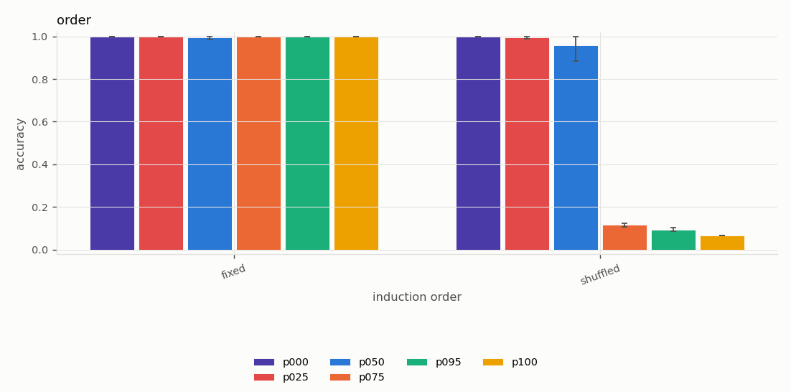
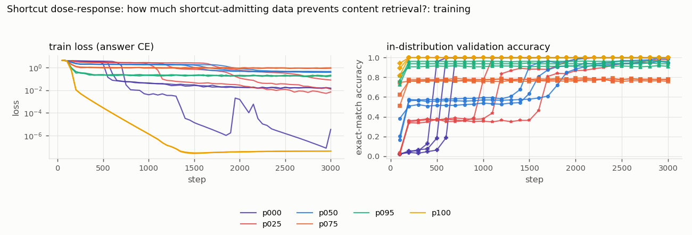

# Shortcut dose-response: how much shortcut-admitting data prevents content retrieval?

*Study id:* `shortcut_dose`  
*Spec:* ``

## Design

**Research question.** When a fraction p of training examples can be solved by a positional shortcut (fixed-order induction) and the rest require content matching (shuffled order), does the model still learn content-based retrieval? At which p does it stop, and does the shortcut appear first in training?

**Hypothesis.** (H1) For p = 1 the model learns only the shortcut (replicating study `induction`: chance on shuffled). (H2) For p < 1 the shuffled examples keep a learning signal for content matching, so shuffled-order accuracy is eventually high, but onset is delayed as p grows because fewer examples require it. (H3) Fixed-order accuracy rises before shuffled-order accuracy (shortcut first) whenever p > 0. Alternative: once the shortcut solves most of the loss, the gradient toward content matching is too weak and content retrieval never forms within the budget even for moderate p.

**Independent variables:** induction_fixed_prob p  
**Controlled variables:** model: RoPE, d_model 64, 2 layers, 4 heads, d_mlp 256, task: induction, length 34, every second-half position supervised, optimiser, lr 3e-3, batch 64, 3000 steps, checkpoints for learning dynamics, evaluation: identical shuffled-order and fixed-order example sets for every run  
**Primary metric:** accuracy on the shuffled order (content retrieval) at the end of training; onset step  
**Seeds:** [0, 1, 2]  
**Evaluation seed (shared by all runs):** 20261017

**Expected failure modes:** onset is stochastic; three seeds detect only large effects; a model can mix strategies (shortcut on fixed-looking inputs, content otherwise) -- both orders are reported

**Scope note (transparent reductions):** One positional method (RoPE, 4 heads), chosen because it learns both strategies within budget in study `induction`.

## Runs (measured)

| run_id | variant | seed | pos_method | status | elapsed_s | final_val_acc | final_train_loss | steps | n_params |
|---|---|---|---|---|---|---|---|---|---|
| p000_s0_ff654378 | p000 | 0 | rope | completed | 359.110 | 1.000 | 0.015 | 3000 | 116736 |
| p000_s1_c6880ee4 | p000 | 1 | rope | completed | 358.411 | 1.000 | 0.000 | 3000 | 116736 |
| p000_s2_4576d952 | p000 | 2 | rope | completed | 358.959 | 1.000 | 0.013 | 3000 | 116736 |
| p025_s0_fd1fcbd0 | p025 | 0 | rope | completed | 290.531 | 1.000 | 0.012 | 3000 | 116736 |
| p025_s1_230fa88f | p025 | 1 | rope | completed | 290.584 | 0.980 | 0.078 | 3000 | 116736 |
| p025_s2_c6563adc | p025 | 2 | rope | completed | 290.377 | 1.000 | 0.007 | 3000 | 116736 |
| p050_s0_cdab438f | p050 | 0 | rope | completed | 291.388 | 0.949 | 0.442 | 3000 | 116736 |
| p050_s1_1324a27f | p050 | 1 | rope | completed | 291.630 | 0.992 | 0.391 | 3000 | 116736 |
| p050_s2_e5603620 | p050 | 2 | rope | completed | 291.625 | 1.000 | 0.380 | 3000 | 116736 |
| p075_s0_d7b54bfe | p075 | 0 | rope | completed | 292.591 | 0.773 | 0.902 | 3000 | 116736 |
| p075_s1_bbcae06c | p075 | 1 | rope | completed | 292.684 | 0.758 | 0.928 | 3000 | 116736 |
| p075_s2_53736fbb | p075 | 2 | rope | completed | 293.220 | 0.781 | 0.845 | 3000 | 116736 |
| p095_s0_3086953b | p095 | 0 | rope | completed | 254.580 | 0.910 | 0.175 | 3000 | 116736 |
| p095_s1_d5f3a8b6 | p095 | 1 | rope | completed | 255.187 | 0.938 | 0.180 | 3000 | 116736 |
| p095_s2_23b655fa | p095 | 2 | rope | completed | 254.725 | 0.961 | 0.211 | 3000 | 116736 |
| p100_s0_54d37f13 | p100 | 0 | rope | completed | 478.393 | 1.000 | 0.000 | 3000 | 116736 |
| p100_s1_95c22248 | p100 | 1 | rope | completed | 478.202 | 1.000 | 0.000 | 3000 | 116736 |
| p100_s2_542a479c | p100 | 2 | rope | completed | 477.977 | 1.000 | 0.000 | 3000 | 116736 |

## Validity flags

* `p075_s0_d7b54bfe`: in-distribution val acc 0.773 < 0.90 -> undertrained or unable to learn the task; out-of-distribution failures of this run are NOT evidence about extrapolation.
* `p075_s1_bbcae06c`: in-distribution val acc 0.758 < 0.90 -> undertrained or unable to learn the task; out-of-distribution failures of this run are NOT evidence about extrapolation.
* `p075_s2_53736fbb`: in-distribution val acc 0.781 < 0.90 -> undertrained or unable to learn the task; out-of-distribution failures of this run are NOT evidence about extrapolation.

## Controls (mean, min and max over seeds)

| grid | cell | variant | n_seeds | mean | min | max |
|---|---|---|---|---|---|---|
| control_in_distribution | default | p000 | 3 | 1.000 | 1.000 | 1.000 |
| control_in_distribution | default | p025 | 3 | 0.999 | 0.997 | 1.000 |
| control_in_distribution | default | p050 | 3 | 0.973 | 0.933 | 1.000 |
| control_in_distribution | default | p075 | 3 | 0.766 | 0.763 | 0.767 |
| control_in_distribution | default | p095 | 3 | 0.940 | 0.940 | 0.940 |
| control_in_distribution | default | p100 | 3 | 1.000 | 1.000 | 1.000 |
| control_position_offset | pos_offset=0 | p000 | 3 | 1.000 | 1.000 | 1.000 |
| control_position_offset | pos_offset=0 | p025 | 3 | 0.999 | 0.997 | 1.000 |
| control_position_offset | pos_offset=0 | p050 | 3 | 0.973 | 0.933 | 1.000 |
| control_position_offset | pos_offset=0 | p075 | 3 | 0.766 | 0.763 | 0.767 |
| control_position_offset | pos_offset=0 | p095 | 3 | 0.940 | 0.940 | 0.940 |
| control_position_offset | pos_offset=0 | p100 | 3 | 1.000 | 1.000 | 1.000 |

## Control metrics per run (measured)

`composition_end_given_both_hops` = accuracy on the chain end among contexts where both single hops were answered correctly (multi-hop only).

| run_id | variant | seed | in_distribution_acc | pos_offset_0_acc |
|---|---|---|---|---|
| p000_s0_ff654378 | p000 | 0 | 1.000 | 1.000 |
| p000_s1_c6880ee4 | p000 | 1 | 1.000 | 1.000 |
| p000_s2_4576d952 | p000 | 2 | 1.000 | 1.000 |
| p025_s0_fd1fcbd0 | p025 | 0 | 1.000 | 1.000 |
| p025_s1_230fa88f | p025 | 1 | 0.997 | 0.997 |
| p025_s2_c6563adc | p025 | 2 | 1.000 | 1.000 |
| p050_s0_cdab438f | p050 | 0 | 0.933 | 0.933 |
| p050_s1_1324a27f | p050 | 1 | 0.987 | 0.987 |
| p050_s2_e5603620 | p050 | 2 | 1.000 | 1.000 |
| p075_s0_d7b54bfe | p075 | 0 | 0.763 | 0.763 |
| p075_s1_bbcae06c | p075 | 1 | 0.767 | 0.767 |
| p075_s2_53736fbb | p075 | 2 | 0.767 | 0.767 |
| p095_s0_3086953b | p095 | 0 | 0.940 | 0.940 |
| p095_s1_d5f3a8b6 | p095 | 1 | 0.940 | 0.940 |
| p095_s2_23b655fa | p095 | 2 | 0.940 | 0.940 |
| p100_s0_54d37f13 | p100 | 0 | 1.000 | 1.000 |
| p100_s1_95c22248 | p100 | 1 | 1.000 | 1.000 |
| p100_s2_542a479c | p100 | 2 | 1.000 | 1.000 |

## Grid `order` (derived: mean across seeds; t-interval over seeds)

| grid | variant | cell_induction_order | n_seeds | n_per_seed | mean | std | min | max | t_lo | t_hi |
|---|---|---|---|---|---|---|---|---|---|---|
| order | p000 | fixed | 3 | 300 | 1.000 | 0.000 | 1.000 | 1.000 | 1.000 | 1.000 |
| order | p000 | shuffled | 3 | 300 | 1.000 | 0.000 | 1.000 | 1.000 | 1.000 | 1.000 |
| order | p025 | fixed | 3 | 300 | 1.000 | 0.000 | 1.000 | 1.000 | 1.000 | 1.000 |
| order | p025 | shuffled | 3 | 300 | 0.997 | 0.006 | 0.990 | 1.000 | 0.982 | 1.011 |
| order | p050 | fixed | 3 | 300 | 0.996 | 0.008 | 0.987 | 1.000 | 0.976 | 1.015 |
| order | p050 | shuffled | 3 | 300 | 0.957 | 0.064 | 0.883 | 1.000 | 0.798 | 1.115 |
| order | p075 | fixed | 3 | 300 | 1.000 | 0.000 | 1.000 | 1.000 | 1.000 | 1.000 |
| order | p075 | shuffled | 3 | 300 | 0.117 | 0.009 | 0.107 | 0.123 | 0.095 | 0.139 |
| order | p095 | fixed | 3 | 300 | 1.000 | 0.000 | 1.000 | 1.000 | 1.000 | 1.000 |
| order | p095 | shuffled | 3 | 300 | 0.094 | 0.008 | 0.087 | 0.103 | 0.074 | 0.115 |
| order | p100 | fixed | 3 | 300 | 1.000 | 0.000 | 1.000 | 1.000 | 1.000 | 1.000 |
| order | p100 | shuffled | 3 | 300 | 0.067 | 0.000 | 0.067 | 0.067 | 0.067 | 0.067 |

Baselines on the identical examples (reference):

| cell_induction_order | oracle | random_context | chance | best_fixed_offset | best_fixed_offset_d |
|---|---|---|---|---|---|
| shuffled | 1.000 | 0.062 | 0.021 | 0.083 | 9 |
| fixed | 1.000 | 0.062 | 0.021 | 1.000 | 16 |

## Paired differences vs `p000` (per-seed differences on identical examples)

| grid | cell_induction_order | a | b | mean_diff | t_lo | t_hi | n_seeds | seeds_a_better | seeds_b_better |
|---|---|---|---|---|---|---|---|---|---|
| order | fixed | p025 | p000 | 0.000 | 0.000 | 0.000 | 3 | 0 | 0 |
| order | shuffled | p025 | p000 | -0.003 | -0.018 | 0.011 | 3 | 0 | 1 |
| order | fixed | p050 | p000 | -0.004 | -0.024 | 0.015 | 3 | 0 | 1 |
| order | shuffled | p050 | p000 | -0.043 | -0.202 | 0.115 | 3 | 0 | 2 |
| order | fixed | p075 | p000 | 0.000 | 0.000 | 0.000 | 3 | 0 | 0 |
| order | shuffled | p075 | p000 | -0.883 | -0.905 | -0.861 | 3 | 0 | 3 |
| order | fixed | p095 | p000 | 0.000 | 0.000 | 0.000 | 3 | 0 | 0 |
| order | shuffled | p095 | p000 | -0.906 | -0.926 | -0.885 | 3 | 0 | 3 |
| order | fixed | p100 | p000 | 0.000 | 0.000 | 0.000 | 3 | 0 | 0 |
| order | shuffled | p100 | p000 | -0.933 | -0.933 | -0.933 | 3 | 0 | 3 |

## Figures

## Reading guide

* Per-seed Wilson intervals (in `per_seed_cells.csv`) capture example sampling only; the across-seed t-interval captures training variability but is very wide with 3 seeds.
* Interpretation and conclusions are written separately in `docs/results.md`; this report is generated mechanically from the measured tables above.
