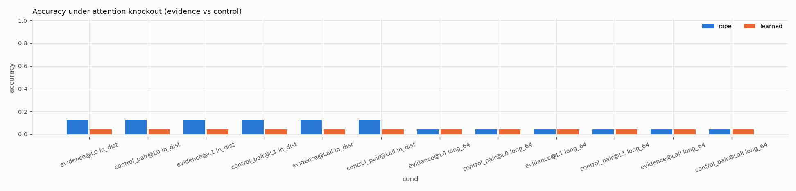
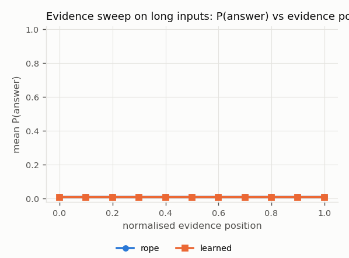

# Mechanistic analysis: Smoke test (tiny, not a scientific result)

Observational measures (attention, logit lens) describe internal quantities; only knockout, patching and ablation are interventions. Knockout measures only the *direct* <ans>-to-evidence read in a layer; patching restoration is reported per position role.

## `learned_s0_6718f8d8` (learned)

* training lengths [16, 32], long set length 64
* retrieval head (max attention to evidence value, last layer, in-distribution): {'layer': 1, 'head': 1}

Retrieval-head attention to evidence value and score gap, by correctness:

| set | correct | attn_evidence_value | score_gap | attn_entropy |
|---|---|---|---|---|
| in_distribution | 0.000 | 0.044 | -0.014 | 3.148 |
| in_distribution | 1.000 | 0.035 | 0.040 | 3.367 |
| long_64 | 0.000 | 0.016 | -0.006 | 4.158 |
| long_64 | 1.000 | 0.014 | -0.103 | 4.158 |

Long set, retrieval head by evidence distance:

| distance_bin | attn_evidence_value | score_gap | correct |
|---|---|---|---|
| (0, 16] | 0.015 | -0.017 | 0.000 |
| (16, 32] | 0.016 | -0.009 | 0.143 |
| (32, 64] | 0.016 | -0.009 | 0.000 |

## `rope_s0_311f16ee` (rope)

* training lengths [16, 32], long set length 64
* retrieval head (max attention to evidence value, last layer, in-distribution): {'layer': 1, 'head': 1}

Retrieval-head attention to evidence value and score gap, by correctness:

| set | correct | attn_evidence_value | score_gap | attn_entropy |
|---|---|---|---|---|
| in_distribution | 0.000 | 0.044 | -0.017 | 3.166 |
| in_distribution | 1.000 | 0.049 | 0.040 | 3.094 |
| long_64 | 0.000 | 0.016 | -0.019 | 4.158 |
| long_64 | 1.000 | 0.016 | 0.025 | 4.158 |

Long set, retrieval head by evidence distance:

| distance_bin | attn_evidence_value | score_gap | correct |
|---|---|---|---|
| (0, 16] | 0.016 | 0.022 | 0.250 |
| (16, 32] | 0.016 | -0.029 | 0.000 |
| (32, 64] | 0.016 | -0.023 | 0.000 |

## Attention knockout (accuracy)

| variant | condition | layer | acc | p_answer | n | set |
|---|---|---|---|---|---|---|
| learned | none | - | 0.042 | 0.010 | 24 | in_distribution |
| learned | evidence | 0 | 0.042 | 0.010 | 24 | in_distribution |
| learned | control_pair | 0 | 0.042 | 0.010 | 24 | in_distribution |
| learned | evidence | 1 | 0.042 | 0.010 | 24 | in_distribution |
| learned | control_pair | 1 | 0.042 | 0.010 | 24 | in_distribution |
| learned | evidence | all | 0.042 | 0.010 | 24 | in_distribution |
| learned | control_pair | all | 0.042 | 0.010 | 24 | in_distribution |
| learned | none | - | 0.042 | 0.010 | 24 | long_64 |
| learned | evidence | 0 | 0.042 | 0.010 | 24 | long_64 |
| learned | control_pair | 0 | 0.042 | 0.010 | 24 | long_64 |
| learned | evidence | 1 | 0.042 | 0.010 | 24 | long_64 |
| learned | control_pair | 1 | 0.042 | 0.010 | 24 | long_64 |
| learned | evidence | all | 0.042 | 0.010 | 24 | long_64 |
| learned | control_pair | all | 0.042 | 0.010 | 24 | long_64 |
| rope | none | - | 0.125 | 0.010 | 24 | in_distribution |
| rope | evidence | 0 | 0.125 | 0.010 | 24 | in_distribution |
| rope | control_pair | 0 | 0.125 | 0.010 | 24 | in_distribution |
| rope | evidence | 1 | 0.125 | 0.010 | 24 | in_distribution |
| rope | control_pair | 1 | 0.125 | 0.010 | 24 | in_distribution |
| rope | evidence | all | 0.125 | 0.010 | 24 | in_distribution |
| rope | control_pair | all | 0.125 | 0.010 | 24 | in_distribution |
| rope | none | - | 0.042 | 0.010 | 24 | long_64 |
| rope | evidence | 0 | 0.042 | 0.010 | 24 | long_64 |
| rope | control_pair | 0 | 0.042 | 0.010 | 24 | long_64 |
| rope | evidence | 1 | 0.042 | 0.010 | 24 | long_64 |
| rope | control_pair | 1 | 0.042 | 0.010 | 24 | long_64 |
| rope | evidence | all | 0.042 | 0.010 | 24 | long_64 |
| rope | control_pair | all | 0.042 | 0.010 | 24 | long_64 |

## Logit lens: P(answer) after each layer

| variant | set | layer | p_answer | correct_at_layer |
|---|---|---|---|---|
| learned | in_distribution | 0 | 0.010 | 0.000 |
| learned | in_distribution | 1 | 0.010 | 0.042 |
| learned | long_64 | 0 | 0.010 | 0.042 |
| learned | long_64 | 1 | 0.010 | 0.042 |
| rope | in_distribution | 0 | 0.010 | 0.125 |
| rope | in_distribution | 1 | 0.010 | 0.125 |
| rope | long_64 | 0 | 0.010 | 0.042 |
| rope | long_64 | 1 | 0.010 | 0.042 |

## Evidence sweep (same context, only the evidence moves; long set)

| variant | norm_bin | p_answer | correct | resid_cos_to_original |
|---|---|---|---|---|
| learned | 0.000 | 0.010 | 0.042 | 1.000 |
| learned | 0.100 | 0.010 | 0.042 | 1.000 |
| learned | 0.200 | 0.010 | 0.042 | 1.000 |
| learned | 0.300 | 0.010 | 0.042 | 1.000 |
| learned | 0.400 | 0.010 | 0.042 | 1.000 |
| learned | 0.500 | 0.010 | 0.042 | 1.000 |
| learned | 0.600 | 0.010 | 0.042 | 1.000 |
| learned | 0.700 | 0.010 | 0.041 | 1.000 |
| learned | 0.800 | 0.010 | 0.041 | 1.000 |
| learned | 0.900 | 0.010 | 0.042 | 1.000 |
| learned | 1.000 | 0.010 | 0.043 | 1.000 |
| rope | 0.000 | 0.010 | 0.042 | 1.000 |
| rope | 0.100 | 0.010 | 0.042 | 1.000 |
| rope | 0.200 | 0.010 | 0.042 | 1.000 |
| rope | 0.300 | 0.010 | 0.042 | 1.000 |
| rope | 0.400 | 0.010 | 0.042 | 1.000 |
| rope | 0.500 | 0.010 | 0.042 | 1.000 |
| rope | 0.600 | 0.010 | 0.042 | 1.000 |
| rope | 0.700 | 0.010 | 0.041 | 1.000 |
| rope | 0.800 | 0.010 | 0.055 | 1.000 |
| rope | 0.900 | 0.010 | 0.028 | 1.000 |
| rope | 1.000 | 0.010 | 0.043 | 1.000 |

## Head ablation (zeroed head output; in-distribution)

| variant | layer | head | acc | p_answer | acc_drop |
|---|---|---|---|---|---|
| learned | - | - | 0.042 | 0.010 | 0.000 |
| learned | 0 | 0 | 0.042 | 0.010 | 0.000 |
| learned | 0 | 1 | 0.042 | 0.010 | 0.000 |
| learned | 1 | 0 | 0.042 | 0.010 | 0.000 |
| learned | 1 | 1 | 0.042 | 0.010 | 0.000 |
| rope | - | - | 0.125 | 0.010 | 0.000 |
| rope | 0 | 0 | 0.125 | 0.010 | 0.000 |
| rope | 0 | 1 | 0.125 | 0.010 | 0.000 |
| rope | 1 | 0 | 0.125 | 0.010 | 0.000 |
| rope | 1 | 1 | 0.125 | 0.010 | 0.000 |
