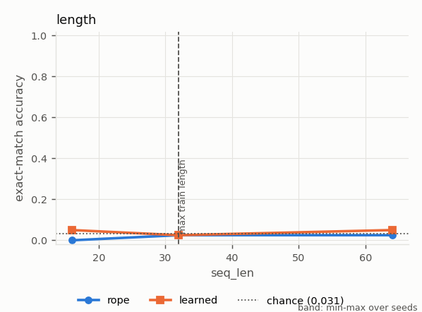
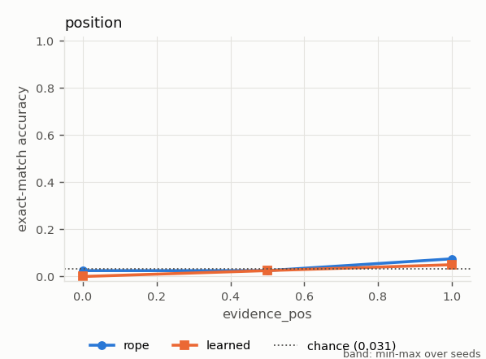
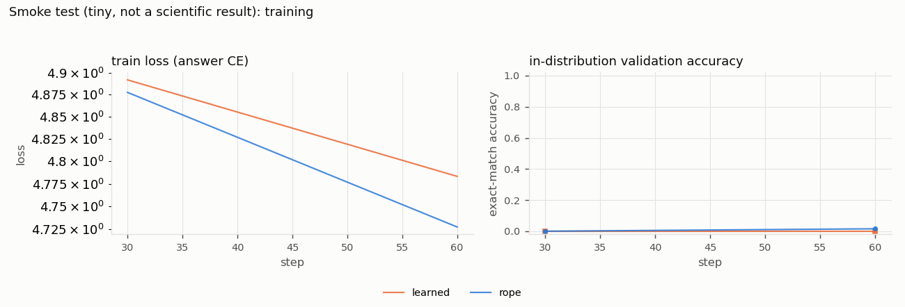

# Smoke test (tiny, not a scientific result)

*Study id:* `smoke`  
*Spec:* ``

## Design

**Research question.** Does the pipeline run end to end?

**Hypothesis.** Pipeline executes; numbers are meaningless at this budget.

**Independent variables:** pos_method  
**Controlled variables:** everything else  
**Primary metric:** exact-match accuracy  
**Seeds:** [0]  
**Evaluation seed (shared by all runs):** 7

**Expected failure modes:** undertrained

## Runs (measured)

| run_id | variant | seed | pos_method | status | elapsed_s | final_val_acc | final_train_loss | steps | n_params |
|---|---|---|---|---|---|---|---|---|---|
| learned_s0_6718f8d8 | learned | 0 | learned | completed | 14.163 | 0.000 | 4.783 | 60 | 29568 |
| rope_s0_311f16ee | rope | 0 | rope | completed | 37.783 | 0.016 | 4.727 | 60 | 25472 |

## Validity flags

* `learned_s0_6718f8d8`: in-distribution val acc 0.000 < 0.90 -> undertrained or unable to learn the task; out-of-distribution failures of this run are NOT evidence about extrapolation.
* `rope_s0_311f16ee`: in-distribution val acc 0.016 < 0.90 -> undertrained or unable to learn the task; out-of-distribution failures of this run are NOT evidence about extrapolation.

## Controls (mean over seeds; min-max in brackets)

| grid | cell | variant | n_seeds | mean | min | max |
|---|---|---|---|---|---|---|
| control_evidence_removed | default | learned | 1 | 0.031 | 0.031 | 0.031 |
| control_evidence_removed | default | rope | 1 | 0.031 | 0.031 | 0.031 |
| control_in_distribution | default | learned | 1 | 0.031 | 0.031 | 0.031 |
| control_in_distribution | default | rope | 1 | 0.031 | 0.031 | 0.031 |
| control_position_offset | pos_offset=0 | learned | 1 | 0.031 | 0.031 | 0.031 |
| control_position_offset | pos_offset=0 | rope | 1 | 0.031 | 0.031 | 0.031 |
| control_position_offset | pos_offset=32 | learned | 1 | 0.031 | 0.031 | 0.031 |
| control_position_offset | pos_offset=32 | rope | 1 | 0.031 | 0.031 | 0.031 |

## Grid `length` (derived: mean across seeds; t-interval over seeds)

| grid | variant | cell_seq_len | n_seeds | n_per_seed | mean | std | min | max | t_lo | t_hi |
|---|---|---|---|---|---|---|---|---|---|---|
| length | learned | 16.000 | 1 | 40 | 0.050 | nan | 0.050 | 0.050 | nan | nan |
| length | learned | 32.000 | 1 | 40 | 0.025 | nan | 0.025 | 0.025 | nan | nan |
| length | learned | 64.000 | 1 | 40 | 0.050 | nan | 0.050 | 0.050 | nan | nan |
| length | rope | 16.000 | 1 | 40 | 0.000 | nan | 0.000 | 0.000 | nan | nan |
| length | rope | 32.000 | 1 | 40 | 0.025 | nan | 0.025 | 0.025 | nan | nan |
| length | rope | 64.000 | 1 | 40 | 0.025 | nan | 0.025 | 0.025 | nan | nan |

Baselines on the identical examples (reference):

| cell_seq_len | oracle | naive_induction | last_value | random_context | chance | cell_evidence_pos |
|---|---|---|---|---|---|---|
| 16.000 | 1.000 | 1.000 | 0.275 | 0.373 | 0.031 | nan |
| 32.000 | 1.000 | 1.000 | 0.300 | 0.381 | 0.031 | nan |
| 64.000 | 1.000 | 1.000 | 0.325 | 0.342 | 0.031 | nan |

## Grid `position` (derived: mean across seeds; t-interval over seeds)

| grid | variant | cell_evidence_pos | n_seeds | n_per_seed | mean | std | min | max | t_lo | t_hi |
|---|---|---|---|---|---|---|---|---|---|---|
| position | learned | 0.000 | 1 | 40 | 0.000 | nan | 0.000 | 0.000 | nan | nan |
| position | learned | 0.500 | 1 | 40 | 0.025 | nan | 0.025 | 0.025 | nan | nan |
| position | learned | 1.000 | 1 | 40 | 0.050 | nan | 0.050 | 0.050 | nan | nan |
| position | rope | 0.000 | 1 | 40 | 0.025 | nan | 0.025 | 0.025 | nan | nan |
| position | rope | 0.500 | 1 | 40 | 0.025 | nan | 0.025 | 0.025 | nan | nan |
| position | rope | 1.000 | 1 | 40 | 0.075 | nan | 0.075 | 0.075 | nan | nan |

Baselines on the identical examples (reference):

| cell_seq_len | oracle | naive_induction | last_value | random_context | chance | cell_evidence_pos |
|---|---|---|---|---|---|---|
| nan | 1.000 | 1.000 | 0.050 | 0.375 | 0.031 | 0.000 |
| nan | 1.000 | 1.000 | 0.325 | 0.388 | 0.031 | 0.500 |
| nan | 1.000 | 1.000 | 1.000 | 0.354 | 0.031 | 1.000 |

## Paired differences vs `rope` (per-seed differences on identical examples)

| grid | cell_seq_len | a | b | mean_diff | t_lo | t_hi | n_seeds | seeds_a_better | seeds_b_better | cell_evidence_pos |
|---|---|---|---|---|---|---|---|---|---|---|
| length | 16.000 | learned | rope | 0.050 | nan | nan | 1 | 1 | 0 | nan |
| length | 32.000 | learned | rope | 0.000 | nan | nan | 1 | 0 | 0 | nan |
| length | 64.000 | learned | rope | 0.025 | nan | nan | 1 | 1 | 0 | nan |
| position | nan | learned | rope | -0.025 | nan | nan | 1 | 0 | 1 | 0.000 |
| position | nan | learned | rope | 0.000 | nan | nan | 1 | 0 | 0 | 0.500 |
| position | nan | learned | rope | -0.025 | nan | nan | 1 | 0 | 1 | 1.000 |

## Figures

## Reading guide

* Per-seed Wilson intervals (in `per_seed_cells.csv`) capture example sampling only; the across-seed t-interval captures training variability but is very wide with 3 seeds.
* Interpretation and conclusions are written separately in `docs/results.md`; this report is generated mechanically from the measured tables above.
