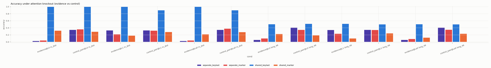
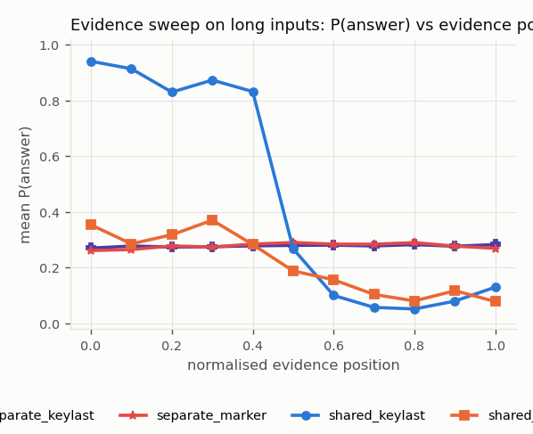

# Mechanistic analysis: Why is associative recall so much harder than induction? The value-type shortcut (2x2)

Observational measures (attention, logit lens) describe internal quantities; only knockout, patching and ablation are interventions. Knockout measures only the *direct* <ans>-to-evidence read in a layer; patching restoration is reported per position role.

## `separate_keylast_s0_02877c6d` (rope)

* training lengths [24, 24], long set length 48 
* retrieval head (max attention to evidence value, last layer, in-distribution): {'layer': 1, 'head': 0}

Retrieval-head attention to evidence value and score gap, by correctness:

| set | correct | attn_evidence_value | score_gap | attn_entropy |
|---|---|---|---|---|
| in_distribution | 0.000 | 0.051 | -0.772 | 2.101 |
| in_distribution | 1.000 | 0.050 | -0.700 | 2.030 |
| long_48 | 0.000 | 0.027 | -0.411 | 3.199 |
| long_48 | 1.000 | 0.030 | -0.520 | 3.042 |

Long set, retrieval head by evidence distance:

| distance_bin | attn_evidence_value | score_gap | correct |
|---|---|---|---|
| (0, 16] | 0.013 | -1.048 | 0.340 |
| (16, 32] | 0.020 | -0.625 | 0.370 |
| (32, 64] | 0.045 | 0.109 | 0.312 |

## `separate_marker_s0_e7f66347` (rope)

* training lengths [24, 24], long set length 48 
* retrieval head (max attention to evidence value, last layer, in-distribution): {'layer': 1, 'head': 1}

Retrieval-head attention to evidence value and score gap, by correctness:

| set | correct | attn_evidence_value | score_gap | attn_entropy |
|---|---|---|---|---|
| in_distribution | 0.000 | 0.185 | -5.734 | 0.149 |
| in_distribution | 1.000 | 0.148 | -7.859 | 0.139 |
| long_48 | 0.000 | 0.075 | -8.848 | 0.309 |
| long_48 | 1.000 | 0.204 | -3.033 | 0.321 |

Long set, retrieval head by evidence distance:

| distance_bin | attn_evidence_value | score_gap | correct |
|---|---|---|---|
| (0, 16] | 0.100 | -12.390 | 0.250 |
| (16, 32] | 0.179 | -5.276 | 0.345 |
| (32, 64] | 0.053 | -6.917 | 0.274 |

## `shared_keylast_s0_de804e47` (rope)

* training lengths [24, 24], long set length 48 
* retrieval head (max attention to evidence value, last layer, in-distribution): {'layer': 1, 'head': 1}

Retrieval-head attention to evidence value and score gap, by correctness:

| set | correct | attn_evidence_value | score_gap | attn_entropy |
|---|---|---|---|---|
| in_distribution | 1.000 | 0.001 | -5.900 | 0.368 |
| long_48 | 0.000 | 0.002 | -1.679 | 1.300 |
| long_48 | 1.000 | 0.001 | -1.785 | 0.817 |

Long set, retrieval head by evidence distance:

| distance_bin | attn_evidence_value | score_gap | correct |
|---|---|---|---|
| (0, 16] | 0.002 | -1.534 | 0.060 |
| (16, 32] | 0.002 | -1.483 | 0.397 |
| (32, 64] | 0.000 | -2.101 | 0.922 |

## `shared_marker_s0_f52a7f38` (rope)

* training lengths [24, 24], long set length 48 
* retrieval head (max attention to evidence value, last layer, in-distribution): {'layer': 1, 'head': 0}

Retrieval-head attention to evidence value and score gap, by correctness:

| set | correct | attn_evidence_value | score_gap | attn_entropy |
|---|---|---|---|---|
| in_distribution | 0.000 | 0.207 | -43.196 | 0.002 |
| in_distribution | 1.000 | 0.483 | -12.662 | 0.010 |
| long_48 | 0.000 | 0.162 | -21.928 | 0.153 |
| long_48 | 1.000 | 0.629 | 5.914 | 0.155 |

Long set, retrieval head by evidence distance:

| distance_bin | attn_evidence_value | score_gap | correct |
|---|---|---|---|
| (0, 16] | 0.326 | -11.065 | 0.125 |
| (16, 32] | 0.154 | -20.488 | 0.131 |
| (32, 64] | 0.336 | -13.917 | 0.310 |

## Attention knockout (accuracy)

| variant | condition | layer | acc | p_answer | n | set |
|---|---|---|---|---|---|---|
| separate_keylast | none | - | 0.330 | 0.276 | 200 | in_distribution |
| separate_keylast | evidence | 0 | 0.030 | 0.037 | 200 | in_distribution |
| separate_keylast | control_pair | 0 | 0.345 | 0.362 | 200 | in_distribution |
| separate_keylast | evidence | 1 | 0.330 | 0.276 | 200 | in_distribution |
| separate_keylast | control_pair | 1 | 0.330 | 0.276 | 200 | in_distribution |
| separate_keylast | evidence | all | 0.030 | 0.037 | 200 | in_distribution |
| separate_keylast | control_pair | all | 0.345 | 0.361 | 200 | in_distribution |
| separate_keylast | none | - | 0.340 | 0.277 | 200 | long_48 |
| separate_keylast | evidence | 0 | 0.060 | 0.044 | 200 | long_48 |
| separate_keylast | control_pair | 0 | 0.410 | 0.356 | 200 | long_48 |
| separate_keylast | evidence | 1 | 0.340 | 0.277 | 200 | long_48 |
| separate_keylast | control_pair | 1 | 0.345 | 0.277 | 200 | long_48 |
| separate_keylast | evidence | all | 0.060 | 0.044 | 200 | long_48 |
| separate_keylast | control_pair | all | 0.410 | 0.356 | 200 | long_48 |
| separate_marker | none | - | 0.290 | 0.276 | 200 | in_distribution |
| separate_marker | evidence | 0 | 0.045 | 0.078 | 200 | in_distribution |
| separate_marker | control_pair | 0 | 0.360 | 0.346 | 200 | in_distribution |
| separate_marker | evidence | 1 | 0.220 | 0.229 | 200 | in_distribution |
| separate_marker | control_pair | 1 | 0.320 | 0.295 | 200 | in_distribution |
| separate_marker | evidence | all | 0.045 | 0.051 | 200 | in_distribution |
| separate_marker | control_pair | all | 0.380 | 0.359 | 200 | in_distribution |
| separate_marker | none | - | 0.300 | 0.282 | 200 | long_48 |
| separate_marker | evidence | 0 | 0.100 | 0.082 | 200 | long_48 |
| separate_marker | control_pair | 0 | 0.345 | 0.341 | 200 | long_48 |
| separate_marker | evidence | 1 | 0.235 | 0.239 | 200 | long_48 |
| separate_marker | control_pair | 1 | 0.340 | 0.304 | 200 | long_48 |
| separate_marker | evidence | all | 0.085 | 0.056 | 200 | long_48 |
| separate_marker | control_pair | all | 0.350 | 0.356 | 200 | long_48 |
| shared_keylast | none | - | 1.000 | 1.000 | 200 | in_distribution |
| shared_keylast | evidence | 0 | 1.000 | 1.000 | 200 | in_distribution |
| shared_keylast | control_pair | 0 | 1.000 | 1.000 | 200 | in_distribution |
| shared_keylast | evidence | 1 | 1.000 | 1.000 | 200 | in_distribution |
| shared_keylast | control_pair | 1 | 0.900 | 0.900 | 200 | in_distribution |
| shared_keylast | evidence | all | 1.000 | 1.000 | 200 | in_distribution |
| shared_keylast | control_pair | all | 0.900 | 0.900 | 200 | in_distribution |
| shared_keylast | none | - | 0.515 | 0.503 | 200 | long_48 |
| shared_keylast | evidence | 0 | 0.505 | 0.497 | 200 | long_48 |
| shared_keylast | control_pair | 0 | 0.515 | 0.502 | 200 | long_48 |
| shared_keylast | evidence | 1 | 0.515 | 0.503 | 200 | long_48 |
| shared_keylast | control_pair | 1 | 0.500 | 0.490 | 200 | long_48 |
| shared_keylast | evidence | all | 0.505 | 0.497 | 200 | long_48 |
| shared_keylast | control_pair | all | 0.500 | 0.489 | 200 | long_48 |
| shared_marker | none | - | 0.300 | 0.238 | 200 | in_distribution |
| shared_marker | evidence | 0 | 0.320 | 0.219 | 200 | in_distribution |
| shared_marker | control_pair | 0 | 0.290 | 0.246 | 200 | in_distribution |
| shared_marker | evidence | 1 | 0.180 | 0.189 | 200 | in_distribution |
| shared_marker | control_pair | 1 | 0.285 | 0.230 | 200 | in_distribution |
| shared_marker | evidence | all | 0.220 | 0.180 | 200 | in_distribution |
| shared_marker | control_pair | all | 0.280 | 0.235 | 200 | in_distribution |
| shared_marker | none | - | 0.205 | 0.192 | 200 | long_48 |
| shared_marker | evidence | 0 | 0.225 | 0.191 | 200 | long_48 |
| shared_marker | control_pair | 0 | 0.190 | 0.192 | 200 | long_48 |
| shared_marker | evidence | 1 | 0.100 | 0.120 | 200 | long_48 |
| shared_marker | control_pair | 1 | 0.245 | 0.213 | 200 | long_48 |
| shared_marker | evidence | all | 0.125 | 0.122 | 200 | long_48 |
| shared_marker | control_pair | all | 0.235 | 0.214 | 200 | long_48 |

## Logit lens: P(answer) after each layer

| variant | set | layer | p_answer | correct_at_layer |
|---|---|---|---|---|
| separate_keylast | in_distribution | 0 | 0.276 | 0.330 |
| separate_keylast | in_distribution | 1 | 0.276 | 0.330 |
| separate_keylast | long_48 | 0 | 0.274 | 0.340 |
| separate_keylast | long_48 | 1 | 0.277 | 0.340 |
| separate_marker | in_distribution | 0 | 0.262 | 0.265 |
| separate_marker | in_distribution | 1 | 0.276 | 0.290 |
| separate_marker | long_48 | 0 | 0.277 | 0.295 |
| separate_marker | long_48 | 1 | 0.282 | 0.300 |
| shared_keylast | in_distribution | 0 | 0.025 | 0.020 |
| shared_keylast | in_distribution | 1 | 1.000 | 1.000 |
| shared_keylast | long_48 | 0 | 0.030 | 0.030 |
| shared_keylast | long_48 | 1 | 0.503 | 0.515 |
| shared_marker | in_distribution | 0 | 0.112 | 0.165 |
| shared_marker | in_distribution | 1 | 0.238 | 0.300 |
| shared_marker | long_48 | 0 | 0.035 | 0.030 |
| shared_marker | long_48 | 1 | 0.192 | 0.205 |

## Evidence sweep (same context, only the evidence moves; long set)

| variant | norm_bin | p_answer | correct | resid_cos_to_original |
|---|---|---|---|---|
| separate_keylast | 0.000 | 0.270 | 0.300 | 1.000 |
| separate_keylast | 0.100 | 0.277 | 0.357 | 1.000 |
| separate_keylast | 0.200 | 0.274 | 0.319 | 1.000 |
| separate_keylast | 0.300 | 0.275 | 0.324 | 1.000 |
| separate_keylast | 0.400 | 0.278 | 0.326 | 1.000 |
| separate_keylast | 0.500 | 0.280 | 0.340 | 1.000 |
| separate_keylast | 0.600 | 0.281 | 0.340 | 1.000 |
| separate_keylast | 0.700 | 0.278 | 0.329 | 1.000 |
| separate_keylast | 0.800 | 0.283 | 0.340 | 1.000 |
| separate_keylast | 0.900 | 0.277 | 0.323 | 1.000 |
| separate_keylast | 1.000 | 0.283 | 0.341 | 1.000 |
| separate_marker | 0.000 | 0.261 | 0.300 | 0.998 |
| separate_marker | 0.100 | 0.265 | 0.306 | 0.999 |
| separate_marker | 0.200 | 0.278 | 0.436 | 0.999 |
| separate_marker | 0.300 | 0.274 | 0.382 | 0.999 |
| separate_marker | 0.400 | 0.284 | 0.464 | 0.999 |
| separate_marker | 0.500 | 0.290 | 0.449 | 0.999 |
| separate_marker | 0.600 | 0.284 | 0.457 | 0.999 |
| separate_marker | 0.700 | 0.284 | 0.425 | 0.999 |
| separate_marker | 0.800 | 0.290 | 0.479 | 0.999 |
| separate_marker | 0.900 | 0.277 | 0.417 | 0.998 |
| separate_marker | 1.000 | 0.269 | 0.283 | 0.997 |
| shared_keylast | 0.000 | 0.941 | 0.920 | 0.515 |
| shared_keylast | 0.100 | 0.914 | 0.929 | 0.528 |
| shared_keylast | 0.200 | 0.830 | 0.862 | 0.561 |
| shared_keylast | 0.300 | 0.874 | 0.878 | 0.557 |
| shared_keylast | 0.400 | 0.832 | 0.842 | 0.555 |
| shared_keylast | 0.500 | 0.267 | 0.278 | 0.668 |
| shared_keylast | 0.600 | 0.100 | 0.106 | 0.628 |
| shared_keylast | 0.700 | 0.057 | 0.055 | 0.700 |
| shared_keylast | 0.800 | 0.051 | 0.053 | 0.670 |
| shared_keylast | 0.900 | 0.080 | 0.081 | 0.692 |
| shared_keylast | 1.000 | 0.130 | 0.136 | 0.649 |
| shared_marker | 0.000 | 0.353 | 0.400 | 0.704 |
| shared_marker | 0.100 | 0.285 | 0.333 | 0.836 |
| shared_marker | 0.200 | 0.318 | 0.340 | 0.845 |
| shared_marker | 0.300 | 0.370 | 0.500 | 0.838 |
| shared_marker | 0.400 | 0.283 | 0.377 | 0.871 |
| shared_marker | 0.500 | 0.188 | 0.184 | 0.883 |
| shared_marker | 0.600 | 0.156 | 0.214 | 0.867 |
| shared_marker | 0.700 | 0.104 | 0.082 | 0.883 |
| shared_marker | 0.800 | 0.080 | 0.062 | 0.867 |
| shared_marker | 0.900 | 0.117 | 0.125 | 0.876 |
| shared_marker | 1.000 | 0.078 | 0.130 | 0.854 |

## Activation patching (value corruption): mean restoration by layer and role

| variant | layer | role | mean | std | count |
|---|---|---|---|---|---|
| separate_keylast | 0 | evidence_value | 1.000 | 0.000 | 24 |
| separate_keylast | 0 | ans | 0.000 | 0.000 | 24 |
| separate_keylast | 0 | aux_query | 0.000 | 0.000 | 144 |
| separate_keylast | 0 | bos | 0.000 | 0.000 | 24 |
| separate_keylast | 0 | distractor_key | 0.000 | 0.000 | 72 |
| separate_keylast | 0 | distractor_value | 0.000 | 0.000 | 72 |
| separate_keylast | 0 | evidence_key | 0.000 | 0.000 | 24 |
| separate_keylast | 0 | filler | 0.000 | 0.000 | 168 |
| separate_keylast | 0 | query_marker | 0.000 | 0.000 | 24 |
| separate_keylast | 1 | ans | 1.000 | 0.000 | 24 |
| separate_keylast | 1 | query_marker | 0.000 | 0.000 | 24 |
| separate_keylast | 1 | aux_query | 0.000 | 0.000 | 144 |
| separate_keylast | 1 | filler | 0.000 | 0.000 | 168 |
| separate_keylast | 1 | distractor_key | 0.000 | 0.000 | 72 |
| separate_keylast | 1 | bos | 0.000 | 0.000 | 24 |
| separate_keylast | 1 | evidence_key | 0.000 | 0.000 | 24 |
| separate_keylast | 1 | distractor_value | -0.000 | 0.000 | 72 |
| separate_keylast | 1 | evidence_value | -0.000 | 0.000 | 24 |
| separate_keylast | 2 | ans | 1.000 | 0.000 | 24 |
| separate_keylast | 2 | aux_query | 0.000 | 0.000 | 144 |
| separate_keylast | 2 | bos | 0.000 | 0.000 | 24 |
| separate_keylast | 2 | distractor_key | 0.000 | 0.000 | 72 |
| separate_keylast | 2 | distractor_value | 0.000 | 0.000 | 72 |
| separate_keylast | 2 | evidence_key | 0.000 | 0.000 | 24 |
| separate_keylast | 2 | evidence_value | 0.000 | 0.000 | 24 |
| separate_keylast | 2 | filler | 0.000 | 0.000 | 168 |
| separate_keylast | 2 | query_marker | 0.000 | 0.000 | 24 |
| separate_marker | 0 | evidence_value | 1.000 | 0.000 | 24 |
| separate_marker | 0 | ans | 0.000 | 0.000 | 24 |
| separate_marker | 0 | aux_query | 0.000 | 0.000 | 216 |
| separate_marker | 0 | bos | 0.000 | 0.000 | 24 |
| separate_marker | 0 | distractor_key | 0.000 | 0.000 | 72 |
| separate_marker | 0 | distractor_value | 0.000 | 0.000 | 72 |
| separate_marker | 0 | evidence_key | 0.000 | 0.000 | 24 |
| separate_marker | 0 | filler | 0.000 | 0.000 | 72 |
| separate_marker | 0 | query_key | 0.000 | 0.000 | 24 |
| separate_marker | 0 | query_marker | 0.000 | 0.000 | 24 |
| separate_marker | 1 | ans | 0.696 | 0.369 | 24 |
| separate_marker | 1 | evidence_value | 0.262 | 0.343 | 24 |
| separate_marker | 1 | distractor_value | 0.041 | 0.171 | 72 |
| separate_marker | 1 | aux_query | 0.001 | 0.005 | 216 |
| separate_marker | 1 | query_marker | 0.000 | 0.000 | 24 |
| separate_marker | 1 | distractor_key | 0.000 | 0.000 | 72 |
| separate_marker | 1 | filler | 0.000 | 0.000 | 72 |
| separate_marker | 1 | query_key | 0.000 | 0.000 | 24 |
| separate_marker | 1 | bos | 0.000 | 0.000 | 24 |
| separate_marker | 1 | evidence_key | 0.000 | 0.000 | 24 |
| separate_marker | 2 | ans | 1.000 | 0.000 | 24 |
| separate_marker | 2 | aux_query | 0.000 | 0.000 | 216 |
| separate_marker | 2 | bos | 0.000 | 0.000 | 24 |
| separate_marker | 2 | distractor_key | 0.000 | 0.000 | 72 |
| separate_marker | 2 | distractor_value | 0.000 | 0.000 | 72 |
| separate_marker | 2 | evidence_key | 0.000 | 0.000 | 24 |
| separate_marker | 2 | evidence_value | 0.000 | 0.000 | 24 |
| separate_marker | 2 | filler | 0.000 | 0.000 | 72 |
| separate_marker | 2 | query_key | 0.000 | 0.000 | 24 |
| separate_marker | 2 | query_marker | 0.000 | 0.000 | 24 |
| shared_keylast | 0 | evidence_value | 1.000 | 0.000 | 24 |
| shared_keylast | 0 | ans | 0.000 | 0.000 | 24 |
| shared_keylast | 0 | aux_query | 0.000 | 0.000 | 144 |
| shared_keylast | 0 | bos | 0.000 | 0.000 | 24 |
| shared_keylast | 0 | distractor_key | 0.000 | 0.000 | 72 |
| shared_keylast | 0 | distractor_value | 0.000 | 0.000 | 72 |
| shared_keylast | 0 | evidence_key | 0.000 | 0.000 | 24 |
| shared_keylast | 0 | filler | 0.000 | 0.000 | 168 |
| shared_keylast | 0 | query_marker | 0.000 | 0.000 | 24 |
| shared_keylast | 1 | filler | 0.231 | 1.723 | 168 |
| shared_keylast | 1 | distractor_value | 0.098 | 0.301 | 72 |
| shared_keylast | 1 | distractor_key | 0.063 | 0.289 | 72 |
| shared_keylast | 1 | aux_query | 0.022 | 0.144 | 144 |
| shared_keylast | 1 | ans | 0.002 | 0.009 | 24 |
| shared_keylast | 1 | evidence_value | 0.000 | 0.001 | 24 |
| shared_keylast | 1 | bos | 0.000 | 0.000 | 24 |
| shared_keylast | 1 | evidence_key | 0.000 | 0.000 | 24 |
| shared_keylast | 1 | query_marker | -0.000 | 0.000 | 24 |
| shared_keylast | 2 | ans | 1.000 | 0.000 | 24 |
| shared_keylast | 2 | aux_query | 0.000 | 0.000 | 144 |
| shared_keylast | 2 | bos | 0.000 | 0.000 | 24 |
| shared_keylast | 2 | distractor_key | 0.000 | 0.000 | 72 |
| shared_keylast | 2 | distractor_value | 0.000 | 0.000 | 72 |
| shared_keylast | 2 | evidence_key | 0.000 | 0.000 | 24 |
| shared_keylast | 2 | evidence_value | 0.000 | 0.000 | 24 |
| shared_keylast | 2 | filler | 0.000 | 0.000 | 168 |
| shared_keylast | 2 | query_marker | 0.000 | 0.000 | 24 |
| shared_marker | 0 | evidence_value | 1.000 | 0.000 | 24 |
| shared_marker | 0 | ans | 0.000 | 0.000 | 24 |
| shared_marker | 0 | aux_query | 0.000 | 0.000 | 216 |
| shared_marker | 0 | bos | 0.000 | 0.000 | 24 |
| shared_marker | 0 | distractor_key | 0.000 | 0.000 | 72 |
| shared_marker | 0 | distractor_value | 0.000 | 0.000 | 72 |
| shared_marker | 0 | evidence_key | 0.000 | 0.000 | 24 |
| shared_marker | 0 | filler | 0.000 | 0.000 | 72 |
| shared_marker | 0 | query_key | 0.000 | 0.000 | 24 |
| shared_marker | 0 | query_marker | 0.000 | 0.000 | 24 |
| shared_marker | 1 | evidence_value | 0.302 | 0.460 | 24 |
| shared_marker | 1 | distractor_value | 0.174 | 0.482 | 72 |
| shared_marker | 1 | ans | 0.153 | 0.665 | 24 |
| shared_marker | 1 | distractor_key | 0.015 | 0.099 | 72 |
| shared_marker | 1 | aux_query | 0.002 | 0.031 | 216 |
| shared_marker | 1 | bos | 0.000 | 0.000 | 24 |
| shared_marker | 1 | evidence_key | 0.000 | 0.000 | 24 |
| shared_marker | 1 | filler | 0.000 | 0.000 | 72 |
| shared_marker | 1 | query_key | 0.000 | 0.000 | 24 |
| shared_marker | 1 | query_marker | 0.000 | 0.000 | 24 |
| shared_marker | 2 | ans | 1.000 | 0.000 | 24 |
| shared_marker | 2 | aux_query | 0.000 | 0.000 | 216 |
| shared_marker | 2 | bos | 0.000 | 0.000 | 24 |
| shared_marker | 2 | distractor_key | 0.000 | 0.000 | 72 |
| shared_marker | 2 | distractor_value | 0.000 | 0.000 | 72 |
| shared_marker | 2 | evidence_key | 0.000 | 0.000 | 24 |
| shared_marker | 2 | evidence_value | 0.000 | 0.000 | 24 |
| shared_marker | 2 | filler | 0.000 | 0.000 | 72 |
| shared_marker | 2 | query_key | 0.000 | 0.000 | 24 |
| shared_marker | 2 | query_marker | 0.000 | 0.000 | 24 |

## Head ablation (zeroed head output; in-distribution)

| variant | layer | head | acc | p_answer | acc_drop |
|---|---|---|---|---|---|
| separate_keylast | - | - | 0.330 | 0.276 | 0.000 |
| separate_keylast | 0 | 0 | 0.265 | 0.256 | 0.065 |
| separate_keylast | 0 | 1 | 0.255 | 0.257 | 0.075 |
| separate_keylast | 1 | 0 | 0.330 | 0.276 | 0.000 |
| separate_keylast | 1 | 1 | 0.330 | 0.276 | 0.000 |
| separate_marker | - | - | 0.290 | 0.276 | 0.000 |
| separate_marker | 0 | 0 | 0.280 | 0.268 | 0.010 |
| separate_marker | 0 | 1 | 0.265 | 0.258 | 0.025 |
| separate_marker | 1 | 0 | 0.265 | 0.270 | 0.025 |
| separate_marker | 1 | 1 | 0.230 | 0.271 | 0.060 |
| shared_keylast | - | - | 1.000 | 1.000 | 0.000 |
| shared_keylast | 0 | 0 | 0.130 | 0.111 | 0.870 |
| shared_keylast | 0 | 1 | 0.095 | 0.085 | 0.905 |
| shared_keylast | 1 | 0 | 0.970 | 0.917 | 0.030 |
| shared_keylast | 1 | 1 | 1.000 | 0.987 | 0.000 |
| shared_marker | - | - | 0.300 | 0.238 | 0.000 |
| shared_marker | 0 | 0 | 0.210 | 0.189 | 0.090 |
| shared_marker | 0 | 1 | 0.295 | 0.200 | 0.005 |
| shared_marker | 1 | 0 | 0.275 | 0.223 | 0.025 |
| shared_marker | 1 | 1 | 0.260 | 0.203 | 0.040 |
