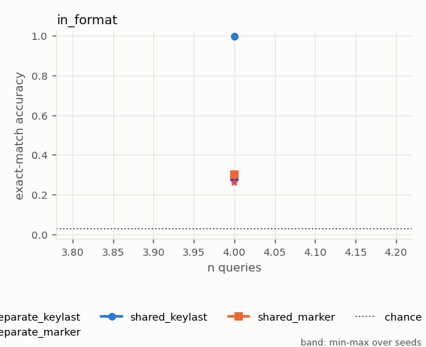
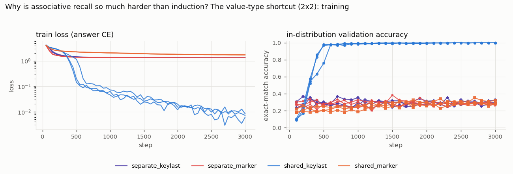

# Why is associative recall so much harder than induction? The value-type shortcut (2x2)

*Study id:* `value_type`  
*Spec:* ``

## Design

**Research question.** The same 2-layer model learns content-based induction in ~500-900 steps but does not learn associative recall (single-query accuracy at the value-guessing level after 3,000 steps). Is the reason that recall values are a separate token type, so "answer with any value token" is a cheap partial solution that traps learning? And does the query format matter?

**Hypothesis.** H_type: with values drawn from the SAME vocabulary as keys (no type-based shortcut), recall is learned; with separate value tokens it is not. Prediction: shared > separate in both query formats. H_format (secondary): key-last queries (the query token itself is the key, as in induction) are learned faster than <ans>-marker queries (the key must first be moved to <ans> by a previous-token head). Either can be refuted: if all four cells stay at the guessing level, H_type is not sufficient.

**Independent variables:** value_vocab (separate / shared), query_format (ans_marker / key_last)  
**Controlled variables:** 4 associations, all 4 queried with HIDDEN auxiliary answers (no elimination shortcut), length 24, chance identical in all cells: random value from context = 0.267, elimination = 0.267, RoPE, 2 heads, d_model 64, 2 layers; lr 3e-3, batch 64, 3,000 steps, fillers: 3 (ans_marker) vs 7 (key_last) -- a side effect of the shorter key-last query block  
**Primary metric:** final validation accuracy (training format, scored final query); counterfactual battery  
**Seeds:** [0, 1, 2]  
**Evaluation seed (shared by all runs):** 20261018

**Expected failure modes:** none of the cells learns within budget (inconclusive about the cause); shared vocabulary allows a value to also be a key elsewhere; positional parsing defines the pairs

## Runs (measured)

| run_id | variant | seed | pos_method | status | elapsed_s | final_val_acc | final_train_loss | steps | n_params |
|---|---|---|---|---|---|---|---|---|---|
| separate_keylast_s0_02877c6d | separate_keylast | 0 | rope | completed | 304.045 | 0.324 | 1.332 | 3000 | 116736 |
| separate_keylast_s1_41cdeab5 | separate_keylast | 1 | rope | completed | 186.964 | 0.293 | 1.328 | 3000 | 116736 |
| separate_keylast_s2_75ab77bc | separate_keylast | 2 | rope | completed | 185.864 | 0.289 | 1.329 | 3000 | 116736 |
| separate_marker_s0_e7f66347 | separate_marker | 0 | rope | completed | 472.422 | 0.281 | 1.328 | 3000 | 116736 |
| separate_marker_s1_90f8d5e2 | separate_marker | 1 | rope | completed | 468.952 | 0.262 | 1.323 | 3000 | 116736 |
| separate_marker_s2_7cab2f55 | separate_marker | 2 | rope | completed | 303.924 | 0.273 | 1.325 | 3000 | 116736 |
| shared_keylast_s0_de804e47 | shared_keylast | 0 | rope | completed | 353.005 | 1.000 | 0.006 | 3000 | 116736 |
| shared_keylast_s1_589ea33d | shared_keylast | 1 | rope | completed | 624.022 | 1.000 | 0.007 | 3000 | 116736 |
| shared_keylast_s2_bf1ab121 | shared_keylast | 2 | rope | completed | 630.406 | 1.000 | 0.008 | 3000 | 116736 |
| shared_marker_s0_f52a7f38 | shared_marker | 0 | rope | completed | 197.302 | 0.320 | 1.731 | 3000 | 116736 |
| shared_marker_s1_47b9737c | shared_marker | 1 | rope | completed | 197.481 | 0.289 | 1.739 | 3000 | 116736 |
| shared_marker_s2_89ae7e04 | shared_marker | 2 | rope | completed | 347.092 | 0.281 | 1.713 | 3000 | 116736 |

## Validity flags

* `separate_keylast_s0_02877c6d`: in-distribution val acc 0.324 < 0.90 -> undertrained or unable to learn the task; out-of-distribution failures of this run are NOT evidence about extrapolation.
* `separate_keylast_s1_41cdeab5`: in-distribution val acc 0.293 < 0.90 -> undertrained or unable to learn the task; out-of-distribution failures of this run are NOT evidence about extrapolation.
* `separate_keylast_s2_75ab77bc`: in-distribution val acc 0.289 < 0.90 -> undertrained or unable to learn the task; out-of-distribution failures of this run are NOT evidence about extrapolation.
* `separate_marker_s0_e7f66347`: in-distribution val acc 0.281 < 0.90 -> undertrained or unable to learn the task; out-of-distribution failures of this run are NOT evidence about extrapolation.
* `separate_marker_s1_90f8d5e2`: in-distribution val acc 0.262 < 0.90 -> undertrained or unable to learn the task; out-of-distribution failures of this run are NOT evidence about extrapolation.
* `separate_marker_s2_7cab2f55`: in-distribution val acc 0.273 < 0.90 -> undertrained or unable to learn the task; out-of-distribution failures of this run are NOT evidence about extrapolation.
* `shared_marker_s0_f52a7f38`: in-distribution val acc 0.320 < 0.90 -> undertrained or unable to learn the task; out-of-distribution failures of this run are NOT evidence about extrapolation.
* `shared_marker_s1_47b9737c`: in-distribution val acc 0.289 < 0.90 -> undertrained or unable to learn the task; out-of-distribution failures of this run are NOT evidence about extrapolation.
* `shared_marker_s2_89ae7e04`: in-distribution val acc 0.281 < 0.90 -> undertrained or unable to learn the task; out-of-distribution failures of this run are NOT evidence about extrapolation.

## Controls (mean, min and max over seeds)

| grid | cell | variant | n_seeds | mean | min | max |
|---|---|---|---|---|---|---|
| control_counterfactual | distractor_edit | separate_keylast | 3 | 0.360 | 0.347 | 0.367 |
| control_counterfactual | distractor_edit | separate_marker | 3 | 0.418 | 0.377 | 0.463 |
| control_counterfactual | distractor_edit | shared_keylast | 3 | 1.000 | 1.000 | 1.000 |
| control_counterfactual | distractor_edit | shared_marker | 3 | 0.513 | 0.497 | 0.543 |
| control_counterfactual | evidence_move | separate_keylast | 3 | 0.954 | 0.943 | 0.963 |
| control_counterfactual | evidence_move | separate_marker | 3 | 0.892 | 0.873 | 0.930 |
| control_counterfactual | evidence_move | shared_keylast | 3 | 0.996 | 0.990 | 1.000 |
| control_counterfactual | evidence_move | shared_marker | 3 | 0.766 | 0.753 | 0.790 |
| control_counterfactual | filler_resample | separate_keylast | 3 | 0.974 | 0.973 | 0.977 |
| control_counterfactual | filler_resample | separate_marker | 3 | 0.971 | 0.960 | 0.983 |
| control_counterfactual | filler_resample | shared_keylast | 3 | 1.000 | 1.000 | 1.000 |
| control_counterfactual | filler_resample | shared_marker | 3 | 0.956 | 0.953 | 0.960 |
| control_counterfactual | key_swap | separate_keylast | 3 | 0.266 | 0.250 | 0.277 |
| control_counterfactual | key_swap | separate_marker | 3 | 0.257 | 0.233 | 0.273 |
| control_counterfactual | key_swap | shared_keylast | 3 | 0.997 | 0.993 | 1.000 |
| control_counterfactual | key_swap | shared_marker | 3 | 0.283 | 0.277 | 0.297 |
| control_counterfactual | value_edit | separate_keylast | 3 | 0.250 | 0.230 | 0.260 |
| control_counterfactual | value_edit | separate_marker | 3 | 0.250 | 0.203 | 0.303 |
| control_counterfactual | value_edit | shared_keylast | 3 | 0.998 | 0.997 | 1.000 |
| control_counterfactual | value_edit | shared_marker | 3 | 0.247 | 0.227 | 0.287 |
| control_evidence_removed | default | separate_keylast | 3 | 0.031 | 0.030 | 0.033 |
| control_evidence_removed | default | separate_marker | 3 | 0.032 | 0.023 | 0.037 |
| control_evidence_removed | default | shared_keylast | 3 | 0.038 | 0.037 | 0.040 |
| control_evidence_removed | default | shared_marker | 3 | 0.029 | 0.027 | 0.033 |
| control_in_distribution | default | separate_keylast | 3 | 0.311 | 0.287 | 0.323 |
| control_in_distribution | default | separate_marker | 3 | 0.329 | 0.320 | 0.347 |
| control_in_distribution | default | shared_keylast | 3 | 0.999 | 0.997 | 1.000 |
| control_in_distribution | default | shared_marker | 3 | 0.316 | 0.303 | 0.323 |
| control_position_offset | pos_offset=0 | separate_keylast | 3 | 0.311 | 0.287 | 0.323 |
| control_position_offset | pos_offset=0 | separate_marker | 3 | 0.329 | 0.320 | 0.347 |
| control_position_offset | pos_offset=0 | shared_keylast | 3 | 0.999 | 0.997 | 1.000 |
| control_position_offset | pos_offset=0 | shared_marker | 3 | 0.316 | 0.303 | 0.323 |

## Control metrics per run (measured)

`composition_end_given_both_hops` = accuracy on the chain end among contexts where both single hops were answered correctly (multi-hop only).

| run_id | variant | seed | in_distribution_acc | evidence_removed_acc | chance_acc | cf_distractor_edit_rate | cf_distractor_edit_rate_given_orig_correct | cf_distractor_edit_n | cf_evidence_move_rate | cf_evidence_move_rate_given_orig_correct | cf_evidence_move_n | cf_filler_resample_rate | cf_filler_resample_rate_given_orig_correct | cf_filler_resample_n | cf_key_swap_rate | cf_key_swap_rate_given_orig_correct | cf_key_swap_n | cf_key_swap_shortcut_reference | cf_value_edit_rate | cf_value_edit_rate_given_orig_correct | cf_value_edit_n | cf_value_edit_shortcut_reference | pos_offset_0_acc |
|---|---|---|---|---|---|---|---|---|---|---|---|---|---|---|---|---|---|---|---|---|---|---|---|
| separate_keylast_s0_02877c6d | separate_keylast | 0 | 0.287 | 0.030 | 0.031 | 0.347 | 0.523 | 300 | 0.943 | 0.942 | 300 | 0.973 | 0.965 | 300 | 0.270 | 0.000 | 300 | 0.250 | 0.260 | 0.279 | 300 | 0.250 | 0.287 |
| separate_keylast_s1_41cdeab5 | separate_keylast | 1 | 0.323 | 0.030 | 0.031 | 0.367 | 0.515 | 300 | 0.957 | 0.948 | 300 | 0.977 | 0.979 | 300 | 0.250 | 0.000 | 300 | 0.250 | 0.230 | 0.309 | 300 | 0.250 | 0.323 |
| separate_keylast_s2_75ab77bc | separate_keylast | 2 | 0.323 | 0.033 | 0.031 | 0.367 | 0.526 | 300 | 0.963 | 0.948 | 300 | 0.973 | 0.959 | 300 | 0.277 | 0.000 | 300 | 0.250 | 0.260 | 0.258 | 300 | 0.250 | 0.323 |
| separate_marker_s0_e7f66347 | separate_marker | 0 | 0.347 | 0.037 | 0.031 | 0.377 | 0.481 | 300 | 0.873 | 0.856 | 300 | 0.960 | 0.981 | 300 | 0.263 | 0.000 | 300 | 0.250 | 0.303 | 0.481 | 300 | 0.250 | 0.347 |
| separate_marker_s1_90f8d5e2 | separate_marker | 1 | 0.320 | 0.023 | 0.031 | 0.463 | 0.573 | 300 | 0.930 | 0.938 | 300 | 0.983 | 1.000 | 300 | 0.233 | 0.000 | 300 | 0.250 | 0.203 | 0.302 | 300 | 0.250 | 0.320 |
| separate_marker_s2_7cab2f55 | separate_marker | 2 | 0.320 | 0.037 | 0.031 | 0.413 | 0.625 | 300 | 0.873 | 0.854 | 300 | 0.970 | 0.948 | 300 | 0.273 | 0.000 | 300 | 0.250 | 0.243 | 0.365 | 300 | 0.250 | 0.320 |
| shared_keylast_s0_de804e47 | shared_keylast | 0 | 1.000 | 0.037 | 0.031 | 1.000 | 1.000 | 300 | 0.997 | 0.997 | 300 | 1.000 | 1.000 | 300 | 0.997 | 0.997 | 300 | 0.250 | 0.997 | 0.997 | 300 | 0.250 | 1.000 |
| shared_keylast_s1_589ea33d | shared_keylast | 1 | 1.000 | 0.040 | 0.031 | 1.000 | 1.000 | 300 | 1.000 | 1.000 | 300 | 1.000 | 1.000 | 300 | 1.000 | 1.000 | 300 | 0.250 | 1.000 | 1.000 | 300 | 0.250 | 1.000 |
| shared_keylast_s2_bf1ab121 | shared_keylast | 2 | 0.997 | 0.037 | 0.031 | 1.000 | 1.000 | 300 | 0.990 | 0.993 | 300 | 1.000 | 1.000 | 300 | 0.993 | 0.993 | 300 | 0.250 | 0.997 | 0.997 | 300 | 0.250 | 0.997 |
| shared_marker_s0_f52a7f38 | shared_marker | 0 | 0.303 | 0.027 | 0.031 | 0.497 | 0.615 | 300 | 0.753 | 0.681 | 300 | 0.960 | 0.956 | 300 | 0.277 | 0.055 | 300 | 0.250 | 0.287 | 0.484 | 300 | 0.250 | 0.303 |
| shared_marker_s1_47b9737c | shared_marker | 1 | 0.320 | 0.027 | 0.031 | 0.543 | 0.740 | 300 | 0.753 | 0.625 | 300 | 0.953 | 0.969 | 300 | 0.277 | 0.031 | 300 | 0.250 | 0.227 | 0.375 | 300 | 0.250 | 0.320 |
| shared_marker_s2_89ae7e04 | shared_marker | 2 | 0.323 | 0.033 | 0.031 | 0.500 | 0.629 | 300 | 0.790 | 0.701 | 300 | 0.953 | 0.969 | 300 | 0.297 | 0.072 | 300 | 0.250 | 0.227 | 0.361 | 300 | 0.250 | 0.323 |

## Grid `in_format` (derived: mean across seeds; t-interval over seeds)

| grid | variant | cell_n_queries | n_seeds | n_per_seed | mean | std | min | max | t_lo | t_hi |
|---|---|---|---|---|---|---|---|---|---|---|
| in_format | separate_keylast | 4 | 3 | 400 | 0.279 | 0.018 | 0.263 | 0.297 | 0.236 | 0.323 |
| in_format | separate_marker | 4 | 3 | 400 | 0.261 | 0.015 | 0.247 | 0.278 | 0.223 | 0.299 |
| in_format | shared_keylast | 4 | 3 | 400 | 0.996 | 0.004 | 0.993 | 1.000 | 0.986 | 1.005 |
| in_format | shared_marker | 4 | 3 | 400 | 0.301 | 0.009 | 0.290 | 0.307 | 0.277 | 0.324 |

Baselines on the identical examples (reference):

| cell_n_queries | oracle | naive_induction | last_value | random_context | elimination | chance | best_fixed_offset | best_fixed_offset_d |
|---|---|---|---|---|---|---|---|---|
| 4 | 1.000 | 1.000 | 0.328 | 0.266 | 0.266 | 0.031 | 0.130 | 13 |

## Paired differences vs `separate_marker` (per-seed differences on identical examples)

| grid | cell_n_queries | a | b | mean_diff | t_lo | t_hi | n_seeds | seeds_a_better | seeds_b_better |
|---|---|---|---|---|---|---|---|---|---|
| in_format | 4 | separate_keylast | separate_marker | 0.018 | 0.011 | 0.026 | 3 | 3 | 0 |
| in_format | 4 | shared_keylast | separate_marker | 0.735 | 0.692 | 0.778 | 3 | 3 | 0 |
| in_format | 4 | shared_marker | separate_marker | 0.040 | -0.003 | 0.083 | 3 | 3 | 0 |

## Figures

## Reading guide

* Per-seed Wilson intervals (in `per_seed_cells.csv`) capture example sampling only; the across-seed t-interval captures training variability but is very wide with 3 seeds.
* Interpretation and conclusions are written separately in `docs/results.md`; this report is generated mechanically from the measured tables above.
